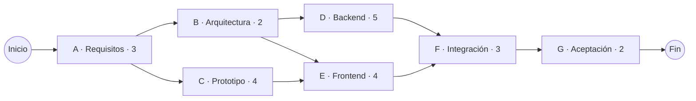

# Resumen de estudio para el Control 2

## Cómo estudiar con este resumen

Este material sigue el foco que indicó el profesor para los capítulos 5, 6, 8 y 11 del PMBOK. La meta no es recitar tablas de entradas, herramientas y salidas, sino reconocer qué concepto explica una situación, elegir una acción coherente y justificarla.

Usaremos una empresa ficticia durante todo el resumen: **SaludConecta**, que desarrolla un portal clínico para pacientes y profesionales. El proyecto debe incluir agenda, videoconsulta, integración con un laboratorio, controles de calidad y una puesta en marcha antes de una fecha comprometida.

Al responder, piensa en cuatro movimientos:

1. **Identificar:** ¿qué concepto o proceso aparece en el caso?
2. **Aplicar:** ¿qué dato del enunciado demuestra que es ese concepto?
3. **Desarrollar:** ¿qué cálculo, secuencia o comparación corresponde?
4. **Concluir:** ¿qué significa el resultado para el proyecto y qué alternativa recomiendo?

Una alternativa marcada sin explicación puede perder parte importante del puntaje. En los cálculos, escribe fórmula, sustitución, unidad y conclusión. Lee el enunciado completo antes de empezar: las dependencias, supuestos y unidades pueden cambiar el método.

---

# Capítulo 5 — Gestión del alcance

## 1. La idea que conecta el capítulo

El alcance responde dos preguntas distintas:

- **Alcance del producto:** ¿qué funciones y características tendrá lo que se entrega?
- **Alcance del proyecto:** ¿qué trabajo se debe realizar para producirlo?

En SaludConecta, “el paciente puede reservar una videoconsulta” describe una característica del producto. Levantar requisitos, diseñar el flujo, programar, probar, capacitar al personal y desplegar la función son trabajo del proyecto.

Gestionar el alcance significa incluir todo el trabajo requerido y solo ese trabajo. Si se omiten tareas necesarias, el proyecto queda incompleto; si se agrega trabajo sin evaluación y aprobación, se puede producir corrupción del alcance, sobrecosto y atraso.

## 2. Los seis procesos y la salida que debes reconocer

Memoriza el hilo lógico y la salida que expresa el propósito de cada proceso. No es necesario aprender de memoria todos los documentos auxiliares que se actualizan.

| Proceso | Qué hace en lenguaje cotidiano | Salida principal que debes reconocer |
|---|---|---|
| **5.1 Planificar la Gestión del Alcance** | Acuerda cómo se definirá, aceptará y controlará el alcance y los requisitos | Plan de gestión del alcance y plan de gestión de requisitos |
| **5.2 Recopilar Requisitos** | Descubre y documenta necesidades y expectativas de los interesados | Documentación de requisitos y matriz de trazabilidad de requisitos |
| **5.3 Definir el Alcance** | Convierte requisitos seleccionados en una descripción precisa de lo que se hará y lo que queda fuera | Enunciado del alcance del proyecto |
| **5.4 Crear la EDT/WBS** | Descompone jerárquicamente el alcance total en componentes manejables | Línea base del alcance |
| **5.5 Validar el Alcance** | Obtiene aceptación formal de entregables completados | Entregables aceptados |
| **5.6 Controlar el Alcance** | Compara el alcance real con el aprobado y tramita cambios | Información de desempeño del trabajo y solicitudes de cambio cuando correspondan |

La secuencia para entender el trabajo es:

```text
Acordar cómo gestionarlo
        ↓
Descubrir necesidades
        ↓
Precisar lo incluido y excluido
        ↓
Descomponer el alcance total
        ↓
Verificar entregables y obtener aceptación
        ↓
Controlar variaciones y cambios
```

La gestión no ocurre una sola vez. Durante la ejecución pueden aparecer requisitos nuevos o cambios, pero deben evaluarse y aprobarse por el mecanismo acordado.

### Cómo reconocer cada proceso en un caso

- “El equipo define cómo se aprobarán cambios y cómo se aceptarán entregables”: **Planificar la Gestión del Alcance**.
- “El equipo entrevista a médicos y pacientes y registra necesidades”: **Recopilar Requisitos**.
- “El documento dice qué módulos incluye la primera versión y excluye otros laboratorios”: **Definir el Alcance**.
- “El producto se divide en entregables y paquetes de trabajo”: **Crear la EDT**.
- “La directora revisa el portal terminado y firma su aceptación”: **Validar el Alcance**.
- “Se compara el trabajo ejecutado con la línea base y se analiza una petición nueva”: **Controlar el Alcance**.

## 3. Requisitos, alcance y trazabilidad

Un requisito expresa una necesidad o condición que debe cumplir el producto, servicio o resultado. Debe ser claro, verificable y rastreable. “El portal debe ser fácil” es demasiado subjetivo; “un paciente nuevo completa una reserva en menos de tres minutos en una prueba con usuarios” permite comprobarlo.

La **matriz de trazabilidad** conecta un requisito con su origen, objetivo, entregable y forma de verificación. Por ejemplo:

```text
REQ-014: el paciente puede cancelar una cita
Origen: entrevistas a pacientes
Objetivo: reducir llamadas al centro
Entregable: módulo de agenda
Verificación: caso de prueba CP-27
Aceptación: cancelación confirmada y cupo liberado
```

La matriz ayuda a detectar tres situaciones: requisito sin entregar, trabajo que no responde a un requisito aprobado, o cambio que afecta varios componentes y pruebas.

## 4. EDT: jerarquía del alcance, no secuencia de tareas

La **EDT/WBS** es una descomposición jerárquica y orientada a entregables del trabajo total del proyecto. Organiza qué está incluido; no indica por sí misma fechas ni orden.

```text
1. Portal SaludConecta
   1.1 Dirección del proyecto
   1.2 Requisitos aprobados
   1.3 Portal de pacientes
       1.3.1 Registro
       1.3.2 Agenda
       1.3.3 Videoconsulta
   1.4 Integración con laboratorio
   1.5 Pruebas y aceptación
   1.6 Capacitación y puesta en marcha
```

La **regla del 100 %** dice que la EDT debe cubrir todo el alcance aprobado: trabajo del producto y trabajo de gestión. Los elementos hijos cubren en conjunto todo el trabajo del padre, sin dejar vacíos ni contar lo mismo dos veces.

### Vocabulario de niveles que puede evaluar el profesor

| Término | Qué representa | Cómo recordarlo |
|---|---|---|
| **Cuenta de control** | Punto donde se integran alcance, cronograma y costo para medir y controlar desempeño | Nivel de gestión y medición; puede contener paquetes de trabajo y paquetes de planificación |
| **Paquete de planificación** | Trabajo conocido dentro de una cuenta de control, pero aún no descompuesto con suficiente detalle para programarlo como paquetes de trabajo | “Sé que habrá que hacerlo, pero todavía no tengo detalle suficiente” |
| **Paquete de trabajo** | Nivel de la EDT donde el trabajo puede estimarse, asignarse, calendarizarse y controlarse | “Puedo nombrar responsable, estimar y comprobar que terminó” |
| **Actividad** | Acción del cronograma necesaria para completar un paquete de trabajo | Pertenece a la planificación del cronograma, no es sinónimo de componente de la EDT |

Ejemplo: “Integración con laboratorio” puede ser un paquete de trabajo; “desarrollar el conector” y “probar respuestas” pueden ser actividades del cronograma derivadas de ese paquete.

Una EDT puede organizar el nivel superior por fases del ciclo de vida si, debajo de las fases, el equipo representa el alcance completo mediante entregables. Las flechas de precedencia y las duraciones pertenecen al cronograma, no a la jerarquía de la EDT.

## 5. Controlar la Calidad y Validar el Alcance: diferencia y orden

Esta distinción es especialmente examinable porque ambas actividades pueden revisar el mismo entregable, pero responden preguntas diferentes.

| Proceso | Pregunta | Quién o qué criterio predomina | Resultado característico |
|---|---|---|---|
| **Controlar la Calidad** (capítulo 8) | ¿El entregable está correcto y cumple las especificaciones técnicas? | Métricas, pruebas, inspecciones y criterios de calidad | Entregable verificado |
| **Validar el Alcance** (capítulo 5) | ¿El cliente o patrocinador acepta formalmente el entregable? | Requisitos y criterios de aceptación acordados | Entregable aceptado |

Flujo habitual:

```text
Construir el entregable
        ↓
Controlar la Calidad: comprobar conformidad
        ↓
Entregable verificado
        ↓
Validar el Alcance: obtener aceptación formal
        ↓
Entregable aceptado
```

El PMBOK relaciona explícitamente los entregables verificados de Controlar la Calidad con Validar el Alcance. En una planificación iterativa, las actividades pueden coordinarse o repetirse por incrementos, pero la distinción se mantiene: conformidad técnica no equivale a aceptación del cliente.

**Caso:** el portal calcula correctamente la hora de una cita según las pruebas técnicas, pero presenta al médico el flujo en una pantalla distinta de la acordada con la clínica. Puede estar verificado respecto de ciertos requisitos técnicos y aun así no ser aceptado respecto del alcance o de los criterios acordados.

## 6. Cambios y control del alcance

Si durante el desarrollo la directora pide incorporar una aplicación móvil:

1. Registrar la solicitud.
2. Analizar el efecto en requisitos, EDT, esfuerzo, costo, cronograma, calidad y riesgos.
3. Presentar el análisis a la autoridad de cambios definida.
4. Aprobar, rechazar o postergar según el proceso acordado.
5. Si se aprueba, actualizar las líneas base y comunicar la decisión.

No conviene añadir la función informalmente “porque parece pequeña”. Una función nueva puede exigir diseño, seguridad, pruebas, soporte y capacitación.

### Respuesta modelo para una pregunta conceptual

> La solicitud debe tratarse como un cambio potencial del alcance. Primero se registra y se analiza su impacto en la línea base, entregables, costo, plazo, calidad y riesgos. Después decide la autoridad correspondiente. Si se aprueba, se actualiza la línea base y se planifica el trabajo; no se agrega directamente al equipo sin evaluación.

---

# Capítulo 6 — Gestión del cronograma

## 1. La lógica del cronograma

La EDT dice qué trabajo debe producirse. El cronograma identifica actividades, dependencias, duraciones, recursos y calendarios para calcular fechas. Para estimar cuánto dura un proyecto no se suman todas las actividades: hay que modelar qué puede ocurrir en paralelo y qué debe esperar a otra actividad.

Antes de calcular, marca en el enunciado:

- duración de cada actividad;
- predecesoras;
- tipo de relación lógica;
- adelantos o retrasos;
- recursos o calendarios restrictivos;
- unidad solicitada y convención temporal.

## 2. Relaciones lógicas

En el método de diagramación por precedencia, las actividades se conectan mediante cuatro relaciones.

| Relación | Nombre | Regla | Ejemplo |
|---|---|---|---|
| **FS** | Fin-Inicio | La sucesora no comienza hasta que termina la predecesora | Las pruebas empiezan al terminar el desarrollo |
| **SS** | Inicio-Inicio | La sucesora comienza cuando comienza la predecesora, o después del retraso especificado | La documentación comienza dos días después del desarrollo |
| **FF** | Fin-Fin | La sucesora no puede terminar antes de que termine la predecesora | La revisión finaliza cuando finaliza el documento |
| **SF** | Inicio-Fin | La sucesora no puede terminar antes de que comience la predecesora | El turno anterior termina cuando comienza el nuevo |

FS es la relación más común. Para abreviar, `A FS+2 B` significa que B comienza dos unidades después de que A termina; `A SS+2 B` significa que B comienza dos unidades después de que A comienza.

- **Adelanto (lead):** permite solapar o iniciar antes una sucesora. Ejemplo: empezar pruebas parciales dos días antes de que termine todo el desarrollo. Debe justificarse técnicamente.
- **Retraso (lag):** impone una espera. Ejemplo: esperar 24 horas después de migrar datos antes de verificar consistencia.

## 3. Tipos de dependencia

| Dependencia | De dónde viene | Ejemplo | ¿Se puede cambiar libremente? |
|---|---|---|---|
| Obligatoria | Lógica física, técnica o contractual | No probar la conexión antes de que exista | Generalmente no; cambiarla puede ser imposible o incumplir una obligación |
| Discrecional | Preferencia o buena práctica elegida por el equipo | Terminar todos los diseños antes de iniciar cualquier desarrollo | A veces sí; revisarla puede permitir solapamiento, con riesgo de retrabajo |
| Externa | Proveedor, regulador u otra entidad fuera del proyecto | Esperar certificado del laboratorio externo | No depende solo del equipo |
| Interna | Relación entre actividades bajo control del proyecto | Aprobar el diseño antes de construir el módulo | El equipo puede analizar una secuencia alternativa si es viable |

Si el jefe de proyecto necesita adelantar la fecha sin añadir recursos, puede estudiar las dependencias discrecionales y el **fast tracking**, especialmente en la ruta crítica. No se debe afirmar que toda relación discrecional puede eliminarse: la nueva secuencia debe ser técnicamente posible y su riesgo debe evaluarse.

## 4. Método de la ruta crítica

La ruta crítica es la secuencia de actividades que determina la duración mínima del proyecto bajo las duraciones y dependencias modeladas. En el caso básico, las actividades críticas tienen **holgura total cero**. Una actividad no se vuelve crítica solo porque parezca importante.

### Símbolos y fórmulas

| Símbolo | Significado |
|---|---|
| ES | Inicio temprano |
| EF | Fin temprano |
| LS | Inicio tardío |
| LF | Fin tardío |
| Dur | Duración |

En el recorrido hacia adelante:

```text
EF = ES + Dur
ES = mayor EF de las predecesoras (para una actividad FS sin adelantos/retrasos)
```

Si convergen varias rutas, la actividad sucesora espera a la que termine más tarde. Por eso se toma el **máximo**.

En el recorrido hacia atrás:

```text
LS = LF - Dur
LF = menor LS de las sucesoras (para una actividad FS sin adelantos/retrasos)
```

Si hay varios sucesores, la actividad debe terminar a tiempo para todos. Por eso se toma el **mínimo**.

Holguras:

```text
Holgura total = LS - ES = LF - EF
Holgura libre = ES de la sucesora - EF de la actividad
                 (en un vínculo FS simple; considerar lag si existe)
```

La holgura total mide cuánto puede retrasarse una actividad sin cambiar la fecha final del proyecto, según el cronograma modelado. La holgura libre mide cuánto puede retrasarse sin afectar el inicio temprano de una sucesora inmediata.

### Ejemplo resuelto con convergencia

| Actividad | Duración | Predecesora |
|---|---:|---|
| A: requisitos | 3 días | — |
| B: arquitectura | 2 días | A |
| C: prototipo | 4 días | A |
| D: backend | 5 días | B |
| E: frontend | 4 días | B y C |
| F: integración | 3 días | D y E |
| G: aceptación | 2 días | F |

Red simplificada:



**Recorrido hacia adelante** (tiempo 0 como inicio):

| Actividad | ES | Operación | EF |
|---|---:|---|---:|
| A | 0 | 0 + 3 | 3 |
| B | 3 | 3 + 2 | 5 |
| C | 3 | 3 + 4 | 7 |
| D | 5 | 5 + 5 | 10 |
| E | 7 | `max(5, 7)` + 4 | 11 |
| F | 11 | `max(10, 11)` + 3 | 14 |
| G | 14 | 14 + 2 | 16 |

E espera a B y C; aunque B termine el día 5, C termina el día 7, así que E no comienza antes del día 7. F espera a D y E; E termina el día 11, más tarde que D en el día 10. La duración temprana total es **16 días**.

**Recorrido hacia atrás** (el proyecto debe terminar en el día 16):

| Actividad | LF | Operación | LS |
|---|---:|---|---:|
| G | 16 | 16 - 2 | 14 |
| F | 14 | 14 - 3 | 11 |
| D | 11 | 11 - 5 | 6 |
| E | 11 | 11 - 4 | 7 |
| B | 6 | `min(6, 7)` - 2 | 4 |
| C | 7 | 7 - 4 | 3 |
| A | 3 | `min(4, 3)` - 3 | 0 |

Para B, sus sucesoras D y E tienen LS 6 y 7; se toma el mínimo, 6. Para A, las sucesoras B y C tienen LS 4 y 3; se toma 3.

| Actividad | ES | LS | Holgura total | ¿Crítica? |
|---|---:|---:|---:|---|
| A | 0 | 0 | 0 | Sí |
| B | 3 | 4 | 1 | No |
| C | 3 | 3 | 0 | Sí |
| D | 5 | 6 | 1 | No |
| E | 7 | 7 | 0 | Sí |
| F | 11 | 11 | 0 | Sí |
| G | 14 | 14 | 0 | Sí |

La ruta crítica es:

```text
A → C → E → F → G
3 + 4 + 4 + 3 + 2 = 16 días
```

B y D tienen un día de holgura. Un atraso de un día en una de ellas puede ser absorbido; un atraso superior a esa holgura puede afectar el término del proyecto. Un atraso en una actividad crítica afecta la fecha final, salvo que el equipo cambie el plan y recupere tiempo.

**Convención de tiempo:** en este cálculo se usa tiempo 0 como inicio y se suman duraciones como intervalos. Si un ejercicio usa fechas de calendario inclusivas (por ejemplo, cuenta el día de inicio como “día 1”), sigue la convención indicada y no mezcles ambos métodos.

## 5. Compresión del cronograma

La compresión busca acortar la duración sin reducir el alcance. Primero confirma qué ruta es crítica en el cronograma actual: acelerar actividades con holgura puede no adelantar la fecha final.

| Técnica | Cómo reduce tiempo | Recursos/costo | Riesgo principal |
|---|---|---|---|
| **Ejecución rápida (fast tracking)** | Solapa actividades que antes estaban en secuencia | No requiere necesariamente más recursos | Retrabajo, coordinación y cambios tardíos |
| **Intensificación (crashing)** | Agrega recursos o inversión a actividades críticas | Normalmente aumenta costo | Rendimiento decreciente y coordinación adicional |

Ejemplo de fast tracking: comenzar a probar módulos estables mientras continúa el desarrollo de otras partes. Es razonable si existen interfaces acordadas y las pruebas pueden aislarse. Si el diseño aún cambia constantemente, el solapamiento puede multiplicar retrabajo.

Ejemplo de crashing: incorporar un especialista para completar antes una actividad crítica que sí puede dividirse. Agregar personas a una tarea que depende de una única aprobación externa no la acelera.

### Dependencias que puede revisar el jefe

Si no agrega recursos, suele analizar si alguna dependencia discrecional puede sustituirse por solapamiento (fast tracking), manteniendo controles para gestionar el riesgo. Las dependencias obligatorias no se eliminan por decisión administrativa. Las externas requieren gestionar al tercero o cambiar una condición del proyecto.

## 6. Optimización de recursos

| Técnica | Qué resuelve | Restricción | Efecto posible en la fecha |
|---|---|---|---|
| **Nivelación de recursos** | Sobreasignación o disponibilidad limitada | Respeta límites reales de recursos | Puede mover actividades críticas y extender el proyecto |
| **Suavizamiento de recursos** | Distribución irregular de carga | Mueve actividades dentro de su holgura | En general conserva ruta crítica y fecha final |

Ejemplo: una arquitecta está asignada al 100 % simultáneamente a dos actividades. La **nivelación** ajusta fechas según su disponibilidad, aunque el proyecto pueda terminar después. El **suavizamiento** movería una actividad solo si tiene holgura suficiente para evitar cambiar la fecha final.

## 7. Método de respuesta para ejercicios de cronograma

1. Lista actividades, duraciones y predecesoras.
2. Dibuja todos los vínculos, con tipo y lag/lead.
3. Calcula hacia adelante; en convergencias toma el máximo.
4. Calcula hacia atrás desde la fecha final; en divergencias toma el mínimo.
5. Calcula holguras y marca actividades con holgura cero.
6. Escribe duración con unidad y la ruta crítica.
7. Contesta la pregunta del enunciado: por ejemplo, impacto del atraso o técnica de compresión.

Una suma de duraciones de todas las tareas suele ser incorrecta cuando existen actividades paralelas. La duración del proyecto es el término de la secuencia que controla la fecha final, considerando todas las restricciones de red.

---

# Capítulo 8 — Gestión de la calidad

## 1. Calidad no es lo mismo que grado

- **Calidad:** grado en que un conjunto de características cumple requisitos.
- **Grado:** categoría o nivel asignado a productos que tienen diferentes conjuntos de características.

Un producto de bajo grado puede tener alta calidad si cumple todos los requisitos de su categoría. Un producto de alto grado puede tener baja calidad si falla en requisitos que prometió cumplir.

**Ejemplo:** SaludConecta entrega dos versiones de un reporte. La versión básica ofrece menos tipos de gráficos (grado menor), pero todos se calculan correctamente y dentro de los tiempos acordados (calidad alta para ese grado). Una versión premium puede tener más funciones (grado alto), pero si presenta resultados clínicos incorrectos, su calidad es baja.

Fórmula mental:

```text
Grado = qué categoría o conjunto de características se ofrece
Calidad = qué tan bien cumple lo prometido y especificado
```

## 2. Los tres procesos y qué mira cada uno

| Proceso | En qué se fija | Pregunta de examen | Salida o resultado que lo caracteriza |
|---|---|---|---|
| **8.1 Planificar la Gestión de la Calidad** | Requisitos, estándares, métricas y forma de demostrar cumplimiento | ¿Qué significa “cumplir calidad” en este proyecto? | Plan de gestión de calidad y métricas de calidad |
| **8.2 Gestionar la Calidad** | Procesos y prácticas usados para crear confianza y mejorar cómo se trabaja | ¿Estamos organizando el trabajo para producir calidad y evitar causas de defectos? | Informes de calidad y cambios/mejoras propuestos |
| **8.3 Controlar la Calidad** | Entregables concretos, mediciones, pruebas e inspecciones | ¿Este resultado cumple los criterios y especificaciones? | Mediciones de control y entregables verificados |

### Planificar la Calidad

Convierte palabras vagas en criterios medibles. “El sistema debe ser rápido” no basta. Un criterio posible sería: “Con 500 usuarios concurrentes, el 95 % de las consultas de agenda responde en menos de dos segundos en el ambiente de aceptación”.

Una métrica útil define qué se mide, unidad, umbral, condición y método de verificación. También identifica estándares aplicables y quién revisará los resultados.

### Gestionar la Calidad

Se ocupa de que los procesos del proyecto sean adecuados y se mejoren. Puede incluir auditorías, análisis de procesos, revisión de prácticas y acciones para prevenir defectos. No es simplemente volver a probar el producto.

Ejemplo: detectar que cada equipo interpreta de manera distinta los criterios de aceptación y acordar una plantilla común antes de seguir construyendo módulos.

### Controlar la Calidad

Inspecciona y mide productos o resultados concretos. Puede usar pruebas automatizadas, inspección, muestreo, listas de verificación o gráficos. Los defectos encontrados se analizan y se decide corrección o cambio.

Ejemplo: ejecutar 200 casos de prueba de agenda y comprobar cuáles pasaron, fallaron o no pudieron ejecutarse.

## 3. Costo de la Calidad (COQ)

El costo de la calidad incluye lo que se invierte para lograr conformidad y lo que cuesta la no conformidad.

| Grupo | Categoría | Cuándo ocurre | Ejemplo en SaludConecta |
|---|---|---|---|
| **Costo de conformidad** | Prevención | Antes de que aparezca el defecto | Capacitar al equipo en manejo de datos clínicos; diseñar estándares seguros |
| **Costo de conformidad** | Evaluación | Medir si se cumplen requisitos | Pruebas, auditorías, inspecciones y revisión independiente |
| **Costo de no conformidad** | Falla interna | El defecto se encuentra antes de llegar al usuario | Corregir una regla de agenda detectada en pruebas de aceptación internas |
| **Costo de no conformidad** | Falla externa | El defecto llega al cliente o ambiente de operación | Reembolsos, soporte de emergencia, multa o pérdida de confianza por una cita mal registrada |

Prevención y evaluación son costos de conformidad; fallas internas y externas son costos de no conformidad. La evaluación no es lo mismo que prevención: una prueba detecta, mientras que una capacitación o un estándar busca evitar que la causa se introduzca.

El punto no es hacer pruebas infinitas. Se elige un nivel de prevención y evaluación cuyo costo sea razonable frente a las fallas esperadas. En sistemas clínicos, seguridad o integridad de datos pueden justificar controles más estrictos por el impacto de una falla.

### Cómo clasificar una situación

- “Capacitar al equipo antes de programar”: **prevención**.
- “Ejecutar una prueba de carga”: **evaluación**.
- “Reparar antes del lanzamiento un defecto encontrado en pruebas”: **falla interna**.
- “Atender una multa y corregir datos erróneos detectados por una clínica”: **falla externa**.

## 4. Estabilidad, especificación y aceptación

Los **límites de control** describen el comportamiento estadístico de un proceso. Los **límites de especificación** expresan lo que el cliente o la regulación acepta. No son intercambiables.

Un proceso puede ser estable y aun producir sistemáticamente resultados fuera de especificación. En ese caso es predecible, pero no capaz de cumplir la necesidad: hay que mejorar el proceso o rediseñar el método.

La cadena de revisión es:

```text
Métrica y criterio acordado
        ↓
Control de calidad: resultado verificado
        ↓
Validación del alcance: aceptación formal
```

Un entregable verificado técnicamente puede necesitar todavía aprobación del cliente. Y un cliente no debería aceptar formalmente un producto que no haya pasado los controles acordados.

### Respuesta modelo para una pregunta de calidad

> No hay contradicción entre que el producto haya superado pruebas técnicas y que el cliente no lo acepte. Controlar la Calidad verifica conformidad con métricas y especificaciones; Validar el Alcance confirma aceptación frente a requisitos y criterios acordados. Revisaría la trazabilidad para determinar si el flujo rechazado estaba especificado. Si estaba acordado y no se implementó, corresponde corregir la no conformidad; si es nuevo, debe analizarse como cambio.

---

# Capítulo 11 — Gestión de los riesgos

## 1. Riesgo, problema y supuesto

Un riesgo es un evento o condición **incierta** que, si ocurre, tiene efecto positivo o negativo en objetivos. También puede describirse como amenaza u oportunidad. Si el evento ya ocurrió, se gestiona como problema o incidente, aunque sus consecuencias puedan originar riesgos nuevos.

| Término | Ejemplo | Tratamiento |
|---|---|---|
| Riesgo | La API del laboratorio podría cambiar durante la integración | Analizar probabilidad, impacto y respuesta |
| Problema | El laboratorio cambió la API ayer y el conector dejó de funcionar | Resolver el incidente y gestionar impacto actual |
| Supuesto | La API estará disponible para pruebas el 1 de noviembre | Validar el supuesto; evaluar el riesgo si no se cumple |
| Restricción | El portal debe salir antes del 15 de diciembre | Incorporarla a la planificación y controlar cumplimiento |

Una formulación sólida usa **causa-evento-efecto**:

> Debido a que el proveedor todavía no congela el contrato de la API (**causa**), podría cambiar una operación durante el desarrollo (**evento incierto**), provocando retrabajo y retraso en la certificación (**efecto**).

“La integración es riesgosa” no aclara qué puede ocurrir ni permite elegir una respuesta.

## 2. Los siete procesos y su lógica

| Proceso | Pregunta práctica | Resultado que conviene reconocer |
|---|---|---|
| **11.1 Planificar la Gestión de los Riesgos** | ¿Cómo se organizará el trabajo de riesgos? | Plan de gestión de riesgos: método, escalas, roles, categorías, frecuencia y umbrales |
| **11.2 Identificar los Riesgos** | ¿Qué incertidumbres podrían afectar objetivos? | Registro de riesgos e informe de riesgos |
| **11.3 Realizar el Análisis Cualitativo** | ¿Cuáles requieren atención primero? | Priorización según probabilidad, impacto y otros criterios acordados |
| **11.4 Realizar el Análisis Cuantitativo** | ¿Qué efecto numérico podría tener la incertidumbre? | Exposición agregada, probabilidades y resultados numéricos |
| **11.5 Planificar la Respuesta a los Riesgos** | ¿Qué haremos ante los riesgos prioritarios? | Respuestas, dueños, acciones, disparadores y reservas necesarias |
| **11.6 Implementar la Respuesta a los Riesgos** | ¿Se ejecutaron las respuestas acordadas? | Acciones de respuesta realmente implementadas |
| **11.7 Monitorear los Riesgos** | ¿Cambió la exposición, aparecieron riesgos o funcionó la respuesta? | Estado, tendencias, riesgos nuevos/cerrados y acciones de control |

Secuencia de razonamiento:

```text
Definir el método → identificar → priorizar → cuantificar si aporta
          → decidir respuestas → ejecutarlas → revisar y actualizar
```

Los procesos son iterativos: aparecen datos nuevos, riesgos pueden desaparecer y las respuestas pueden crear riesgos secundarios. El análisis cuantitativo no necesita usarse con la misma profundidad en todo proyecto; tiene sentido cuando la decisión justifica el esfuerzo y existen datos suficientes.

## 3. Análisis cualitativo y cuantitativo

El análisis **cualitativo** ordena riesgos usando escalas y juicio estructurado, por ejemplo probabilidad e impacto bajo/medio/alto. Sirve para decidir cuáles requieren dueño, respuesta urgente o análisis adicional.

El análisis **cuantitativo** estima numéricamente efectos en costo, tiempo u objetivos. EMV y árboles de decisión son técnicas cuantitativas.

Si el equipo usa escalas 1 a 5 y multiplica probabilidad por impacto para priorizar, el resultado es un **puntaje de prioridad** según la escala definida. No debe presentarse automáticamente como dinero ni como una probabilidad real.

## 4. Estrategias de respuesta

### Para amenazas

| Estrategia | Qué busca | Ejemplo |
|---|---|---|
| **Escalar** | Entregar la decisión a un nivel superior cuando excede autoridad o alcance del proyecto | Elevar al portafolio una decisión regulatoria que afecta varios proyectos |
| **Evitar** | Eliminar la amenaza o proteger el objetivo modificando el plan | Reemplazar una tecnología experimental por una probada |
| **Transferir** | Asignar a un tercero la responsabilidad de manejar o soportar parte del impacto | Seguro o contrato que asigna al proveedor una obligación definida |
| **Mitigar** | Reducir probabilidad o impacto | Prototipar temprano la API y preparar pruebas de contrato |
| **Aceptar** | Reconocer el riesgo y no tomar acción preventiva inmediata; puede haber reserva o contingencia | Aceptar una demora menor y activar una alternativa si se supera un umbral |

Transferir no significa que el riesgo desaparezca. El contrato puede trasladar costo directo, pero el cliente aún podría sufrir atraso, daño reputacional o afectación al servicio.

### Para oportunidades

| Estrategia | Qué busca | Ejemplo |
|---|---|---|
| **Escalar** | Llevar la oportunidad a una autoridad con alcance para capturarla | Proponer al portafolio reutilizar el portal en otras clínicas |
| **Explotar** | Asegurar que la oportunidad ocurra | Reservar al especialista clave para automatizar la regresión |
| **Compartir** | Asociarse con quien puede capturarla mejor | Trabajar con un proveedor que aporta experiencia y comparte beneficio |
| **Mejorar** | Aumentar probabilidad o impacto positivo | Financiar una prueba para elevar cobertura de automatización |
| **Aceptar** | Aprovechar el beneficio si ocurre, sin invertir para provocarlo | Usar capacidad liberada si se concreta una mejora externa |

**Truco de examen:** mitigar es para amenazas; mejorar es para oportunidades. Explotar una oportunidad intenta asegurar que ocurra; aceptar no invierte activamente para provocarla.

## 5. Valor monetario esperado (EMV)

El valor monetario esperado es la suma de resultados monetarios ponderados por sus probabilidades:

```text
EMV = Σ (probabilidad del resultado × valor monetario del resultado)
```

Para amenazas suele usarse impacto negativo; para oportunidades, positivo. Un EMV negativo representa pérdida esperada bajo los supuestos analizados. No predice exactamente cuánto se perderá en un caso individual.

**Ejemplo SaludConecta:**

- Amenaza A: probabilidad 30 %, pérdida de $20 millones.
- Amenaza B: probabilidad 10 %, pérdida de $50 millones.
- Oportunidad C: probabilidad 40 %, ahorro de $15 millones.

```text
EMV(A) = 0,30 × (-$20 M) = -$6 M
EMV(B) = 0,10 × (-$50 M) = -$5 M
EMV(C) = 0,40 × (+$15 M) = +$6 M
EMV neto = -6 - 5 + 6 = -$5 M
```

**Conclusión escrita:** “El EMV neto es una pérdida esperada de $5 millones bajo estas probabilidades e impactos. Esto ayuda a comparar respuestas o reservas, pero no significa que el costo final será exactamente $5 millones”.

## 6. Árbol de decisión

Un árbol de decisión compara alternativas cuando hay resultados inciertos. En cada nodo de azar, pondera los resultados por sus probabilidades. Si se comparan **costos**, normalmente se elige el menor costo esperado; si se comparan **beneficios**, normalmente se elige el mayor valor esperado. No inviertas el criterio.

### Ejemplo con costo esperado

SaludConecta debe elegir cómo abordar una API inestable.

**Alternativa A: construir directamente**

- 60 % de probabilidad de que la integración funcione al primer intento: costo total $8 millones.
- 40 % de probabilidad de falla y retrabajo: costo total $28 millones.

```text
Costo esperado A = 0,60 × $8 M + 0,40 × $28 M
                 = $4,8 M + $11,2 M
                 = $16 M
```

**Alternativa B: hacer un prototipo primero**

- El prototipo cuesta $4 millones en todos los casos.
- Luego, con 85 % de probabilidad, la integración cuesta $8 millones adicionales.
- Con 15 % de probabilidad, falla y cuesta $28 millones adicionales en total para la fase posterior.

```text
Costo esperado B = $4 M + 0,85 × $8 M + 0,15 × $28 M
                 = $4 M + $6,8 M + $4,2 M
                 = $15 M
```

El costo esperado favorece B: $15 M es menor que $16 M. La diferencia es de $1 millón esperado. La decisión final debe considerar también fecha, aprendizaje, tolerancia al peor caso y si las probabilidades son confiables.

### Pasos para cualquier árbol

1. Define la decisión y las alternativas.
2. Enumera resultados posibles de cada alternativa.
3. Comprueba que las probabilidades de cada nodo de azar sumen 1 (100 %).
4. Multiplica cada resultado por su probabilidad.
5. Suma para obtener el valor esperado de cada alternativa.
6. Elige menor costo esperado o mayor beneficio esperado, según lo que represente el árbol.
7. Concluye y declara supuestos o límites de la comparación.

Si se dibuja de derecha a izquierda, se empieza calculando los nodos finales y se retrocede hacia la decisión. No mezcles costos totales con costos incrementales: deja claro qué incluye cada resultado.

## 7. Reservas de contingencia y de gestión

En el tratamiento de riesgos, las dos reservas principales son:

| Reserva | Para qué sirve | Relación con riesgos | Ubicación en presupuesto |
|---|---|---|---|
| **Contingencia** | Financiar respuestas o exposición de riesgos identificados y aceptados | “Conocidos desconocidos”: se identificó la incertidumbre, aunque no se sabe si ocurrirá | Se incluye en la línea base de costos |
| **Gestión** | Cubrir trabajo imprevisto dentro del alcance global cuando aparece incertidumbre no identificada | “Desconocidos desconocidos” | Está fuera de la línea base de costos, pero dentro del presupuesto total del proyecto |

```text
Estimaciones de costos + reserva de contingencia = línea base de costos
Línea base de costos + reserva de gestión = presupuesto del proyecto
```

La reserva no es utilidad del proveedor. Tampoco debe usarse para ocultar una mala estimación o agregar alcance sin aprobación. Su uso sigue el gobierno definido por la organización.

## 8. Residuales, secundarios y disparadores

- **Riesgo residual:** permanece después de ejecutar la respuesta. Ejemplo: aun con un adaptador de API, algunos cambios pueden exigir retrabajo.
- **Riesgo secundario:** aparece como consecuencia de una respuesta. Ejemplo: el adaptador reduce la exposición al proveedor, pero aumenta complejidad de mantenimiento.
- **Disparador:** condición observable que activa una respuesta. Ejemplo: “si la API no está disponible el 1 de noviembre, se activa el simulador”.
- **Contingencia:** acción preparada para ejecutar cuando ocurre el disparador.

Una respuesta completa no termina al elegir “mitigar”: especifica qué acción, quién la realiza, cuándo, cómo se financia y qué riesgo queda después.

### Respuesta modelo para un caso de riesgo

> La API ya cambió, por lo tanto el evento se materializó y debe gestionarse como problema, no seguir tratándose únicamente como riesgo futuro. El equipo debe contener el impacto, evaluar atraso y retrabajo, ejecutar la contingencia definida si corresponde, actualizar el estado del riesgo y buscar riesgos secundarios de la corrección. La exposición que persista se registra como residual.

---

# Integración de los cuatro capítulos

Los capítulos se encadenan en decisiones reales:

```text
Requisitos y alcance aprobado (cap. 5)
              ↓
Paquetes de trabajo → actividades y dependencias (cap. 6)
              ↓
Métricas y controles para prevenir/detectar defectos (cap. 8)
              ↓
Riesgos que pueden afectar alcance, plazo o calidad (cap. 11)
              ↓
Entregable verificado (cap. 8) → aceptación formal (cap. 5)
```

Si cambia un requisito, puede cambiar la EDT, las actividades, la ruta crítica, las métricas de calidad y los riesgos. Una respuesta completa muestra esas conexiones cuando el caso las menciona.

---

# Confusiones que debes despejar antes de responder

| Si el enunciado dice… | No lo confundas con… | Distinción correcta |
|---|---|---|
| “El cliente firma la aceptación” | Controlar la Calidad | Es Validar el Alcance |
| “Se inspeccionan defectos y se verifican pruebas” | Validar el Alcance | Es Controlar la Calidad |
| “El resultado es estable, pero siempre supera el máximo del cliente” | Capacidad suficiente | Puede ser estable e incapaz de cumplir especificación |
| “Agregar tareas o flechas a la EDT” | Construir cronograma | EDT organiza alcance; red del cronograma representa precedencias |
| “Una tarea importante” | Actividad crítica | Crítica es la que controla término del proyecto bajo el modelo |
| “Reducir duración solapando tareas” | Crashing | Es fast tracking; aumenta riesgo de retrabajo |
| “Agregar recursos a tareas críticas” | Fast tracking | Es crashing/intensificación; normalmente aumenta costo |
| “Mover actividades por límite de disponibilidad” | Suavizamiento | Es nivelación y puede extender el plazo |
| “Bajar una actividad dentro de su holgura” | Nivelación | Es suavizamiento |
| “La API podría cambiar” | Problema actual | Es riesgo mientras sea incierto |
| “La API cambió ayer” | Riesgo futuro | Es problema materializado |
| “Reducir la probabilidad de amenaza” | Aceptar o transferir | Es mitigar |
| “Garantizar que ocurra una oportunidad” | Mejorar | Es explotar |
| “Capacitar para evitar defectos” | Evaluación | Es prevención |
| “Probar para encontrar defectos” | Prevención | Es evaluación |
| “Reserva para riesgo identificado” | Reserva de gestión | Es contingencia |
| “Reserva fuera de la línea base de costos” | Contingencia | Es reserva de gestión |

---

# Hoja corta de fórmulas y reglas

## Cronograma

```text
EF = ES + duración
LS = LF - duración
Holgura total = LS - ES = LF - EF
Ruta crítica = secuencia que controla el término; en el caso básico, holgura total cero
Adelante: sumar y tomar máximo en convergencias
Atrás: restar y tomar mínimo en divergencias
```

Con vínculos FS más retrasos o adelantos, incorpora el lag/lead al cálculo. Con SS, FF o SF, usa la condición específica del vínculo; no apliques mecánicamente la fórmula FS.

## Riesgos

```text
EMV de un resultado = probabilidad × impacto monetario
EMV de una alternativa = suma de los valores esperados de sus resultados
En árbol de costos: suele preferirse el costo esperado menor
En árbol de beneficios: suele preferirse el valor esperado mayor
```

## Calidad

```text
Calidad = cumplimiento de requisitos
Grado = categoría o conjunto de características
COQ = prevención + evaluación + fallas internas + fallas externas
```

---

# Cómo administrar el tiempo y revisar el desarrollo

El profesor advierte que no conviene gastar en una pregunta de menor puntaje el tiempo de una de mayor puntaje. Al comenzar:

1. Recorre la prueba completa y estima el tiempo según puntaje y dificultad.
2. Resuelve primero lo que sabes desarrollar con seguridad, cuidando no dejar cálculos largos para los últimos minutos.
3. En problemas extensos, avanza por etapas: red, cálculo, resultado, interpretación.
4. Reserva tiempo para revisar el último paso: unidad, redondeo, suma, signo y conclusión.

No hay una distribución universal de minutos por pregunta; usa el puntaje y el tiempo total del control. Si te trabas, deja visibles los pasos correctos parciales y continúa.

### Lista de revisión para cualquier ejercicio numérico

- ¿Leí todas las condiciones y relaciones del enunciado?
- ¿Identifiqué las unidades y la precisión pedida?
- ¿Escribí la fórmula antes de sustituir?
- ¿Usé probabilidades como decimales (30 % = 0,30)?
- ¿En el cronograma respeté convergencias y holguras?
- ¿Revisé el signo del impacto de una amenaza u oportunidad?
- ¿Terminé con una oración que responde exactamente lo preguntado?

### Estructura para una pregunta conceptual aplicada

> “El concepto aplicable es **[concepto]**. En el caso se observa porque **[dato concreto del enunciado]**. Esto implica **[efecto o distinción]**. Por lo tanto, recomiendo **[acción]**, considerando **[impacto, riesgo o límite relevante]**”.

### Estructura para un cálculo

```text
Datos: …
Fórmula: …
Sustitución: …
Resultado: … [unidad y redondeo solicitado]
Conclusión: … [qué significa / qué alternativa corresponde]
```

---

# Miniensayo de práctica

Intenta responder sin mirar la pauta. Escribe el desarrollo y la conclusión.

## Pregunta 1 — Alcance y aceptación

El portal de SaludConecta supera todas las pruebas de seguridad y rendimiento. La clínica rechaza el entregable porque el proceso de reserva no incluye una confirmación que estaba en los criterios acordados. ¿Qué procesos están involucrados y qué debería hacer el equipo?

## Pregunta 2 — EDT

Un equipo pone “Análisis, Desarrollo y Pruebas” como fases del primer nivel de la EDT, agrega flechas entre paquetes y fija cada paquete en 200 horas. ¿Qué parte podría ser válida y qué problemas debe revisar?

## Pregunta 3 — Ruta crítica

| Actividad | Duración | Predecesora |
|---|---:|---|
| A | 2 días | — |
| B | 4 días | A |
| C | 3 días | A |
| D | 5 días | B |
| E | 4 días | C |
| F | 2 días | D y E |

Calcula duración del proyecto, ruta crítica y holgura total de B y C.

## Pregunta 4 — Compresión

El proyecto tiene cuatro días de atraso debido a una actividad crítica. El jefe propone solapar diseño y desarrollo sin añadir recursos. Nombra la técnica, explica una ventaja y un riesgo, e indica qué dependencia conviene revisar.

## Pregunta 5 — Calidad y COQ

Clasifica: capacitación preventiva del equipo; prueba de carga; corrección de un defecto antes de liberar; multa por una falla descubierta en producción. Además, explica cómo un producto de bajo grado puede tener alta calidad.

## Pregunta 6 — EMV y respuesta

Un riesgo de integración tiene 25 % de probabilidad de generar una pérdida de $40 millones. Calcula el EMV. Recomienda una estrategia de respuesta posible y explica qué información faltaría para comparar económicamente esa estrategia con aceptar el riesgo.

## Pregunta 7 — Árbol de decisión

Alternativa A tiene 70 % de probabilidad de costar $10 millones y 30 % de costar $30 millones. Alternativa B cuesta $15 millones con certeza. ¿Cuál tiene menor costo esperado? Desarrolla y concluye.

## Pregunta 8 — Reservas

SaludConecta identifica antes de construir un riesgo de incompatibilidad y reserva fondos para su contingencia. Más adelante aparece una obligación nueva que no se había podido identificar. ¿Qué reserva corresponde a cada caso y dónde se ubican respecto de la línea base de costos?

---

# Pauta razonada del miniensayo

## 1

Controlar la Calidad produjo un entregable verificado respecto de seguridad y rendimiento. Validar el Alcance revela que no se cumple un criterio acordado, por lo que no corresponde tratarlo como aceptado. El equipo debe registrar el resultado, analizar el requisito omitido, corregir el entregable y volver a verificarlo antes de solicitar aceptación formal.

## 2

Organizar el primer nivel por fases puede ser válido si, dentro de cada fase, la EDT cubre el 100 % del alcance mediante entregables y paquetes de trabajo. Las flechas de precedencia pertenecen al cronograma, no a la EDT. Detener todo paquete en 200 horas es un umbral arbitrario: el tamaño debe permitir estimar, asignar y controlar el trabajo, considerando el ritmo de medición. No hay un máximo universal del PMBOK.

## 3

Recorrido hacia adelante:

| Actividad | ES | EF |
|---|---:|---:|
| A | 0 | 2 |
| B | 2 | 6 |
| C | 2 | 5 |
| D | 6 | 11 |
| E | 5 | 9 |
| F | 11 | 13 |

F espera a D y E: `ES(F)=max(11,9)=11`. Duración del proyecto: **13 días**. Las rutas son A-B-D-F = 13 días y A-C-E-F = 11 días; la ruta crítica es **A-B-D-F**.

Recorrido hacia atrás desde el día 13: F tiene LS 11; D debe terminar a más tardar en 11, entonces LS(D)=6; E también debe terminar a más tardar en 11, entonces LS(E)=7. Para B, `LF=min(LS de D)=6`, por lo que LS(B)=2. Para C, LS(C)=4. Para A, `LF=min(LS de B=2, LS de C=4)=2`, así que LS(A)=0.

Holguras: B = LS−ES = 2−2 = **0 días**; C = 4−2 = **2 días**.

**Conclusión:** el proyecto dura 13 días; B es crítica y C tiene dos días de holgura.

## 4

La técnica es **fast tracking** o ejecución rápida. Puede recuperar tiempo al solapar actividades originalmente secuenciales sin incorporar necesariamente recursos adicionales. Aumenta el riesgo de retrabajo si el diseño cambia mientras se desarrolla. Conviene revisar si la dependencia es discrecional y si existen partes del diseño suficientemente estables para iniciar de forma controlada.

## 5

- Capacitación: prevención.
- Prueba de carga: evaluación.
- Corrección antes de liberar: falla interna.
- Multa tras descubrir falla en producción: falla externa.

Un producto de bajo grado ofrece menos características o pertenece a una categoría más básica, pero puede cumplir completamente los requisitos de esa categoría y por eso tener alta calidad.

## 6

```text
EMV = 0,25 × (-$40 M) = -$10 M
```

El EMV es una pérdida esperada de $10 millones bajo los supuestos dados. Podría mitigarse mediante prototipo, prueba temprana o contrato; para compararlo con aceptar se necesita el costo de la respuesta y cuánto reduciría la probabilidad o el impacto. También importan plazo y tolerancia al riesgo.

## 7

```text
Costo esperado A = 0,70×$10 M + 0,30×$30 M
                 = $7 M + $9 M
                 = $16 M
Costo esperado B = $15 M
```

**Conclusión:** B tiene menor costo esperado por $1 millón. La decisión supone que los costos y probabilidades incluyen los mismos conceptos y horizonte.

## 8

El riesgo de incompatibilidad ya identificado se asocia con **reserva de contingencia**, que forma parte de la línea base de costos. La obligación imprevista no identificada se cubre, si corresponde y con autorización, mediante **reserva de gestión**, que está fuera de la línea base pero dentro del presupuesto total del proyecto.

---

# Repaso de dos minutos antes de entregar

1. **Alcance:** EDT = jerarquía del 100 %; paquete de trabajo = nivel estimable/controlable.
2. **Aceptación:** Controlar Calidad verifica; Validar Alcance obtiene aceptación.
3. **Cronograma:** adelante máximo; atrás mínimo; holgura cero suele señalar ruta crítica.
4. **Compresión:** fast tracking solapa y eleva riesgo; crashing agrega recursos y costo.
5. **Recursos:** nivelación puede extender; suavizamiento usa holgura.
6. **Calidad:** grado es categoría; calidad es cumplimiento.
7. **COQ:** prevención, evaluación, falla interna, falla externa.
8. **Riesgos:** incierto = riesgo; ocurrido = problema.
9. **Respuestas:** amenaza mitigar; oportunidad mejorar; asegurar oportunidad = explotar.
10. **Cálculos:** muestra desarrollo, unidad, redondeo y conclusión.
