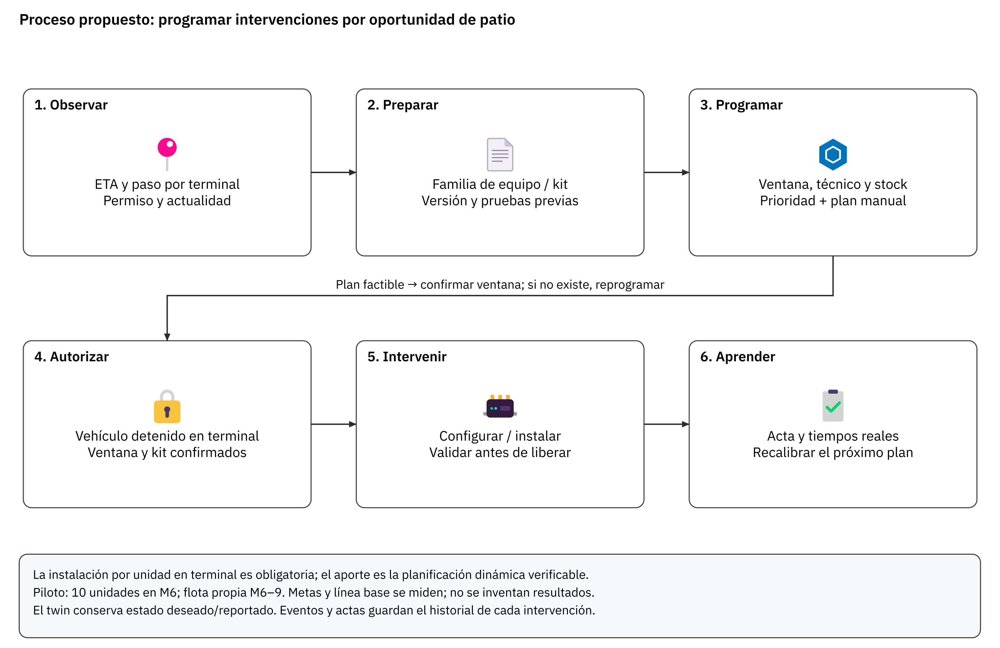

# Ficha T-19. Innovación 2 — Proceso

audIT, Empresa N.º 10. Licitación TFEP-01/2026. Informe 2. Responsable: D3, ingeniería de software y datos.

## Propuesta: programación dinámica de intervenciones por oportunidad de patio

La ficha especifica los siete elementos de FEP01 · Artículo 29° · p.19 y sustituye el argumento de innovación basado únicamente en instalar sin detener la flota. Esa condición ya es obligatoria (FEP03 · capítulo 10 · pp.23–24; revisión del Informe 1, S13 · p.12). El aporte propuesto consiste en programar y recalibrar la preparación de kits, técnicos y versiones a partir de oportunidades reales de patio, comparar sus resultados con la programación manual y conservar la justificación de cada decisión. Se presenta como diseño para incorporación al alcance, sin atribuir a Curimón ahorros ni pruebas que no se han realizado.

### 1. Problema y evidencia del Caso

La instalación física sólo puede efectuarse durante el paso normal por un terminal; hay 148 tractocamiones propios y 34 de terceros sin equipo, mientras otros 192 conservan sus equipos y plataformas (FEP03 · numeral 14.1 · p.29). Programar por mes y cantidad instalada no identifica si la familia del kit, la ventana, la autorización y el técnico estarán disponibles para una unidad concreta. Los 34 terceros requieren adhesión; no se programa una intervención física de sus equipos sin acuerdo. La línea base de tiempo de preparación, reintentos y espera por kit debe levantarse durante el piloto; el Caso no aporta esos valores.

### 2. Práctica y tecnología

Un planificador determinista en Flota y activos consume ETA y calidad de posición de Telemetría, autorización vigente, familia de hardware, stock de kits, turnos de técnicos, versión objetivo y ventana prevista. Cada candidato unidad–terminal–turno se admite sólo si cumple autorización, kit compatible, técnico y duración prevista dentro de la parada normal. Los congelamientos de S7 son restricciones duras.

Entre candidatos factibles se minimiza un costo normalizado de retraso hasta la próxima oportunidad y preparación desperdiciada; como desempate se prioriza la unidad con falla o vencimiento de versión más urgente y luego la que tiene mayor intervalo hasta su siguiente paso. Los pesos se fijan en el piloto y se conservan con versión; no se aprende sobre datos del conductor ni se decide automáticamente extender su jornada. Se recalcula al cambiar ETA, stock o autorización. El jefe de terminal confirma la ventana; si ésta se acorta, la intervención se reprograma.

Azure IoT Hub Device Twins registra configuración deseada y reportada; una diferencia no acredita por sí sola instalación correcta. Los eventos y actas separados conservan cada intento, firma del paquete, versión aplicada, pruebas y resultado, ya que el twin representa estado y no garantiza todos los estados intermedios (Microsoft, 2024). Device Update distribuye paquetes o imágenes a equipos compatibles mediante agente; su integración con el Linux y mecanismos de recuperación del equipo elegido se homologa antes de usarla (Microsoft, 2026). La anticipación logística y el algoritmo constituyen el proceso particular propuesto; los servicios cloud son herramientas de soporte.

### 3. Madurez

Se utiliza la escala TRL de nueve niveles explicada por NASA (Manning, 2023), aplicada aquí como referencia de madurez del desarrollo, sin confundir disponibilidad de un servicio cloud con validación del proceso completo. El proceso integrado está en **TRL 2 propuesto**: concepto y contratos definidos, sin prueba de concepto ejecutada. Se prevé contrastar factibilidad en laboratorio antes del piloto de M6, avanzar a integración validada y documentar el nivel alcanzado con resultados. Se elimina la afirmación de TRL 8 sin evidencia del sistema integrado.

### 4. Incorporación, arquitectura y calendario

La Figura 13.2 muestra el proceso, sus entradas y el control que evita intervenir sin ventana confirmada.

*Figura 13.2. Proceso propuesto. Fuente: elaboración D3 con el lienzo de D4.*

Flota y activos conserva `INTERVENCION_TALLER`; Telemetría conserva `DISPOSITIVO` y eventos de configuración; la plataforma de S6 construye y firma el artefacto. El manifiesto vincula dispositivo, familia, kit, versión y acta de validación, sin sobrescribir la evidencia anterior. El detalle de planificación se mantiene en el backlog EDT 12.2, con integración a EDT 4.1/4.2; no se altera la EDT de D2.

Calendario de S7/CONSIDERACIONES-D2: piloto de **10 camiones en M6**, montaje propio **M6–M9**, terceros adheridos desde M7, pausa M11–M15 y continuación M16–M18. El proceso no garantiza intervenir un tercero que no acuda o no adhiera. Los equipos existentes de los 192 terceros se integran mediante sus contratos autorizados; no se sustituyen por esta ficha.

### 5. Impacto económico y vínculo al flujo de caja

La inversión incremental comprende el planificador, el tablero de oportunidades, pruebas de integración, homologación del agente y los kits diferenciales que efectivamente agregue el proceso. Se contabiliza en EDT 12.2 y en las partidas de implementación de la oferta económica; el stock contractual de sustitución de T-11 no se cobra nuevamente como inversión innovadora. El costo recurrente incluye ejecución, almacenamiento de actas y mantenimiento del planificador, separado de la conectividad ya presupuestada.

El beneficio estimado se calcula como intervenciones evitadas por falta de kit × costo unitario de visita, más reducción medida de preparación × costo operativo aplicable, menos costo incremental del proceso. Sólo se incorpora un ahorro al escenario financiero cuando su base, cantidad, costo unitario y sensibilidad estén documentados; el escenario inicial no atribuye ahorro garantizado. La valorización se vincula a E-25/partidas de implementación y operación con D2. La fuente económica del repositorio mantiene valores vacíos; esta ficha no inventa montos ni una partida aprobada. La valoración monetaria y su reflejo en flujo de caja deben completarse en la oferta económica conforme al Artículo 29.5°.

### 6. Indicadores y medición

La Tabla 13.2 distingue metas propuestas de la obligación de no extender la parada. La evaluación se realiza por familia de vehículo y terminal para no atribuir a la planificación diferencias de complejidad física.

**Tabla 13.2.** Indicadores del proceso y evidencia de aceptación

| Indicador | Línea base | Meta propuesta | Medición |
|---|---|---|---|
| Preparación inútil por ausencia de unidad, autorización o kit compatible | Registro del piloto M6 y programación manual comparable; aún sin valor | Reducir ≥20 % desde la línea base homologada | Por terminal y familia, M7–M9; cantidades, causas y denominador |
| Intervenciones validadas al primer intento | Levantamiento M6; aún sin valor | ≥95 % en cohorte de al menos 20 intervenciones elegibles | M7–M9; acta y resultado de autodiagnóstico; no ocultar reintentos |
| Sustitución modular | Tiempo real del piloto; aún sin valor | ≤30 min dentro de la ventana normal, en familias homologadas | Cronometraje por unidad, desde entrega de kit hasta liberación; reportar excepciones |
| Parada comercial adicional por instalación | Restricción contractual, no beneficio novedoso | 0; abortar y reprogramar cuando se reduzca la ventana | En cada intervención; comparar ingreso, parada normal y liberación |

La Tabla 13.2 permite aceptar o ajustar el proceso con evidencia. Una instalación cuenta como terminada sólo después de las pruebas físicas y de datos; cambiar el estado reportado en nube no sustituye esas pruebas. Ninguna meta se declara ya alcanzada.

### 7. Riesgos, mitigación y contingencia

| Riesgo | Probabilidad / impacto propuestos | Mitigación | Contingencia |
|---|---|---|---|
| ETA o permanencia mal estimada | Media / alto | Conservar actualidad y calidad; confirmación del jefe de terminal antes de intervenir | Abortar preparación/intervención segura y reprogramar sin extender parada |
| Kit o agente incompatible con el hardware | Media / alto | Matriz por familia, ensayo previo, artefacto firmado y reversión validada | Procedimiento homologado manual y versión previa; sin borrar eventos pendientes |
| Escaso beneficio frente a coordinación manual | Media / medio | Comparación trazable por familia y terminal, con denominadores | Mantener planificación manual y limitar el desarrollo incremental |
| Tercero sin autorización o sin paso por terminal | Media / alto | Agenda sólo con autorización vigente y oportunidad confirmada | Integración lógica de capacidades disponibles; no intervenir equipo privado |

Las valoraciones son hipótesis AMFE a conciliar con S8; no resultados de incidentes observados. Los responsables de Flota y terminal registran el riesgo y su decisión en los comités de S6.

## Fuentes

- Manning, C. G. (2023, 27 de septiembre). *Technology Readiness Levels*. NASA. https://www.nasa.gov/directorates/somd/space-communications-navigation-program/technology-readiness-levels/
- Microsoft. (2024, 19 de diciembre). *Understand and use device twins in IoT Hub*. Microsoft Learn. https://learn.microsoft.com/en-us/azure/iot-hub/iot-hub-devguide-device-twins
- Microsoft. (2026, 5 de octubre). *What is Device Update for IoT Hub?* Microsoft Learn. https://learn.microsoft.com/en-us/azure/iot-hub-device-update/understand-device-update

## Declaración de uso de IA

OpenAI Codex (GPT-6), 11-10-2026: generación sustancial del diseño y ficha de proceso, nivel Alto en texto y diagramas. D3 debe revisar la pertinencia e incorporar su juicio de ingeniería; D2 concilia calendario y valorización; D4 homologa dispositivo/kit. No se atribuyen aprobación humana ni resultados del piloto.
