# Subdocumento 4.1. Arquitectura lógica de la solución

audIT, Empresa N.º 10. Licitación TFEP-01/2026, Caso 10 Transporte de Carga. Oferta Técnica, Sobre N.º 2. Informe Preparatorio 2. Archivo AUDIT-Subdocumento4.pdf. Anexos: Formulario T-11 en el archivo AUDIT-Formulario-T-11.pdf.

## Resolución de observaciones del Informe 1

La Tabla de resolución identifica los cambios de diseño de esta sección para el Informe 2. La comprobación documental no sustituye los ensayos de implementación ni la aceptación del CLIENTE (FEP01 · Artículo 46° · p.28).

| N.º | Observación atendida | Respuesta y evidencia de diseño | Sección |
|---|---|---|---|
| 53–54 | Capas sin interfaces ni responsabilidades | Ocho capas, canales por perfil, contratos y recorrido de una petición; figura y texto concordantes | 4.1.3, 4.1.11 y 4.1.24 |
| 55 | Falta correspondencia RF → componente | Correspondencia de contextos y contratos con el catálogo T-12 | 4.1.23 y T-12 |
| 56 | SOLID y ambientes ausentes | Aplicación concreta de SOLID; DEV, QA, PREPROD, PROD y DR con datos y accesos separados | 4.1.22 y 4.1.25 |
| 57 | Secuencias incompletas o sin análisis | Asignación, documento, liquidación y reconexión con mensajes, confirmaciones y fallos | Figuras 4.4, 4.8, 4.10 y 4.12 |
| 58, 63 | Stack sin fundamento ni validación | Productos decididos, políticas de soporte verificadas y pruebas de compatibilidad exigidas antes de congelar versiones | 4.1.1 y 4.1.6 |
| 59 | DDD sin límites ni eventos | Seis contextos canónicos, agregados y contratos de comandos/eventos | 4.1.4, 4.1.18 y 4.1.22 |
| 60–62 | Decisiones estructurales incompletas | Ocho ADR fechados: legado, satélite, servicios, eventos, analítica, identidad, persistencia y operación local; comparación de estilos | 4.1.6 y 4.1.22 |
| 65, 70, 78 | Ambigüedad de motores, bus y acceso a terceros | Event Hubs Premium mediante protocolo Kafka, TimescaleDB separado y acceso a terceros limitado a permisos acreditados | 4.1.1, 4.1.11 y 4.1.14 |
| 73–75 | Capacidad sin derivación | Perfil normal, ráfaga de reconexión, volumen anual y supuestos explícitos; cálculo de búfer enlazado con S4.2/T-11 | 4.1.20 y 4.1.26 |
| 72, 79–80 | DR, exposición y seguridad | Condiciones de réplica a Brazil South, control de identidad y superficie expuesta; RPO/RTO se verifican en S9 | 4.1.21, 4.1.24 y S5 5.1.6 |

Las observaciones de emplazamiento físico, sala técnica, cantidades y catálogo T-11 se resuelven en S4.2/4.3. Aquí se describe su interfaz con el software, sin atribuir a D3 una comprobación física ejecutada.

## 4 Introducción a la Arquitectura Lógica y Física de la Solución

Este capítulo describe cómo se construye la Plataforma Digital de Misión Crítica para Transporte de Carga: con qué piezas de software se organiza
la solución y en qué equipos, sitios y regiones de nube corre cada una. La sección 4.1 presenta la
arquitectura lógica, sus ocho capas, sus seis contextos delimitados y sus decisiones registradas, y la
4.1.1 las tecnologías de software. La sección 4.2 ubica cada componente en la nube, en San Bernardo,
en los cuatro terminales regionales y en los camiones, declara los enlaces y los puntos únicos de
falla, y dimensiona la ingesta de datos y la reconexión masiva. La sección 4.3 declara los dos
centros de datos: Azure Chile Central como región primaria, con la sala de San Bernardo como sitio de
continuidad, y Azure Brazil South como región secundaria.

El capítulo parte del esquema de solución del Subdocumento 3 y del catálogo de requerimientos de su
Formulario T-12. Se apoya en el modelo de datos del Subdocumento 5, que define dónde reside cada dato
y cómo se respalda. Los riesgos que abre la infraestructura, como el apagado de las redes 2G y 3G o el
retraso de una réplica, se tratan en el Subdocumento 8, y el ritmo de instalación a bordo en el plan
de trabajo del Subdocumento 7. La innovación tecnológica del Subdocumento 13 usa el Bluetooth del
equipo a bordo que se especifica aquí. Lo que el mandante compra, con cantidades y características, se
detalla en el Formulario T-11, que acompaña este capítulo como archivo propio
(`AUDIT-Formulario-T-11.pdf`), conforme al Comunicado 10, sección 1.

## 4.1 Arquitectura lógica

El Capítulo 5 del Caso resume el problema en una frase. El sistema de gestión de transporte de 2013
conoce el viaje que la compañía encargó y no conoce el viaje que efectivamente ocurrió
(Caso, capítulo 5, p. 13). El dato existe repartido en tres plataformas de posicionamiento, en una
telemetría que nadie descarga, en una liquidación de combustible que llega con cuarenta días de
atraso y en papeles que viajan en la cabina, y nunca se junta. Esa dispersión no se corrige
configurando el sistema existente, porque nace de cómo está construido.

### 4.1.1 Especificaciones Tecnologías de Software a utilizar

La selección sigue RT-03.05: servicios administrados cuando reducen el riesgo operacional, con separación entre datos de negocio, series de tiempo y análisis. La Tabla 4.1 fija productos y políticas de soporte. El contrato de 56 meses exige actualizaciones; una versión inicial no se presenta como soportada hasta el mes 56.

**Tabla 4.1.** Tecnologías seleccionadas y mantenimiento del soporte

| Componente | Selección y fundamento | Soporte y actualización |
|---|---|---|
| Aplicación móvil, cuatro perfiles | Flutter 3, Dart y SQLite local: una base de interfaz y operación desconectada. Se descartan interfaces exclusivamente web para cabina por integración local y pruebas con guantes | Canal estable; fijar versión exacta y plataformas mínimas en el manifiesto del hito de diseño. No se atribuye un LTS indefinido a Flutter |
| Portales y torre | React y Next.js; separar consulta pública de estado y portales autenticados. WCAG 2.2 AA verificable en S9 | Versiones exactas, licencias y dependencias en SBOM; actualización y regresión antes del fin de soporte de la versión escogida |
| Servicios de negocio | .NET 10 LTS; Go 1.27 para ingesta/borde. Se conserva separación de contextos y contratos | .NET 10 hasta 14-11-2028; Go mantiene cada versión hasta dos versiones mayores posteriores. .NET 8 termina 10-11-2026 y no es la base del inicio supuesto en febrero de 2027 |
| Orquestación | Azure Kubernetes Service; despliegue independiente y aislamiento de recursos | Versión soportada por AKS en cada liberación; matriz exacta de Kubernetes e imágenes, actualización por grupos y pruebas de reversa |
| Transaccional | PostgreSQL 16 Flexible Server con PostGIS, conforme a T-11; claves y restricciones para reservas y vigencias | PostgreSQL 16 hasta 09-11-2028. Ensayar actualización mayor antes de esa fecha; preservar compatibilidad de extensiones y CDC |
| Series de tiempo | Instancia Flexible Server separada con TimescaleDB, edición Apache-2 disponible en Azure. Se descarta Cosmos DB para este dominio por conservar SQL y el modelo temporal elegido | Azure publica la matriz de versiones de extensión por versión de PostgreSQL. No se inventa un fin de soporte independiente en mayo de 2029 ni se presuponen funciones comerciales de compresión no incluidas |
| Eventos | Azure Event Hubs Premium, compatible con clientes del protocolo Kafka; se descarta operar un clúster Strimzi adicional para el mismo flujo | Servicio administrado. Orden por partición y entrega al menos una vez; idempotencia propia. No depender de transacciones Kafka en vista previa |
| Caché | Azure Managed Redis, producto de T-11; almacena datos derivados y sesiones, nunca la única prueba habilitante de despacho | Para una implantación nueva se provisiona el destino. Sólo si hay una instancia de Azure Cache for Redis efectivamente existente se programa su migración antes del retiro de su SKU |
| Persistencia local | SQLite 3 en WAL; cola de salida transaccional y acuses duraderos | Fijar biblioteca e imagen Linux del equipo; probar cortes de energía y actualizar sin borrar registros no confirmados. No se denomina LTS al producto sin política aplicable |
| Analítica | ADLS Gen2 y tablas Delta Lake; cómputo y modelo dimensional separados del OLTP | Manifiesto de versiones del motor de procesamiento, conectores y biblioteca Delta; exportación en formatos abiertos |
| Identidad y secretos | Entra ID, identidades administradas y Key Vault; autorización por rol, atributo, transportista y viaje | Fijar edición y capacidades en T-11; no atribuir certificación de HSM a una bóveda o SKU sin comprobarlo |

La Tabla 4.1 decide productos y evita dos buses alternativos o dos motores intercambiables. Las versiones exactas de los canales móviles y web se fijan en el hito de diseño con SBOM, licencia, prueba de compatibilidad, fecha o política de soporte y responsable. Esta es una especificación de mantenimiento, no una prueba de concepto ya ejecutada. Los servicios cloud y su disponibilidad regional se cotejan con S4.2/T-11 antes de su aprovisionamiento.

Fuentes consultadas el 11-10-2026: [política de .NET](https://dotnet.microsoft.com/en-us/platform/support/policy), [política de Go](https://go.dev/doc/devel/release), [soporte de PostgreSQL](https://www.postgresql.org/support/versioning/), [extensiones de Azure](https://learn.microsoft.com/en-us/azure/postgresql/extensions/concepts-extensions-versions), [consideraciones de TimescaleDB](https://learn.microsoft.com/en-us/azure/postgresql/extensions/concepts-extensions-considerations) y [protocolo Kafka en Event Hubs](https://learn.microsoft.com/en-us/azure/event-hubs/azure-event-hubs-apache-kafka-overview).

Microsoft lista tres zonas en Chile Central y no le asigna región emparejada ([regiones de Azure](https://learn.microsoft.com/en-us/azure/reliability/regions-list)). Brazil South es una elección de DR de la propuesta. La existencia de la región no acredita disponibilidad de cada SKU, extensión, modalidad HA o cuota: D3/D4 deben fijar la matriz por servicio y región en el diseño detallado y validar aprovisionamiento y recuperación antes de activar producción.

### 4.1.2 Punto de partida

Los rasgos del sistema de 2013 que explican esa dispersión y la respuesta que da esta arquitectura a
cada uno se resumen en la Tabla 4.2.

**Tabla 4.2.** Rasgos del sistema de 2013 y respuesta de esta arquitectura

| Rasgo | Efecto que produce hoy | Respuesta de esta arquitectura |
|---|---|---|
| Base operativa del sistema de gestión 2013 acoplada a consultas de gestión | La consulta de gestión compite con la operación de la torre por el mismo motor | Separación del almacenamiento transaccional y del analítico, obligatoria por RT-05.05 |
| Integración con el sistema contable por consultas y tablas compartidas | Todo cambio contable alcanza el núcleo operacional sin traducción | Capa anticorrupción, obligatoria por RT-05.20 |
| Ausencia de costo por kilómetro por ruta | Tres de los ocho contratos principales se sirven bajo costo, el peor a menos catorce por ciento sostenido durante cuatro años (Caso, numeral 7.3, p. 15) | Costo por viaje en doble versión, preliminar y consolidada |
| Puerto de telemetría de fábrica inactivo | La lectura del motor de 61 tractocamiones no se aprovecha por temor a la garantía | Lectura de fábrica autorizada; protocolo y equipo homologados con cada fabricante |
| Módulos operativos acoplados entre sí | El sistema no distingue el viaje encargado del viaje ocurrido | Seis contextos delimitados, cada uno con sus propios datos |

*Fuente: Bases Técnicas del Caso, capítulos 5 y 7.*

Cada rasgo de la tabla tiene una respuesta estructural propia. Ninguna se resuelve configurando el
sistema existente.

### 4.1.3 Las ocho capas

La solución se organiza en las ocho capas del modelo de referencia, cuya existencia es obligatoria
conforme al FEP02, numeral 2.1, p. 6. RT-02.01 exige el diagrama que identifica cada capa, sus
componentes y las interfaces entre ellas, y la descripción se ajusta a ISO/IEC/IEEE 42010
(ISO, 2022). La Tabla 4.3 resume el contenido de cada capa.

**Tabla 4.3.** Las ocho capas y su contenido en esta solución

| Capa | Contenido |
|---|---|
| Presentación | Portal web para 84 clientes y 148 transportistas, aplicación móvil, terminales de torre y taller, pantallas de terreno operables con guantes |
| Borde y exposición | Distribución de contenidos, cortafuegos de aplicación, balanceo y terminación de cifrado. Único punto de entrada público |
| Puerta de enlace | Autenticación, autorización, cuotas, límites de tasa, versionado semántico y catálogo de servicios |
| Servicios de negocio | Seis contextos delimitados con límites explícitos, sin estado y desplegables de forma independiente |
| Integración y eventos | Bus de telemetría, bus transaccional, cola de mensajes fallidos, reintento y deduplicación |
| Datos | Persistencia políglota. Transaccional, series de tiempo, documental inmutable y analítica separadas |
| Seguridad | Identidad, autorización, gestión de secretos, cifrado y auditoría. Transversal a todas las capas |
| Observabilidad | Métricas, registros y trazas correlacionadas, sin puntos ciegos entre nube y terreno |

*Fuente: Bases Técnicas Transversales, numeral 2.1, y elaboración propia.*

Ninguna interfaz accede directamente a la base de datos. Una petición entra por presentación, borde y puerta de enlace; el servicio invoca su repositorio o publica mediante outbox cuando corresponde. No toda consulta atraviesa el bus de eventos. La respuesta vuelve por la puerta de enlace y el canal de presentación. Seguridad y observabilidad no ocupan un
lugar en esa pila, la atraviesan entera. Los componentes declarados en cada capa se listan en la
Tabla 4.4.

**Tabla 4.4.** Componentes declarados por capa

| Capa | Componentes |
|---|---|
| Presentación | Portal web con representación en servidor, aplicación móvil en los cuatro perfiles que exige RT-17.01 del Caso, conductor, torre, terminal y taller, y transportista subcontratado, y vistas de portería y de taller de alto contraste |
| Borde y exposición | Distribución de contenidos con presencia global, cortafuegos de aplicación y protección volumétrica en las capas de red, transporte y aplicación |
| Puerta de enlace | Gestión de interfaces con identidad federada, certificado mutuo entre máquinas, límites de tasa por perfil y catálogo publicado |
| Servicios de negocio | Contenedores orquestados sobre nodos repartidos en tres zonas de disponibilidad, con un despliegue independiente por contexto delimitado |
| Integración y eventos | Flujo de telemetría para la ingesta masiva, bus transaccional con orden garantizado dentro de la partición y cola de mensajes fallidos, y capa anticorrupción frente al sistema contable |
| Datos | Motor relacional multizona, base de series de tiempo, caché en memoria, almacenamiento inmutable y repositorio analítico. El diseño detallado es materia del Subdocumento 5 |
| Seguridad | Bóveda de claves en módulo criptográfico, identidad federada con control por rol y por atributo, y bitácora que permite reconstruir quién, qué, cuándo y con qué valores anteriores, según RT-05.03 |
| Observabilidad | Instrumentación única con trazas, métricas y registros correlacionados por el identificador común que RT-05.19 exige a toda integración |

*Fuente: elaboración propia.*

La Figura 4.1 dibuja las ocho capas con sus componentes.

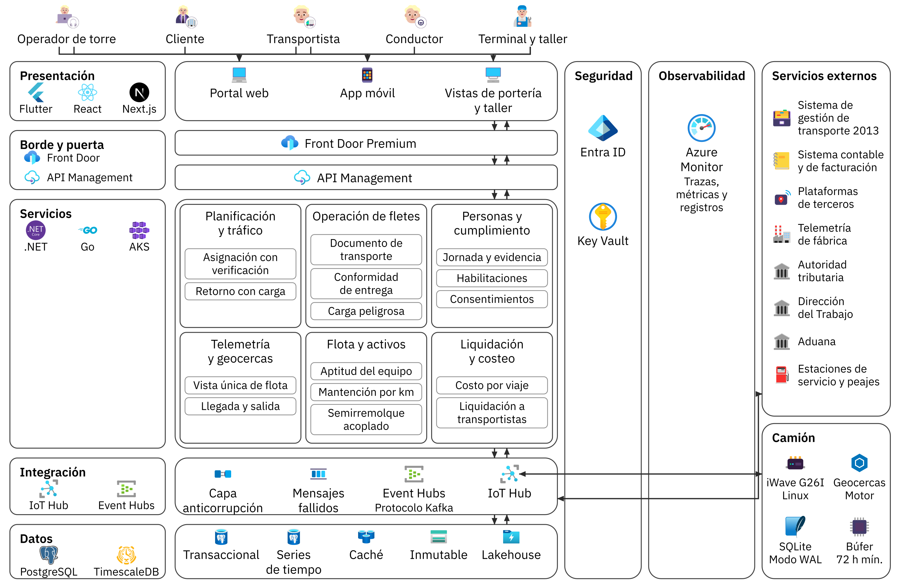

*Figura 4.1. Las ocho capas obligatorias del numeral 2.1 transversal, con sus componentes e interfaces, conforme a RT-02.01*

Fuente: Elaboración propia.

La figura muestra la pila de seis capas y las dos capas transversales. Las capas de servicios y de
datos existen además a bordo del camión, en versión reducida, para operar sin enlace.

### 4.1.4 Los seis contextos delimitados

RT-02.02 rechaza toda arquitectura monolítica que no permita desplegar de forma independiente sus
componentes críticos. Los servicios de negocio se organizan en seis contextos, cada uno con su propio
lenguaje y sus propios datos. Un contexto no consulta la base de datos de otro, le pregunta. La
Tabla 4.5 declara qué decide cada uno.

**Tabla 4.5.** Contextos delimitados y la decisión que sostiene cada uno

| Contexto | Qué decide |
|---|---|
| Planificación y tráfico | Qué carga hay que mover y hacia dónde |
| Flota y activos | Si el equipo puede salir hoy |
| Personas y cumplimiento | Si la persona puede conducir hoy |
| Telemetría y geocercas | Dónde está el camión y cuándo llegó |
| Operación de fletes | El viaje que realmente ocurrió |
| Liquidación y costeo | Cuánto costó y a quién se paga |

*Fuente: elaboración propia.*

La descomposición separa responsabilidades que hoy quedan dispersas entre el sistema de gestión, planillas, papeles y plataformas de posicionamiento. La Figura 4.2 muestra los seis contextos
y los sistemas con los que conviven.

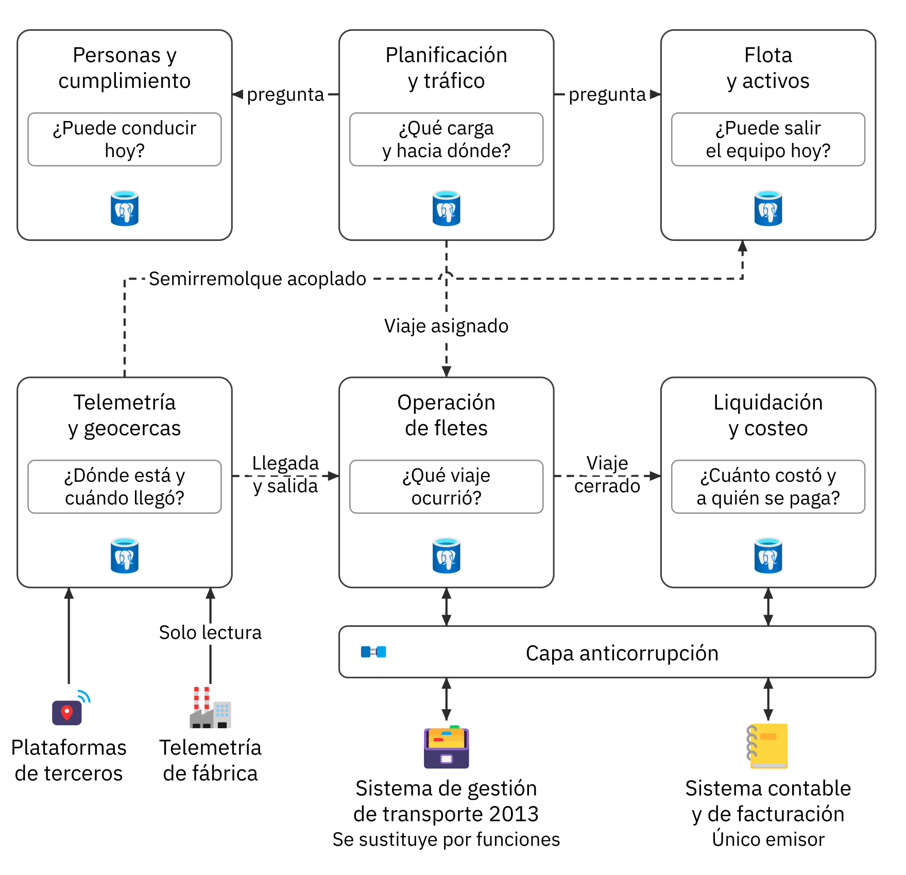

*Figura 4.2. Contextos delimitados del dominio y sistemas con los que convive la solución*

Fuente: D4, figura conservada.

En la figura, cada contexto tiene su propio lenguaje y sus propios datos. Planificación y tráfico puede bloquear un
viaje sin conocer por dentro a Personas y cumplimiento ni a Flota y activos, porque les pregunta.

### 4.1.5 Convivencia con lo que ya existe

El sistema de gestión de transporte de 2013 y el sistema contable son contrapartes distintas (FEP03 · capítulo 5 · pp.12–13). La capa anticorrupción traduce sus contratos, sin sustituir por sí sola sus módulos. Los servicios nuevos reemplazan asignación, control de viaje y liquidación en M16; órdenes y tarifas a clientes en M21. El sistema de gestión queda de consulta hasta M24, con conciliación y reversa según S3/S7. El contable permanece como único emisor tributario bajo la Restricción 8.

### 4.1.6 Registro de decisiones de arquitectura

RT-02.04 exige ADR fechados y actualizados. La Tabla 4.6 registra ocho decisiones de diseño al 11-10-2026. Se preservan los identificadores de las cuatro decisiones previas para no romper las referencias de S4.2; los nuevos ADR 05–08 completan el análisis solicitado para el Informe 2.

**Tabla 4.6.** Registro de decisiones de arquitectura

| ADR / fecha | Decisión | Alternativas evaluadas | Criterio, consecuencia y verificación |
|---|---|---|---|
| 01 / 11-10-2026 | Seis contextos desplegables en AKS | Monolito modular, SOA con orquestador central, servicios independientes | RT-02.02 exige independencia de componentes críticos. Separar ingesta del despacho; asumir mayor costo de operación, observabilidad y pruebas de contratos. Medir aislamiento y carga en S9 |
| 02 / 11-10-2026 | Event Hubs Premium con protocolo Kafka y outbox transaccional | Cadena HTTP síncrona; Kafka autoadministrado sobre Strimzi | Aislar ráfagas y evitar que los efectos derivados alarguen el despacho. Deduplicar y reconciliar entrega al menos una vez; no confundir el endpoint Kafka con un clúster Kafka propio |
| 03 / 11-10-2026 | CDC hacia ADLS/Delta y modelo dimensional | BI sobre OLTP; réplica operacional usada para BI | RT-05.05 exige separación. CDC también consume recursos: vigilar slots/WAL y medir su impacto; no prometer carga nula |
| 04 / 11-10-2026 | Identidad federada y certificados por equipo; acceso por rol y atributos | Claves compartidas o parámetros secretos en URI | RT-05.18 y Zero Trust: revocación, mínima exposición, secreto fuera del código y autorización por viaje. Probar acceso cruzado entre transportistas |
| 05 / 11-10-2026 | Reemplazar gestión 2013 función por función; conservar contable | Corte único; conservar sólo integrando; paquete de mercado sin integración demostrada | M16/M21/M24 de S3. Evitar interrupción y doble registro definitivo; presupuestar coexistencia, adaptadores y conciliación en los paquetes de S7 y Sobre 3, sin inventar ahorro monetario |
| 06 / 11-10-2026 | Captura local y enlace satelital de mensajes; documento emitido en contable | Banda ancha satelital en toda la flota; generación fiscal en cabina | Restringir costo recurrente y equipos del T-11; la alternativa local infringe R-08. El descarte de banda ancha no prueba que SBD baste: validar entrega documental completa y 90 s; revisar esta decisión si el ensayo falla |
| 07 / 11-10-2026 | PostgreSQL transaccional y TimescaleDB separado | Motor único; Cosmos DB; motor temporal autoadministrado adicional | Integridad referencial en el negocio, aislamiento de series y SQL conocido. Verificar extensión Apache-2, funciones efectivas, actualización y HA en Azure |
| 08 / 11-10-2026 | SQLite local con outbox, acuses y conciliación determinista | Depender del enlace para cada evento; búfer sólo en RAM | 72 h a bordo, 24 h en terminal como mínimo transversal y confirmación ≤20 min tras 72 h. 288 h es ampliación propuesta: ensayos y capacidad separados |

La Tabla 4.6 permite revisar la elección y sus costos operativos sin declarar pruebas ejecutadas. Cada cambio de proveedor, protocolo o estrategia de continuidad actualiza el ADR, los contratos, la EDT y los casos de aceptación.

### 4.1.7 Degradación, escalamiento y puntos únicos de falla

Tres requisitos obligatorios de la misma sección exigen declaraciones que conviene no dejar
implícitas. RT-02.09 obliga a degradar de forma elegante, de modo que la caída de un componente no
crítico deje la solución operando en modo reducido y avisando de la degradación, y nunca falle de
forma total. La aplicación de esa regla en esta operación es directa. Si el repositorio analítico no
responde, la torre sigue despachando. Si el sistema contable no responde, continúan la captura, el seguimiento y los viajes que ya disponen de documentación conforme. Se encola la solicitud pendiente, pero se bloquea la salida de un viaje que todavía requiere emisión. Si el enlace satelital no está disponible, el registro sigue
acumulándose a bordo.

RT-02.10 exige que las capas de aplicación e integración escalen horizontalmente de forma automática,
con umbrales, límites superiores y costo asociado declarados en la oferta. Los umbrales y los límites
se declaran en esta sección. El costo asociado se remite al Sobre N.º 3, porque el FEP01, Artículo 50.2, p. 29
excluye toda cifra de precio de la Oferta Técnica.

RT-02.11 evalúa como observación grave omitir la declaración de los puntos únicos de falla que
subsistan. Esta oferta declara dos en la capa lógica, que se listan en la Tabla 4.7.

**Tabla 4.7.** Puntos únicos de falla declarados en la capa lógica

| Punto | Por qué subsiste | Por qué es aceptable |
|---|---|---|
| El sistema contable como emisor único de documentos tributarios | La restricción 8 lo fija y no es negociable | La captura y el seguimiento continúan. Una salida sin documento conforme queda bloqueada; se monitoriza la cola y se escala como incidente crítico |
| El dispositivo a bordo de cada camión | Hay uno por unidad y solo puede intervenirse cuando el camión pasa por un terminal, según RT-06.01 del Caso | La falla afecta a una unidad y no a la flota. Se mitiga con repuestos precargados y con el procedimiento de contingencia aprobado, sin levantar bloqueos legales |

*Fuente: elaboración propia sobre el Caso, capítulo 10 y RT-06.01.*

Los puntos únicos de falla de la infraestructura física se analizan en la sección 4.2.7.

### 4.1.8 Resiliencia

Los servicios de negocio son sin estado, con el estado de sesión y de proceso en almacenes externos de
alta disponibilidad. Los patrones de RT-02.08 son obligatorios y esta oferta los adopta. Tiempos
límite explícitos en toda llamada remota, cortacircuitos y mamparos para aislar fallas de
integraciones externas, y reintento exponencial con variación aleatoria. La escritura es idempotente
con ventana de deduplicación dimensionada para tolerar la desconexión prolongada en ruta.

El estado de sesión y el estado de proceso residen en almacenes externos de alta disponibilidad, como
exige RT-02.05. Allí viven las sesiones concurrentes de los 22 operadores de la torre, las credenciales
activas y las geocercas de los 1.400 puntos distintos de carga y descarga que declara el
Caso, numeral 14.1, p. 29. Cualquier instancia puede destruirse y reemplazarse sin pérdida de
transacciones en curso. Los parámetros de la Tabla 4.8 son de diseño de audIT y se ajustan
con la medición de la Etapa 1.

**Tabla 4.8.** Parámetros de los patrones de resiliencia

| Patrón | Parámetro declarado |
|---|---|
| Cortacircuito | Se abre al superarse la mitad de las llamadas fallidas en una ventana deslizante de diez peticiones, permanece abierto 30 segundos y admite tres llamadas de prueba antes de restablecer el tráfico |
| Mamparo | La verificación bloqueante del despacho tiene su propio conjunto de hilos y de conexiones. La saturación de la consulta de liquidaciones o de reportes no le quita capacidad |
| Tiempo de espera | Validación en memoria, 800 milisegundos. Consulta transaccional del despacho, 5 segundos. Llamada al sistema contable a través de la capa anticorrupción, 10 segundos. Emisión del documento electrónico de transporte, 90 segundos, que es el techo que fija RT-09.01 del Caso |
| Reintento | Hasta tres intentos sobre operaciones idempotentes sólo si caben en el plazo total, con retroceso exponencial y variación aleatoria. La variación evita que cientos de unidades que recuperan cobertura a la vez reintenten sincronizadas |
| Límite de tasa | Declarado por perfil en la puerta de enlace, según se detalla en la gobernanza de interfaces |

*Fuente: elaboración propia sobre RT-02.08 y RT-09.01 del Caso.*

Los tiempos de espera escalonan desde la validación en memoria hasta el techo de 90 segundos del Caso,
de modo que ninguna llamada lenta consume el presupuesto de la verificación bloqueante.

### 4.1.9 Verificación bloqueante del despacho

Caso, RT-09.01, p. 32 fija en 30 segundos el tope para asignar un viaje con verificación de jornada,
habilitaciones y aptitud del equipo. El servicio evalúa en paralelo las tres invariantes de la
Tabla 4.9, y ninguna admite excepción automática.

**Tabla 4.9.** Invariantes de la verificación bloqueante

| Invariante | Comprobación | Fuente y efecto |
|---|---|---|
| Persona y jornada | Identidad del conductor, descanso y jornada acumulada, evidencia previa relevante y licencia vigente | S3 RN-01–04; FEP03 · RT-09.01 · p.32. Una causa legal bloquea siempre |
| Equipo | Vigencias acreditadas de tracto y semirremolque, disponibilidad y compatibilidad con la carga | FEP03 · numerales 4.4 y 16.1; S3 RN-05. Sin respaldo vigente no habilita |
| Carga y documentación | Documento de transporte conforme, requisitos y lista de verificación firmada para carga peligrosa | Restricción 8; RF-006/RF-013/RF-014. La asignación no sustituye la autorización de salida |

La Tabla 4.9 separa la elegibilidad de los recursos y la condición documental de salida. El conductor, tracto y semirremolque no pueden tener asignaciones activas superpuestas. El servicio obtiene evaluaciones versionadas de Personas y de Flota; Planificación confirma únicamente si esas versiones siguen vigentes. La autorización de salida exige además el documento y la comprobación de carga.

Cada evaluación lleva sujeto, versión, instante y vencimiento. No basta leer una versión remota y después hacer commit en otra base: la revalidación y el protocolo de reserva deben impedir confirmar mientras cambia una habilitación. Planificación serializa las reservas de recursos y conserva el intento antes de consultar. Una modificación incompatible invalida los intentos afectados; ante falta de confirmación de vigencia se rechaza dentro del presupuesto total. S9 prueba especialmente una revocación concurrente, dos solicitudes para el mismo recurso y el vencimiento del token; no se afirma atomicidad global por usar una transacción local.

La Tabla 4.10 distribuye el tiempo máximo de la decisión, incluyendo confirmación, auditoría y respuesta.

**Tabla 4.10.** Presupuesto de diseño de la asignación, extremo a extremo

| Paso | Máximo presupuestado | Control |
|---|---|---|
| Identidad, contrato y clave de idempotencia | 2 s | Autorización y unicidad duradera |
| Jornada, vigencias y aptitud, en paralelo | 8 s | Evidencia vigente; retorno a fuente autoritativa si caché desactualizada |
| Reserva y confirmación atómica | 8 s | Restricciones de exclusión/unicidad, versión y conflicto de concurrencia |
| Composición del veredicto y auditoría | 4 s | Causal, evidencia, regla y correlación |
| Respuesta al operador | 3 s | Incluye tránsito de red y puerta de enlace |
| Total + margen | 25 s + 5 s = 30 s | Ningún reintento rebasa el plazo total |

La Tabla 4.10 es una asignación de tiempo de diseño, no una medición. Los 660 ms nominales representados en la Figura 4.3 describen un caso favorable de caché; no acreditan extremo a extremo ni reemplazan este presupuesto. Un objetivo interno menor de 2 s se conserva como hipótesis de optimización y se mide en S9, sin presentarlo como resultado demostrado.

Ante rechazo, la respuesta identifica causa, regla aplicada, valor evaluado, dato faltante y correlación; la Tabla 4.11 fija los campos. Una petición repetida devuelve el resultado ya confirmado y una operación aún en curso devuelve conflicto, sin emitir una segunda asignación.

**Tabla 4.11.** Respuesta trazable ante rechazo

| Campo | Contenido |
|---|---|
| tipo / estado | Causal estable y categoría: regla, dato insuficiente, conflicto o error técnico |
| detalle | Umbral, dato evaluado y motivo, sin divulgar antecedentes personales a un rol no autorizado |
| instancia / correlacion | Viaje, intento y operaciones relacionadas |
| versionRegla / evidencias | Versión normativa-operacional y referencias que sustentan el veredicto |

La Tabla 4.11 permite al operador corregir la causa y conserva la decisión para auditoría. RN-04 permite una excepción sólo por fuente indisponible, con jefe de turno y prevención de riesgos, motivo, un viaje y revisión mensual; no admite jornada agotada ni documento legal faltante.

La Figura 4.3 muestra los patrones que aíslan el despacho de las integraciones externas.

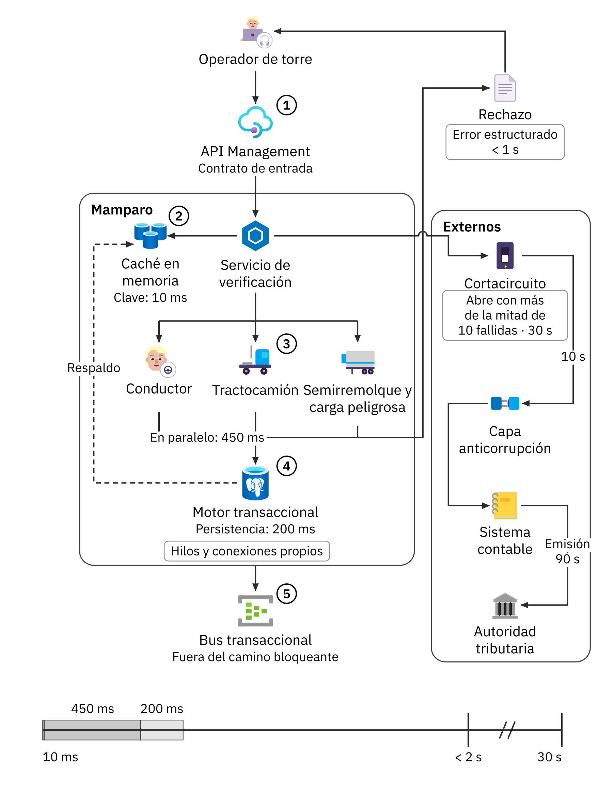

*Figura 4.3. Patrones de resiliencia. Fuente: D4, figura conservada. Los tiempos nominales son hipótesis de diseño, no mediciones.*

La Figura 4.4 detalla los mensajes de la asignación. La transacción incorpora reserva, asignación y outbox; sólo después del commit se devuelve confirmación. La publicación se reintenta desde outbox y el consumidor deduplica. Se elimina así la ventana de pérdida entre confirmar el viaje y publicar su evento.

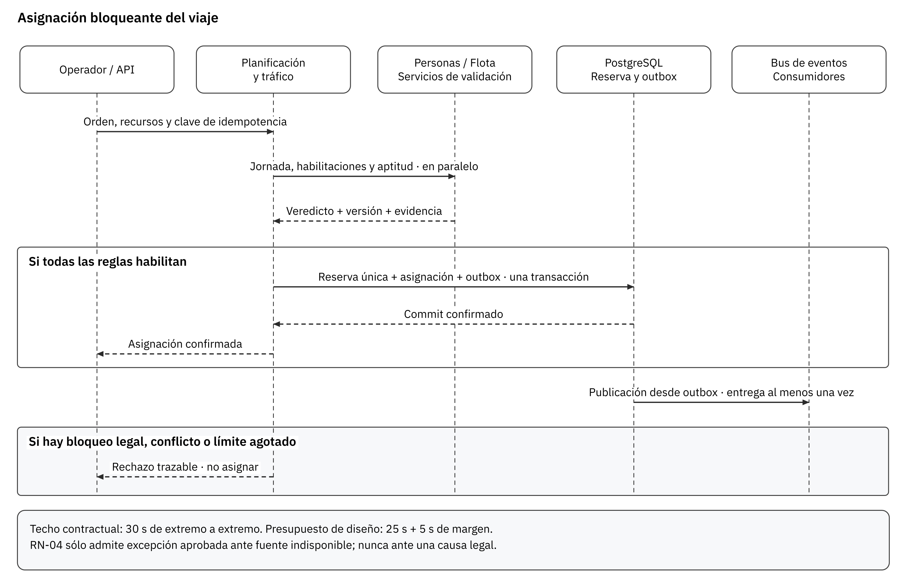

*Figura 4.4. Secuencia de asignación bloqueante. Fuente: elaboración D3 con el lienzo gráfico de D4.*

La rama de rechazo de la Figura 4.4 conserva el bloqueo ante incumplimiento o plazo agotado. La excepción RN-04 es un procedimiento separado y aprobado, nunca un reintento que cambia silenciosamente el veredicto.

### 4.1.10 Idempotencia y ventana de deduplicación

RT-02.06 exige escrituras idempotentes. Cada operación lleva una clave única. La caché puede retenerla siete días para acelerar reintentos frecuentes; siete días no cubren doce días. La unicidad duradera y la respuesta registrada permanecen durante la retención del registro de negocio, incluida cualquier reconexión de 288 h. La clave se bloquea en el almacén en memoria y se respalda con una
restricción de unicidad duradera en el motor transaccional, de modo que un reintento tras la
reconexión masiva no duplica un viaje ni un documento.

La ventana opera en dos niveles con propósitos distintos. El nivel en memoria resuelve la concurrencia
inmediata. Si la clave ya está tomada y la operación sigue en curso, la petición se rechaza como
conflicto. Si ya se completó, se devuelve la respuesta guardada en lugar de repetir la escritura. El
nivel duradero resuelve el caso que importa aquí, el mensaje que llega desde el búfer de un camión
después de días sin cobertura, cuando la clave ya expiró en memoria. La restricción de unicidad lo
descarta sin importar cuánto tiempo pasó. RT-02.07 exige además deduplicación en el consumidor y orden
garantizado dentro de la partición, y ambos se aplican al flujo de telemetría.

### 4.1.11 Gobernanza de interfaces y contratos

FEP02, RT-05.16, p. 12 obliga a documentar los servicios síncronos en OpenAPI 3.1 y los flujos dirigidos
por eventos en AsyncAPI 2.6 o superior, y exige que esa documentación se genere desde el código y se
mantenga actualizada de forma automática. La consecuencia práctica es que no se admite discrepancia
entre el contrato publicado y la implementación viva, porque el contrato no se escribe aparte.
A modo representativo, el servicio síncrono de verificación bloqueante pre-despacho expone el contrato
`POST /api/v1/despacho/validar` documentado bajo OpenAPI 3.1, recibiendo en su esquema JSON
los identificadores del viaje (`viajeId`), conductor (`conductorId`), tracto
(`patenteTracto`), rampla (`patenteRampla`) y carga (`codigoSUSPEL`), retornando el
veredicto (`autorizado`), latencia de validación (`latenciaMs`) y la bitácora auditable de
factores. En paralelo, el evento asíncrono de notificación de salida se formaliza bajo AsyncAPI 2.6
en el canal de eventos de operaciones, transportando eventos CloudEvents con identificador único, agregado, secuencia, versión de esquema y correlación. El transporte autenticado y el sellado de evidencias se especifican según el tipo de evento; un HMAC no se presenta como firma tributaria.

RT-05.17 obliga a versionar semánticamente los contratos, con compatibilidad hacia atrás y política de
obsolescencia con preaviso mínimo de seis meses. RT-05.18 fija el mecanismo de autenticación entre
sistemas y prohíbe la clave estática en la ruta de la dirección web. RT-05.19 exige registrar la
transacción de entrada y la de salida de toda integración con un identificador de correlación común,
que es lo que permite seguir una operación de negocio a través de todos los sistemas que toca. Ese
identificador es el mismo que usa la capa de observabilidad.

RT-05.21 obliga a declarar, por cada integración, el modo, el volumen esperado, la ventana de
disponibilidad de la contraparte y el comportamiento de la solución cuando esa contraparte no
responde. Esa declaración se entrega en la Tabla 4.12.

**Tabla 4.12.** Declaración por integración conforme a RT-05.21

| Contraparte | Modo | Volumen esperado | Ventana de la contraparte | Si no responde |
|---|---|---|---|---|
| Sistema contable y de facturación | Solicitud/respuesta para emisión; asíncrono para asientos | Hasta 128.000 documentos y eventos de 96.000 viajes/año | Capacidad 24x7 de emisión por acordar y probar; no consta en el Caso | Cortacircuito y encolado. Sin documento conforme se bloquea la salida; captura y viajes ya documentados continúan |
| Plataformas de posicionamiento de terceros | Asíncrono | Posición de los camiones de terceros con dispositivo | No declarada por el Caso | Última posición conocida con su antigüedad visible, nunca una posición sin fecha |
| Telemetría de fábrica | Asíncrono | 61 tractocamiones, solo lectura | Sujeta a la autorización de cada fabricante | El viaje se registra igual con el dispositivo a bordo |
| Red de estaciones de servicio | Por lotes | 74.000 abastecimientos al año | Mensual, con hasta 40 días de desfase | El costo se emite preliminar y se marca como pendiente |
| Concesionarias de peaje | Por lotes | 620.000 pasadas al año | Mensual | Peaje estimado por la traza, marcado como estimado |
| Autoridad tributaria, a través del contable | Según contrato fiscal del emisor | 128.000 documentos/año | Según servicio de la autoridad | Aplicar contingencia fiscal admitida y documentada; audIT no se convierte en emisor |
| Clientes y autoridad aduanera | Ambos | Según contrato y cruce | Variable | Reintento con retroceso y aviso a la torre |

*Fuente: Caso, numeral 14.1, p. 29, y elaboración propia.*

Los volúmenes de esta tabla provienen del Caso, numeral 14.1, p. 29. La ventana de disponibilidad de las
plataformas de terceros y de la autoridad tributaria no está declarada en las bases y se consulta al
mandante. RT-05.22 exige además carga y descarga masiva en formatos abiertos, con validación previa,
informe de errores por registro y procesamiento parcial. Esa capacidad es la que sostiene la migración
de las cerca de 6.000 vigencias y la ingesta mensual de combustible y peajes. La
Figura 4.5 dibuja el mapa de integraciones.

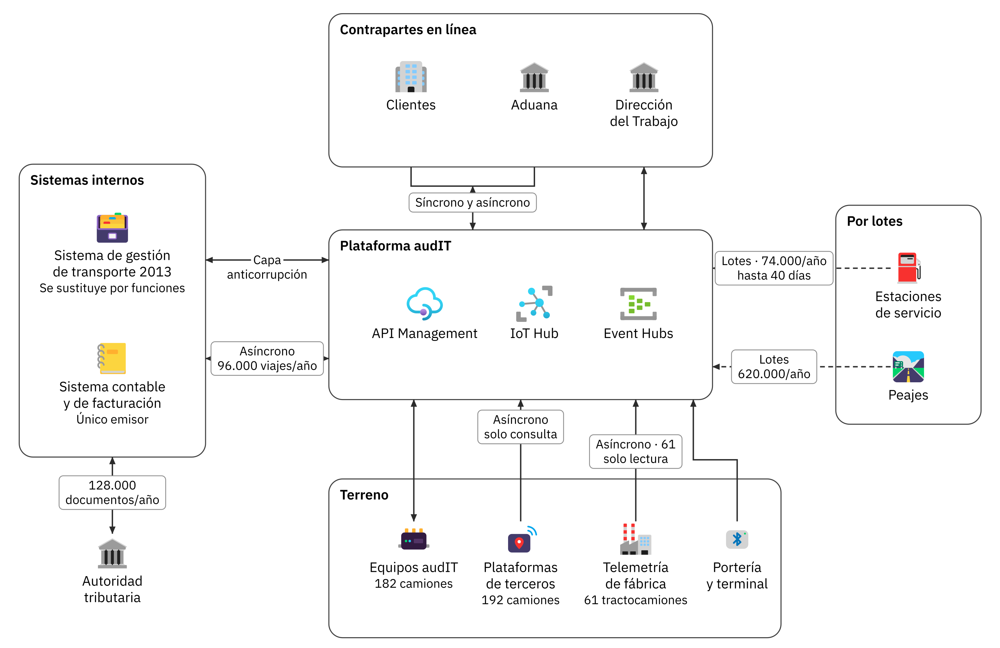

*Figura 4.5. Mapa de integraciones. Sistemas internos, fuentes de terreno y contrapartes externas*

Fuente: D4, figura conservada.

La Figura 4.5 diferencia el sistema de gestión 2013, que se sustituye, del contable, que se conserva. Los 192 terceros con equipo son población de referencia; el dibujo no acredita acceso automático a las tres plataformas. La cobertura efectiva y su antigüedad se muestran por unidad.

### 4.1.12 Convivencia con el sistema contable heredado

Los servicios de negocio sustituyen los módulos operativos del sistema de gestión 2013. La capa anticorrupción traduce los contratos y encapsula el sistema contable, que se conserva como único emisor de documentos
tributarios. El aislamiento es bidireccional. Un cambio en el sistema externo no propaga su modelo al
núcleo, y el núcleo no escribe directamente sobre el legado.

RT-02.14 valora la aplicación documentada de patrones de arquitectura evolutiva que permitan
sustituir un componente sin reescribir la solución, y nombra tres. Esta oferta aplica los tres. La capa
anticorrupción frente al sistema heredado, el estrangulamiento progresivo con que los módulos
operativos de 2013 se van sustituyendo función por función en lugar de en un corte único, y la
abstracción de proveedores, que es lo que permite declarar la estrategia de reversibilidad que exige
RT-03.07. Las piezas de la capa se listan en la Tabla 4.13.

**Tabla 4.13.** Piezas de la capa anticorrupción

| Pieza | Función |
|---|---|
| Adaptador de dominio | Traduce el evento de negocio, viaje cerrado o liquidación aprobada, a la estructura plana que el sistema contable espera |
| Transformador de esquemas | Homologa formatos en ambos sentidos, de modo que las convenciones de 2013 no lleguen al modelo nuevo |
| Protector de resiliencia | Cortacircuito y cola de mensajes fallidos. Si el contable no responde, las solicitudes quedan pendientes y las salidas sin documento conforme se bloquean |
| Reconciliador | Verifica que todo evento encolado terminó registrado, y expone el pendiente en lugar de dejarlo silencioso |

*Fuente: elaboración propia.*

La Figura 4.6 muestra la integración con el sistema contable a través de esa capa.

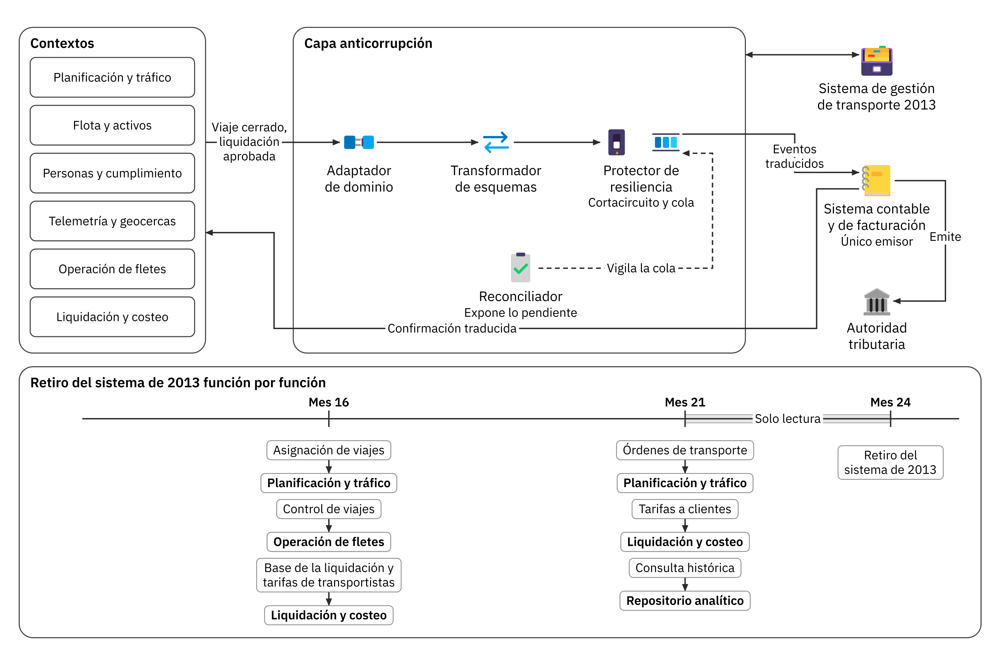

*Figura 4.6. Integración con el sistema contable heredado a través de la capa anticorrupción*

Fuente: D4, figura conservada.

El sistema contable queda detrás de la capa y solo recibe eventos ya traducidos.

### 4.1.13 Emisión del documento de transporte bajo Restricción 8

El sistema contable y de facturación es el único emisor fiscal (FEP03 · capítulo 10 · Restricción 8 · p.24). Cabina y terminal no generan folios ni firman documentos tributarios. RF-013/RF-014 exigen documento conforme antes de iniciar el traslado; asignar recursos no habilita por sí solo la salida.

La Figura 4.7 representa los dos caminos de S3: emisión anticipada cuando la carga definitiva se conoce, y solicitud satelital cuando sólo se conoce en el punto sin cobertura. En ambos, el contable emite y se entrega a cabina el contenido íntegro necesario para portar una representación conforme; un folio o una huella no bastan.

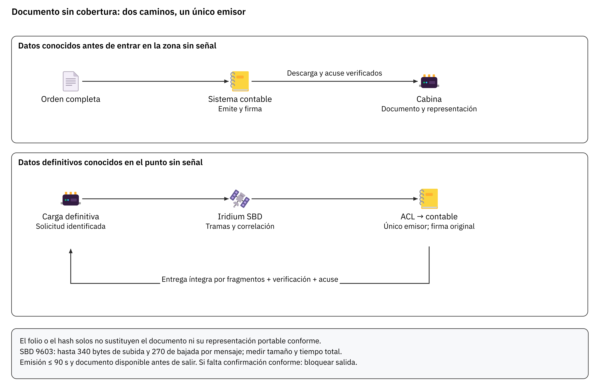

*Figura 4.7. Emisión sin cobertura, adaptada del diseño de D4 para explicitar entrega íntegra y bloqueo de salida.*

Para SBD de la familia 9603, la documentación de Iridium permite hasta 340 bytes de subida y 270 de bajada por mensaje. Es capacidad por mensaje, no tamaño garantizado de un documento completo ([Iridium, RockBLOCK 9603](https://www.iridium.com/products/rockblock-9603)). El protocolo propuesto usa solicitud correlacionada, versión, longitud, número de fragmento, integridad y reensamblado verificable. El original XML firmado se conserva en el contable y en su custodia; la cabina debe recibir todos los datos y el timbre necesarios para portar la representación válida aplicable, o el archivo de representación completo. No se exige transmitir todo el XML si no es necesario para esa representación; tampoco se acepta una representación incompleta generada desde folio/hash. El gateway satelital requiere un adaptador autorizado hacia la plataforma; no se presupone que Iridium hable directamente el protocolo de IoT Hub.

El límite total de emisión es 90 s (FEP03 · RT-09.01 · p.32). Debe medirse la solicitud, emisión, retorno fragmentado, verificación y disponibilidad portable con el documento de mayor tamaño previsto. Para tamaño comprimido B y cabecera de h bytes por mensaje, con 0 ≤h <270, la bajada requiere al menos `ceil(B / (270 − h))` mensajes; el ensayo debe incluir pérdidas, reintentos y tiempo satelital. No se supone que un timbre completo quepa en una única trama.

La contingencia de falta de cobertura descrita por el SII no autoriza a audIT a emitir desde la cabina: la Restricción 8 conserva al contable como emisor. La representación y el envío fiscal deben seguir el régimen aplicable del contribuyente ([SII, contingencia de guía electrónica](https://www.sii.cl/preguntas_frecuentes/factura_electronica/001_003_8040.htm); [Resolución Exenta 99/2019](https://www.sii.cl/normativa_legislacion/resoluciones/2019/reso99.pdf)). La factibilidad del retorno SBD completo en 90 s queda como puerta de validación previa a aceptar ese camino; si no se logra, se revisan ADR-06 y T-11 con S3/D4. La regla inmediata es bloquear la salida sin documento conforme, sin afirmar cero detenciones.

La Figura 4.8 detalla el intercambio y el cotejo previo al movimiento.

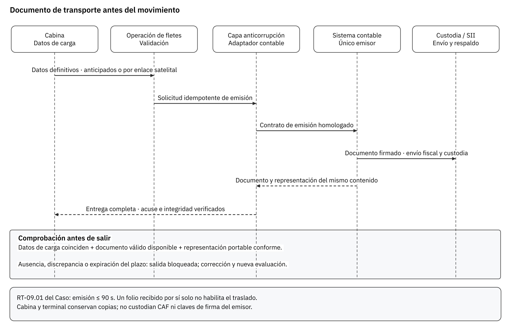

*Figura 4.8. Secuencia documental. Fuente: elaboración D3 con el lienzo de D4.*

La salida sólo se habilita con carga coincidente, documento válido y representación portable disponible. Un cambio posterior de carga exige corregir mediante el emisor y volver a evaluar; la cabina no modifica la copia firmada ni reutiliza un folio para otro viaje.

### 4.1.14 Fuentes con desfase y telemetría del vehículo

Dos integraciones no entregan datos en el momento en que ocurren y la arquitectura las trata como
tales. El consumo de combustible llega con hasta 40 días de desfase (Caso, numeral 7.3, p. 15), y los
peajes se liquidan mensualmente. Ambas se ingieren por lotes desde un depósito seguro, con validación
sintáctica y verificación de totales, y ambas quedan detrás de un adaptador, de modo que el día en que
una de esas contrapartes publique una interfaz en línea baste conectar el adaptador nuevo sin tocar el
modelo de costeo.

Ingerir el archivo no basta. Cada carga de combustible se cruza contra la posición del camión en ese
instante y cada pasada de peaje contra la traza del viaje. Ese cruce es lo que convierte un archivo de
cobros en costo imputable a un viaje, y es también lo que deja a la vista la carga que se registró en
una estación por la que el camión no pasó. Son 74.000 abastecimientos y 620.000 pasadas de peaje al año
según el Caso, numeral 14.1, p. 29, volumen que no admite revisión manual.

Un tercer frente es la posición de la flota de terceros. El Caso declara 340 de 374 camiones con
dispositivo repartidos en tres plataformas distintas (Caso, numeral 14.1, p. 29), dos de ellas con acceso
de solo consulta y una que ni siquiera permite exportar (Caso, numeral 16.1, p. 34). Unificar esa vista es
obligación de esta oferta y reemplazar esos equipos está excluido (Caso, capítulo 11, p. 24). Lo que se
entrega es la vista unificada y el estándar de homologación contra el cual clasificar cada equipo, no
un inventario de un parque que el Caso no describe.

La telemetría de fábrica de los 61 tractocamiones se lee por acoplamiento sin contacto sobre la
interfaz del vehículo, en modo de solo lectura y sujeta a la autorización de cada fabricante que exige
RT-17.06 del Caso. La ausencia de contacto eléctrico no demuestra por sí sola autorización ni disponibilidad de señales. Cada lectura requiere protocolo, PGN/parámetros, licencia de acceso y homologación del fabricante. Esa elección responde a las restricciones del Caso. La restricción 6 prohíbe que el
equipamiento a bordo afecte la garantía del vehículo o interfiera con sus sistemas de seguridad, y el
Capítulo 11 excluye intervenir la electrónica de fábrica. No cortar ni empalmar el arnés reduce la intervención, pero la conformidad de garantía y seguridad se verifica por modelo de vehículo; los 182 lectores previstos no implican 182 fuentes CAN disponibles. Los parámetros que se leen se listan en la
Tabla 4.14.

**Tabla 4.14.** Parámetros leídos de la telemetría de fábrica

| Parámetro | Para qué se usa |
|---|---|
| Consumo instantáneo y acumulado | Componente medido del costo por kilómetro de la flota propia |
| Nivel de estanque | Contraste con el abastecimiento facturado por la red de estaciones |
| Revoluciones y aceleraciones bruscas | Conducción eficiente y explicación de la dispersión de rendimiento de 19 por ciento entre camiones del mismo modelo y ruta |
| Odómetro del vehículo | Kilómetro efectivo del viaje, denominador del costo |
| Horas de funcionamiento y de ralentí | Consumo que no produce kilómetro |
| Uso de freno de servicio y freno motor | Insumo del mantenimiento por condición |

*Fuente: elaboración propia sobre el Caso, criterio 18.*

Todos son parámetros de lectura. Ninguno escribe sobre el bus del vehículo, y esa restricción es de
diseño y no de configuración.

### 4.1.15 Capa analítica y costo real por kilómetro

La segregación entre lo transaccional y lo analítico se resuelve por captura de cambios hacia un
repositorio organizado en capas sucesivas de refinamiento, desde el dato crudo hasta el modelo
dimensional que consume la gerencia. La replicación lee la bitácora del motor transaccional y no
consulta sus tablas, para evitar consultas analíticas sobre OLTP. La lectura de WAL y sus slots consumen recursos y se monitorizan; la separación se comprueba bajo carga.
Las capas del repositorio se describen en la Tabla 4.15.

**Tabla 4.15.** Capas del repositorio analítico

| Capa | Qué contiene | Qué garantiza |
|---|---|---|
| Cruda | El registro tal como llegó, replicación transaccional, posición telemática y archivos mensuales de combustible y peaje | Reproceso completo sin volver a la fuente y trazabilidad del origen de cada indicador |
| Depurada | Deduplicación, validación de coordenadas, corrección de marcas de tiempo y cruce de la telemetría con el tramo de la orden | Un mismo hecho con una sola representación |
| De negocio | Modelo dimensional con el hecho de costo por viaje y por tramo, y las dimensiones de ruta, cliente, tracto, conductor, régimen de propiedad y tiempo | Consulta de gerencia sin conocimiento del modelo transaccional |

*Fuente: elaboración propia.*

La Figura 4.9 muestra la capa analítica y la explotación del costo por kilómetro.

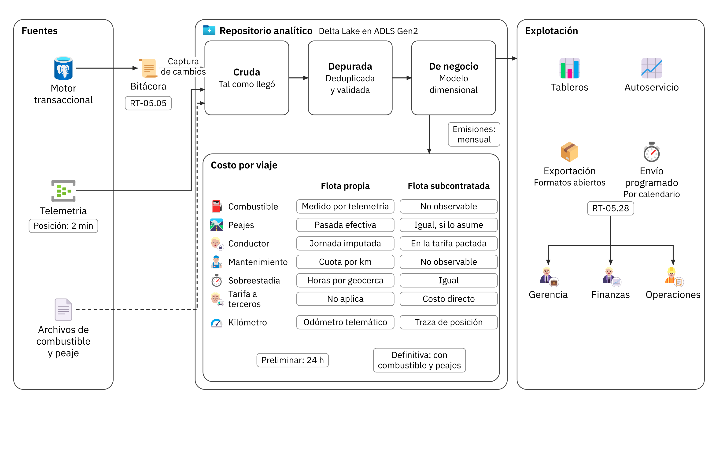

*Figura 4.9. Capa analítica por niveles de refinamiento y explotación del costo por kilómetro*

Fuente: D4, figura conservada.

El costo por kilómetro se calcula distinto según el régimen de propiedad del equipo. Para la flota
propia se compone de combustible medido por telemetría, peajes efectivamente transitados, neumáticos,
mantenimiento, jornada del conductor y depreciación. Para la flota subcontratada el mandante solo
conoce la tarifa pactada y los anticipos de combustible, de modo que el resto se imputa. Esa diferencia
hay que declararla, porque comparar flota propia con flota de terceros sin declararla es comparar cosas
distintas, y esa comparación gobierna la decisión de crecer con una u otra. La Tabla 4.16
muestra el origen de cada componente.

**Tabla 4.16.** Componentes del costo por viaje y su origen

| Componente | Flota propia | Flota subcontratada |
|---|---|---|
| Combustible | Medido por telemetría y valorizado con la liquidación mensual | No observable. La compañía solo conoce el anticipo que otorga |
| Peajes | Pasada efectiva cruzada con la traza | Igual, cuando el peaje lo asume la compañía |
| Conductor | Jornada imputada al tramo | Incluida en la tarifa pactada, no descomponible |
| Mantenimiento y neumáticos | Cuota por kilómetro sobre la orden de taller y la posición de neumático | No observable |
| Sobreestadía | Horas de espera acreditadas por geocerca | Igual |
| Tarifa a terceros | No aplica | Costo directo contractual |
| Denominador | Kilómetro del odómetro telemático | Kilómetro de la traza de posición |

*Fuente: elaboración propia.*

El mecanismo es dual y no es una elección de diseño, es lo que el propio Caso fija.
Caso, RT-05.29, p. 32 exige el costo consolidado de un viaje en no más de 24 horas tras su cierre, con los
componentes que a esa fecha estén disponibles y con indicación explícita de los que aún no lo están. Se
emite entonces una versión preliminar dentro de esas 24 horas, marcada como tal y enumerando qué falta,
y una versión definitiva cuando llegan el combustible y los peajes. La primera no se sobrescribe. Ambas
coexisten, y la desviación entre una y otra mide la calidad de la estimación. Sin ese doble paso el
costo por viaje se convierte en un cierre contable tardío, que es exactamente la condición que permitió
servir tres contratos bajo costo, el peor durante cuatro años.

El mismo RT-05.29 fija el resto de las latencias analíticas, y conviene tenerlas juntas porque
gobiernan el diseño de la capa. La Tabla 4.17 las reúne.

**Tabla 4.17.** Latencias de la capa analítica fijadas por RT-05.29 del Caso

| Dato | Latencia máxima |
|---|---|
| Posición de un camión con cobertura | 2 minutos |
| Jornada acumulada de un conductor | Tiempo real, disponible en el momento de asignar |
| Tiempo de llegada y de salida en un punto de cliente | Registrado en el momento del evento |
| Costo consolidado de un viaje | 24 horas tras su cierre, con indicación de los componentes pendientes |
| Emisiones | Consolidación mensual |

*Fuente: Caso, RT-05.29, p. 32.*

La jornada acumulada es la fila que condiciona la arquitectura. Exigirla en tiempo real en el momento
de asignar significa que no puede leerse del repositorio analítico, y por eso la evaluación utiliza estado autoritativo o una proyección cuya versión y actualidad se comprueban antes del commit. Una caché antigua no habilita al conductor.

### 4.1.16 Explotación analítica y autoservicio

RT-05.25 obliga a proveer tableros operacionales y de gestión sobre los indicadores que el Caso define.
RT-05.26 exige poder filtrar por período y por dimensión propia del caso y profundizar desde el
indicador agregado hasta la transacción de origen. Esa navegación termina en el viaje individual con su
traza, su documento de transporte y su respaldo de entrega, y no en un subtotal.

RT-05.27 obliga a que el cliente construya sus propios informes sin intervención del adjudicatario,
mediante una herramienta de autoservicio con modelo semántico documentado. El modelo semántico se
entrega validado con la gerencia de administración y finanzas, con las métricas nombradas y definidas
una sola vez, de modo que margen por ruta signifique lo mismo en todos los tableros. RT-05.28 exige que
todo informe sea exportable en formatos abiertos y programable para envío automático por calendario.

RT-05.30 valora la analítica predictiva con el modelo, sus variables, su métrica de desempeño y su plan
de reentrenamiento documentados. Es un requisito deseable y esta oferta lo aborda en el
Subdocumento 13.

### 4.1.17 Secuencia de liquidación y costeo por viaje

El proceso de consolidación de costos operacionales y liquidación formal a transportistas se representa en la Figura 4.10.

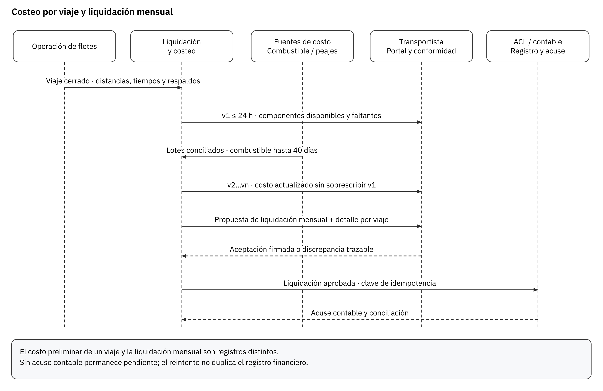

*Figura 4.10. Secuencia de estimación de costo por viaje, conciliación de insumos y liquidación ERP*

Fuente: Elaboración propia.

Como ilustra la Figura 4.10, al finalizar el viaje el contexto de Liquidación emite la versión preliminar v1 en menos de 24 horas (Caso, RT-05.29, pp. 31–32), incorporando versiones incrementales auditadas (v2 a vn) a medida que ingresan las cartolas de combustible y telepeaje TAG, hasta consolidar la liquidación mensual definitiva en el sistema contable.

### 4.1.18 Modelo táctico del dominio

RT-02.13 exige presentar el modelo de dominio del negocio con las entidades principales, sus relaciones
y los eventos de negocio que las modifican. El modelo táctico de la Figura 4.11 lo entrega
organizado por contexto delimitado, de modo que cada agregado quede bajo el contexto que lo posee.

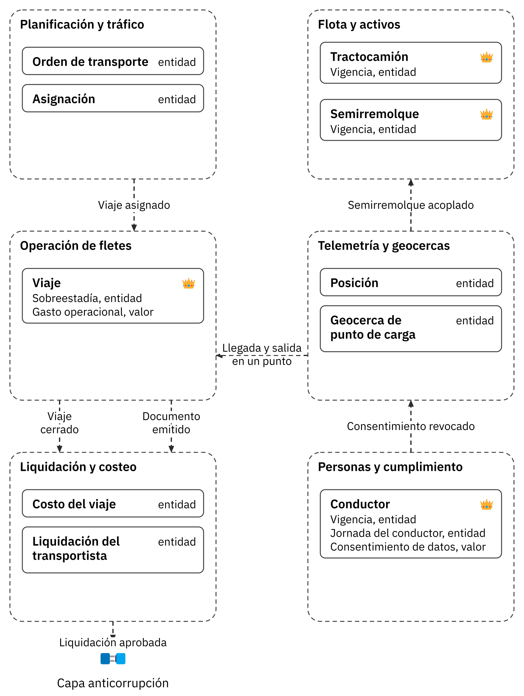

*Figura 4.11. Modelo táctico del dominio. Agregados, entidades y servicios por contexto*

Fuente: D4, figura conservada.

Cada agregado de la figura pertenece a un solo contexto delimitado.

### 4.1.19 Responsabilidad y emplazamiento de componentes lógicos

La Tabla 4.18 sintetiza responsabilidades y emplazamiento; las cantidades y configuraciones exhaustivas corresponden a T-11. Cada contexto conserva sus datos bajo un propietario y expone contratos, sin acceder a las tablas de otro (FEP01 · Artículo 16.2° · p.11).

**Tabla 4.18.** Componentes lógicos y fundamento del emplazamiento

| Componente | Responsabilidad | Emplazamiento y motivo |
|---|---|---|
| Planificación y tráfico | Orden, asignación y retornos | Servicios en AKS; requiere estado coherente de todos los recursos y plazo de 30 s |
| Flota y activos | Aptitud, semirremolque y taller | AKS; integra maestros acreditados y lectura autorizada. La captura instrumental reside a bordo |
| Personas y cumplimiento | Evidencia, jornada, habilitaciones y permisos | AKS más registro local; decide con identidad y evidencia conservadas, no con BI |
| Telemetría y geocercas | Captura, posición, llegada/salida y reconexión | Captura/evaluación de geocerca a bordo; ingesta y vista unificada en nube; funciona sin equipos en recintos del cliente |
| Operación de fletes | Viaje ocurrido, documento, conformidad y carga peligrosa | AKS más aplicación de terreno; el emisor tributario permanece externo detrás de ACL |
| Liquidación y costeo | Versiones de costo y liquidación | Servicio y repositorio analítico separado; contable recibe sólo registros aprobados y traducidos |
| PostgreSQL / TimescaleDB / Redis | Negocio, series y caché, respectivamente | Instancias separadas conforme a S5 y T-11; Redis no es autoridad única de despacho |
| IoT Hub / Event Hubs / outbox | Admisión, eventos y publicación duradera | Nube con identidad por dispositivo, cuotas, partición, reintento y deduplicación |
| Búfer, móvil y terminal | Captura sin enlace y copia documental | Equipo local y aplicación por perfil; autonomía y conflictos descritos en 4.1.26 |

La Tabla 4.18 usa los seis nombres canónicos de S3. Los objetivos de latencia son los del Caso; estimaciones de milisegundos de un componente se evalúan como hipótesis y no como prueba de cumplimiento extremo a extremo.

### 4.1.20 Concurrencia y volumen declarados

Caso, RT-09.02, p. 32 no fija un número. Ordena derivarlo de la volumetría del numeral 14.1 y declararlo
conforme al numeral 14.2, considerando de manera expresa la reconexión simultánea de unidades al salir
de zonas de sombra. La derivación de la concurrencia está en la Tabla 4.19.

**Tabla 4.19.** Concurrencia derivada de la volumetría del Caso

| Población | En hora punta | Base de la derivación |
|---|---|---|
| Personal interno con acceso a sistemas | 50 a 80 | Torre de 22 personas en turno, despacho de terminal, finanzas, facturación y taller, sobre los 336 con acceso del numeral 14.1 |
| Conductores en aplicación móvil | 100 a 150 | Accesos breves de inicio y cierre de turno sobre 454 conductores |
| Transportistas subcontratados en portal | 30 a 50 | Consulta de viajes y de liquidación sobre 148 |
| Clientes en seguimiento | 50 a 100 | Sesiones de seguimiento sobre 84 clientes activos |
| Suma aritmética de los rangos | 230 a 380 | Extremo inferior y superior de las cuatro filas |
| Concurrencia de dimensionamiento preliminar | 380 | Hipótesis de D3/D1 obtenida al sumar los extremos superiores de los cuatro rangos; no es una medición del Caso ni una concurrencia contractual. S4.2 de D4 mantiene 350 (525 en estrés), mientras D1/T-17 utiliza 380 (570); D3 y D4 deben acordar una única línea base y comunicarla a S7/S9 antes de dimensionar o declarar aceptación. |

*Fuente: elaboración propia sobre el Caso, numeral 14.1, p. 29.*

El volumen anual y los perfiles de ráfaga se distinguen en la Tabla 4.20. Son supuestos de capacidad solicitados por FEP03 · numeral 14.2 · p.30; se reemplazan por mediciones en el levantamiento.

**Tabla 4.20.** Derivación reproducible de la carga de datos

| Magnitud | Fórmula y resultado | Alcance del supuesto |
|---|---|---|
| Horas anuales en marcha | 41.000.000 km / 55 km/h = 745.455 h | Velocidad comercial de diseño; el kilometraje es dato de FEP03 14.1 |
| Posición en marcha | 745.455 h × 120 muestras/h ≈ 89,45 millones | Cada 30 s; escenario de vista completa futura de 374 unidades, no acceso actual garantizado |
| Posición detenida | (374 × 8.760 − 745.455) h × 12 muestras/h ≈ 30,37 millones | Cada 5 min; año de 365 días y unidades dentro del alcance autorizado |
| Posición total y bytes crudos | 119,82 millones × 64 bytes ≈ 7,67 GB/año | Registro binario supuesto; JSON, índices, transporte y réplicas se miden aparte |
| Motor, escenario inicial de 61 unidades | (745.455 × 61 / 374) h × 60 × 160 bytes ≈ 1,17 GB/año | Reparto proporcional de marcha; autorización y señales reales por fabricante. No se asume CAN activo en toda la flota |
| Capacidad normal máxima de admisión | 374/30 + 182/60 ≈ 15,5 eventos/s, más eventos de negocio | Escenario simultáneo de diseño; no TPS de despacho ni cantidad de fuentes acreditadas |
| Asignación en punta | 22 puestos × 1 asignación/30 s ≈ 0,73 TPS; ráfaga propuesta 10× ≈ 7,33 TPS | Hipótesis de carga; no se deriva dividiendo viajes anuales por usuarios |
| Reconexión de 300 unidades, perfil 72 h de S4/T-17 | 1.786.200 registros y 971.296.800 bytes con fotos; ≥1.861 registros/s en 960 s útiles | 20 min menos 20 % de reserva; ancho útil con overhead/reserva ≈10,12 Mbit/s; prueba CP-PERF-02 |
| Retención de series en línea | 2 años; posición cruda ≈15,34 GB y motor inicial ≈2,34 GB | Dimensionar además índices, WAL, réplicas, fotos, documentos y crecimiento. Factor físico provisional 3×, sujeto a medición |

La Tabla 4.20 no equivale al tamaño de toda la base de datos: incluye supuestos de muestreo, población y tamaño de registro. Los volúmenes transaccionales e históricos se estiman en el anexo de S5. El perfil por camión de 72 h y la reserva de búfer propuesta de 288 h se conservan separados del volumen anual. El cierre vial de doce días no se equipara automáticamente a doce días sin enlace.

FEP03 · RT-05.10 · p.31 exige dos años en línea para posición/telemetría, con agregación declarada para el resto. La carga de crecimiento a tres veces la volumetría inicial se prueba según RT-09.03 transversal, además de estrés a 570 sesiones y ráfaga de 300 reconexiones; son ensayos distintos.

### 4.1.21 Modelado de amenazas de la arquitectura

Para la baliza Bluetooth asociada al semirremolque considerada en la innovación, se modelan a nivel de
diseño las amenazas STRIDE de la Tabla 4.21. Este análisis responde a FEP02, RT-26.07, p. 44; define
controles propuestos y no constituye evidencia de pruebas de seguridad ejecutadas. Si cambia el
protocolo o el alcance de la baliza, el modelo debe actualizarse antes de su aprobación.

**Tabla 4.21.** Amenazas y controles de diseño para la baliza y su integración

| Categoría STRIDE | Amenaza considerada | Control de diseño y efecto esperado |
|---|---|---|
| Suplantación | Baliza desconocida o asociada a otro semirremolque/viaje | Vincular el identificador registrado con el activo y el viaje vigente; marcar eventos desconocidos o fuera de contexto y excluirlos de la evidencia habilitante |
| Manipulación | Evento alterado, repetido o fuera de secuencia | Validar esquema y vigencia temporal, conservar procedencia, aplicar deduplicación e idempotencia; comprobar secuencia solo si el protocolo entrega ese dato |
| Repudio | Disputa sobre el origen o tratamiento del evento | Registrar identificador de fuente, hora de recepción, correlación con viaje y acciones posteriores; enlazar las rectificaciones al registro original. La señal de baliza por sí sola no acredita jornada ni descanso legal |
| Divulgación de información | Exposición de ubicación o asociación entre conductor y semirremolque | Limitar la consulta a roles autorizados y al viaje/cliente habilitado; minimizar los datos expuestos y proteger su transmisión y almacenamiento en la plataforma |
| Denegación de servicio | Pérdida, retraso o ráfaga de eventos de baliza | Controlar tasa y vigencia, señalar explícitamente la ausencia o antigüedad de la última señal y degradar la vista sin inventar posiciones ni bloquear otras fuentes disponibles |
| Elevación de privilegios | Evento de baliza usado para alterar despacho o controlar el vehículo | Mantener la ingesta como entrada de solo lectura; no otorgar a la baliza facultad de actuar sobre CAN ni de cambiar por sí sola estados del viaje o decisiones de despacho |

La Tabla 4.21 acota la baliza como fuente auxiliar: la operación conserva la procedencia del evento y la evaluación independiente de las reglas de despacho y jornada.

### 4.1.22 Estilo, principios de diseño y contratos de dominio

El estilo combina servicios independientes, transacciones locales y eventos. Un monolito modular ofrece menor costo de operación, pero no satisface el despliegue independiente exigido para los componentes críticos; una cadena síncrona de servicios multiplica tiempos de espera; SOA con orquestación central concentra fallas. Los seis contextos con API para decisiones inmediatas y eventos para efectos derivados separan la carga de ~15,5 eventos/s normal de la ráfaga de reconexión de ~1.861 registros/s, sin deducir el estilo únicamente del volumen anual.

Se aplica SOLID de forma verificable: cada servicio mantiene una responsabilidad de contexto (SRP); nuevos proveedores se incorporan mediante adaptadores del mismo contrato (OCP); todo adaptador debe superar las pruebas comunes de ese contrato (LSP); las interfaces de jornada, permisos y liquidación se segregan según su consumidor (ISP); el dominio depende de puertos de repositorio/mensajería y no del SDK cloud (DIP). Se documentan vistas y preocupaciones bajo ISO/IEC/IEEE 42010 y gobierno arquitectónico equivalente a TOGAF mediante ADR, Comité de Arquitectura y revisión mensual (FEP01 · Artículo 4.3° · p.5).

La Tabla 4.22 completa la Figura 4.11 con comandos y eventos. Los nombres de contratos se proponen para implementación; cada evento lleva ID, agregado, versión, secuencia y correlación, con esquemas AsyncAPI y política de compatibilidad.

**Tabla 4.22.** Responsabilidad, comandos y eventos por contexto

| Contexto | Comando principal | Evento derivado y consumidor |
|---|---|---|
| Planificación y tráfico | AsignarRecursos / ReprogramarViaje | ViajeAsignado → Operación, Telemetría; rechazo conservado en auditoría |
| Flota y activos | AcreditarVigencia / RegistrarIntervencion | AptitudEquipoActualizada → Planificación; invalida proyección afectada |
| Personas y cumplimiento | EvaluarAsignacion / RevocarPermiso | JornadaActualizada y PermisoRevocado → Planificación y canales autorizados |
| Telemetría y geocercas | IngerirLote / EvaluarGeocerca | LlegadaRegistrada / SalidaRegistrada → Operación; posición autorizada al portal |
| Operación de fletes | SolicitarDocumento / CerrarViaje | DocumentoDisponible / ViajeCerrado → Planificación y Liquidación |
| Liquidación y costeo | CalcularCosto / AprobarLiquidacion | CostoVersionado / LiquidacionAprobada → portal y ACL contable |

La Tabla 4.22 no requiere una transacción distribuida entre seis bases. Planificación valida versiones y reservas en su transacción; los contextos conservan sus agregados y publican efectos desde outbox. Cambios invalidantes concurrentes fuerzan una nueva evaluación antes de confirmar.

### 4.1.23 Trazabilidad del alcance de Informe 2

El T-12 vigente mantiene los 28 RF y 14 RNF, sus paquetes EDT y casos CP asociados. Los contratos de S4.1 se corresponden con ese catálogo. Los componentes se ubican en la Tabla 4.18 y la Figura 4.1. RF-001 atraviesa Planificación, Personas y Flota; RF-013/RF-014 terminan en ACL y contable; RNF-008 atraviesa borde, ingesta y persistencia. Esta relación permite comprobar cobertura del alcance sin convertir el cuerpo en inventario de formularios.

### 4.1.24 Seguridad lógica y superficie de exposición

El acceso público termina en Front Door/WAF y API Management; bases, bus, secretos y servicios internos permanecen en red privada conforme a RT-03.04. El seguimiento sin autenticación muestra sólo el estado del envío mediante número de documento, sin posición personal ni historial del transportista (FEP03 · RT-16.30 · p.33). Los portales autenticados evalúan rol, transportista, recurso, cliente, viaje activo, finalidad y permiso vigente en cada petición.

Entra ID autentica personas y los equipos usan identidad/certificado individual revocable. El conductor se identifica estando detenido, mediante tarjeta/token asignado y vinculación a persona y viaje; la validación con guantes y rotación de conductores pertenece a S9, sin exigir una contraseña recordada ni interacción en marcha (RT-12.11/RT-13.08 del Caso). Identidades administradas acceden a Key Vault; claves y secretos no aparecen en código ni URI. Se cifra el transporte y los campos exigidos por RT-11.10, con separación de claves y roles. Los accesos sensibles se registran con qué se mostró y autorización utilizada, conforme a RT-16.09 del Caso.

Se verifican, como mínimo, suplantación de dispositivo y baliza, alteración/repetición de eventos, repudio de firma, consulta entre transportistas, saturación de reconexiones y elevación a administración. La Tabla 4.21 cubre STRIDE de la baliza; las pruebas del resto se trazan a S9/T-17. Ni el hash ni el cifrado por sí solos acreditan cumplimiento legal o seguridad integral.

### 4.1.25 Ambientes y liberación

DEV usa datos sintéticos; QA contiene escenarios y simuladores reproducibles; PREPROD reproduce integraciones y configuración sin accesos de producción; PROD contiene los datos autorizados y cambios aprobados; DR replica los componentes críticos bajo el mecanismo jurídico y de continuidad de S5/S4.3. Cada ambiente tiene identidades, secretos, redes, almacenes y permisos separados. La configuración se versiona como código y se promueve el mismo artefacto firmado según S6.

La aceptación incluye pruebas de contratos, carga, reconexión, evidencia, permisos y reversión. Activar Brazil South con datos personales exige un mecanismo de transferencia documentado; deshabilitar esa réplica sin otro sitio secundario operativo tampoco acredita RPO ≤15 min/RTO ≤4 h. La revisión jurídica y la conmutación probada son puertas conjuntas de producción.

### 4.1.26 Operación desconectada, reconexión y escalamiento

A bordo se conservan posición, eventos de jornada, llegada/salida y documentos durante al menos 72 h. En terminal se adopta el mayor mínimo: 24 h del RT-03.10 transversal frente a 12 h del Caso. La captura local emplea SQLite/WAL y outbox; la aplicación comparte identidad y catálogos vigentes con el nodo autorizado. La operación local no inventa vigencias, permisos ni asignaciones globales. Toda nueva asignación requiere acceso al servicio autoritativo de reserva. RN-04 sólo excepciona una fuente de evidencia indisponible bajo sus controles; no sustituye la reserva, la legalidad ni el documento conforme necesario para el movimiento.

La Figura 4.12 muestra la reconexión: autenticación, lotes numerados, admisión, deduplicación, commit y acuse duradero. Sólo el último acuse permite depurar el búfer. La conciliación conserva el original y la resolución de conflictos; el timestamp de recepción no reemplaza la hora del evento.

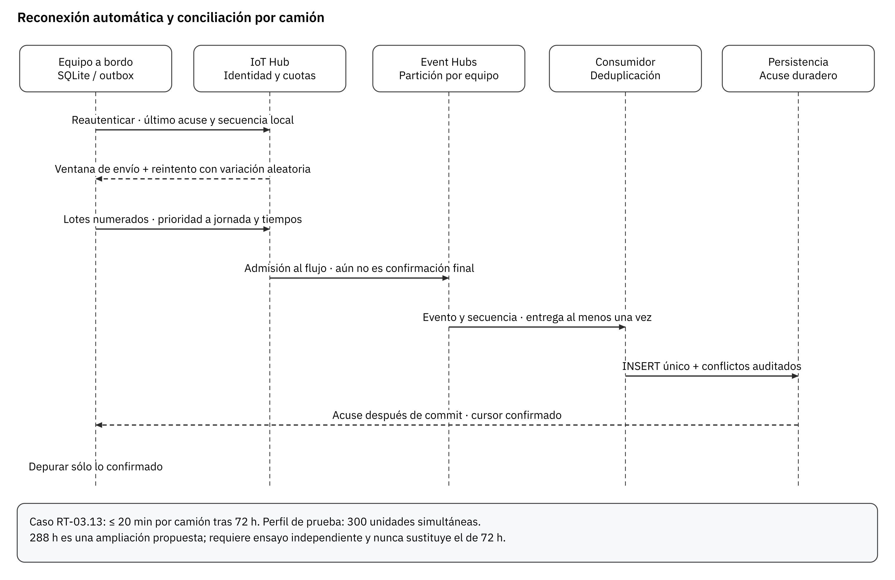

*Figura 4.12. Reconexión. Fuente: elaboración D3 con el lienzo de D4.*

CP-PERF-02 debe demostrar ≤20 min para cada camión después de 72 h, con 300 unidades simultáneas y sin pérdida de jornada ni tiempos de cliente. La admisión por IoT Hub no demuestra entrega final. Las 288 h propuestas y la capacidad de búfer de S4.2 requieren otro ensayo; no sustituyen esta prueba contractual.

El escalamiento propuesto usa mínimo dos réplicas por contexto, aumento al superar CPU 65 % o retraso de consumo 30 s durante dos minutos, con reducción sólo tras diez minutos estables. Máximo inicial: ocho réplicas de ingesta y cuatro por servicio de negocio, sujeto al perfil y cuotas de S4.2/T-11. Los mamparos reservan recursos para despacho, documento y emergencia. Al alcanzar el máximo se alerta a operación y se limita carga no crítica; no se incrementa capacidad ni costo sin registro. El impacto económico de esos límites corresponde al Sobre 3. S9 mide latencia completa, saturación, costo de recursos y recuperación antes de aceptar el perfil.

## Referencias

Microsoft. (s.f.). *Políticas de soporte de .NET y documentación de Azure PostgreSQL, Event Hubs y Managed Redis*. Enlaces primarios junto a la Tabla 4.1; consulta 11-10-2026.

PostgreSQL Global Development Group. (s.f.). *Versioning policy*. https://www.postgresql.org/support/versioning/

The Go Authors. (s.f.). *Release history and release policy*. https://go.dev/doc/devel/release

Iridium. (s.f.). *RockBLOCK 9603: tamaños de mensaje*. https://www.iridium.com/products/rockblock-9603

Servicio de Impuestos Internos. (2019). *Resolución Exenta N.º 99*. https://www.sii.cl/normativa_legislacion/resoluciones/2019/reso99.pdf

## Declaración de uso de IA

Se conserva el diseño previo y se declaran los cambios asistidos del 11-10-2026. La revisión humana de ingeniería permanece pendiente; no se atribuyen ensayos ni conformidad humana al asistente (Comunicado 10, secciones 7.1–7.2).

| Sección | Herramienta | Finalidad | Nivel en texto | Nivel en diagramas | Revisión humana |
|---|---|---|---|---|---|
| 4, 4.1 y 4.1.1–4.1.26 | OpenAI Codex (GPT-6), sobre fuentes previas del repositorio | Contraste con bases/S3/S5/S6/S7/S9; corrección de contratos, decisiones y capacidad | Alto | Alto en figuras regeneradas; incluye figuras D4 conservadas o adaptadas | Pendiente: D3 debe revisar decisiones y supuestos; D1/D2/D4 concilian interfaces antes de entrega |
| Formulario T-11 | Sin intervención en esta revisión; responsabilidad de D4 | Consultado para concordancia de productos y cantidades | Ninguno | Ninguno | Declaración propia del formulario y validación de D4 |
