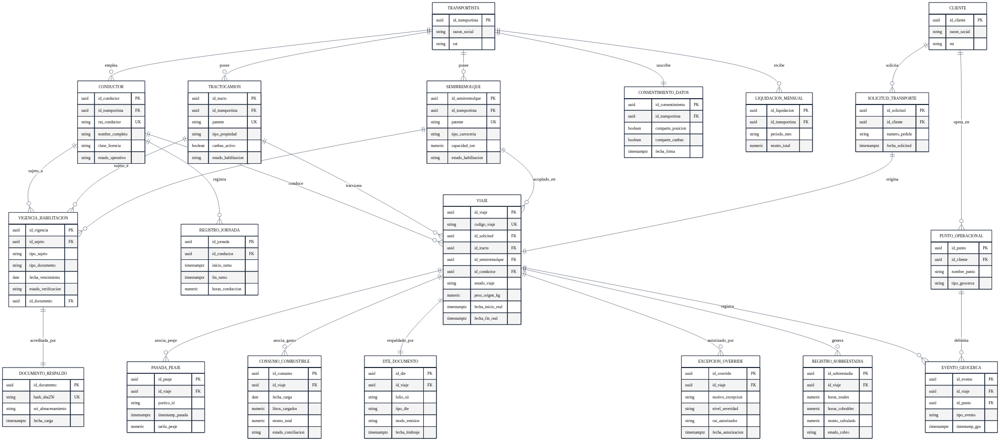
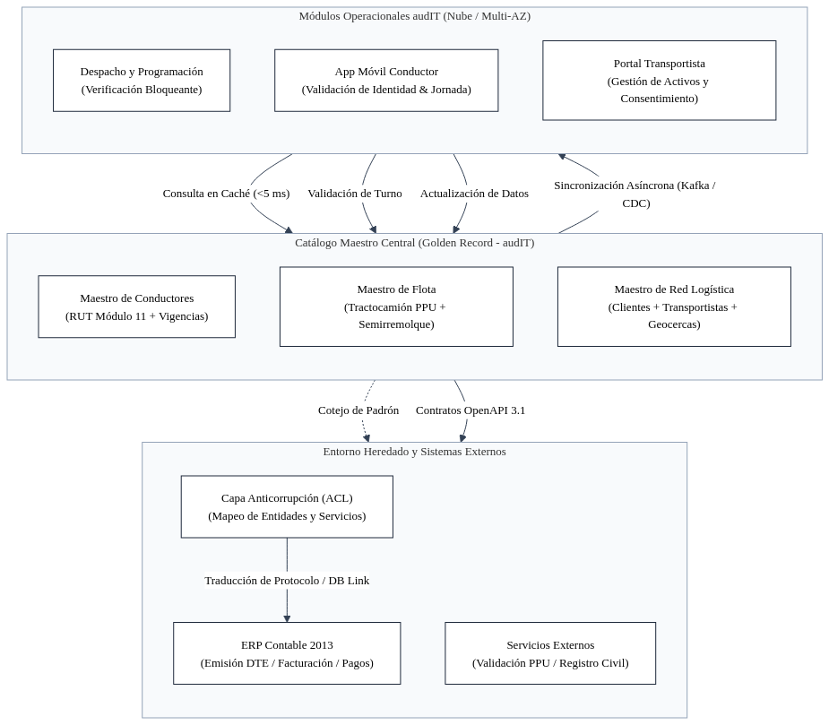
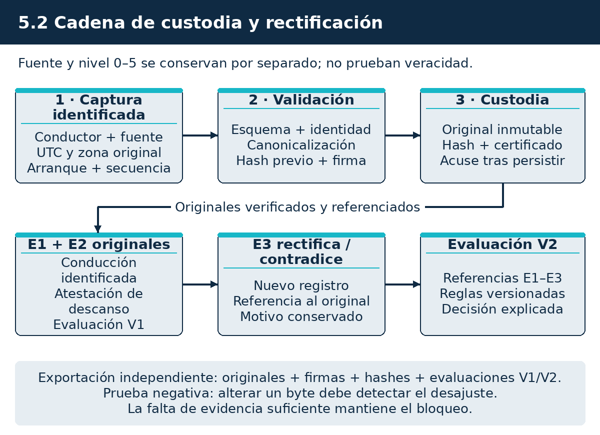
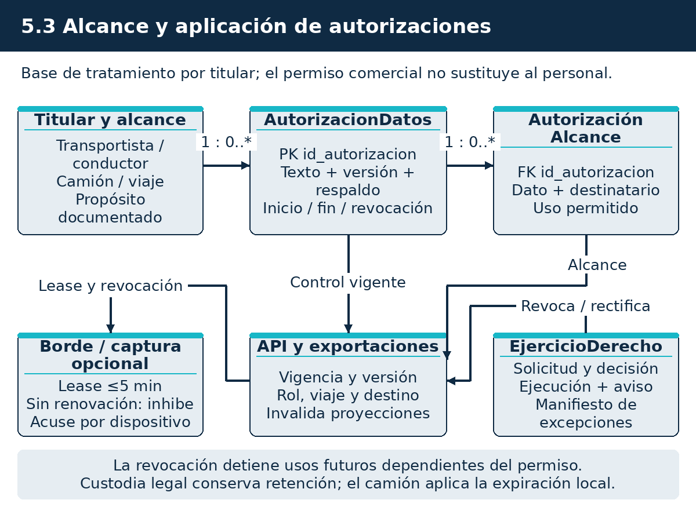
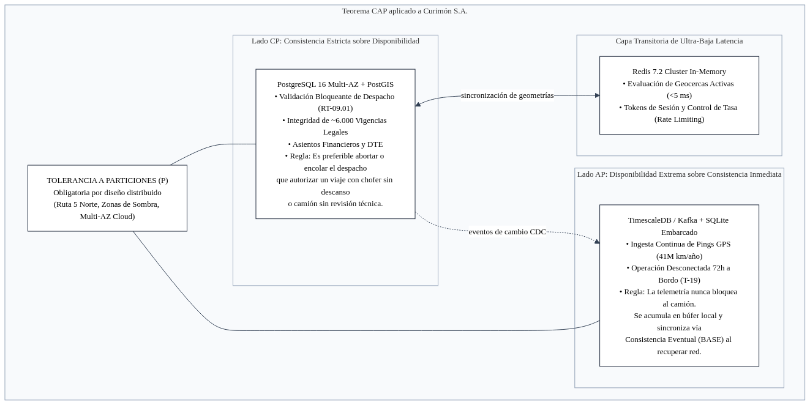
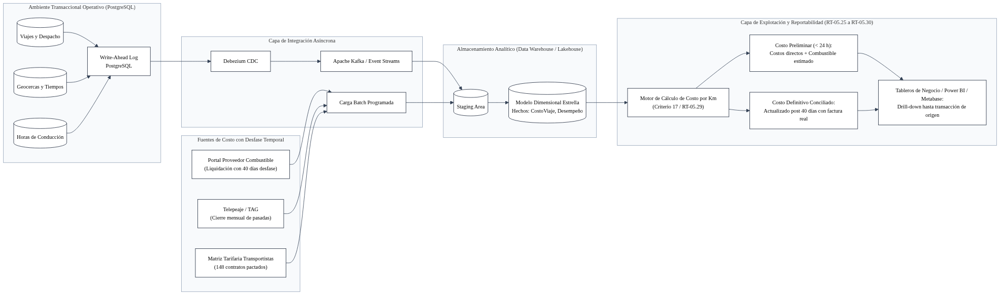
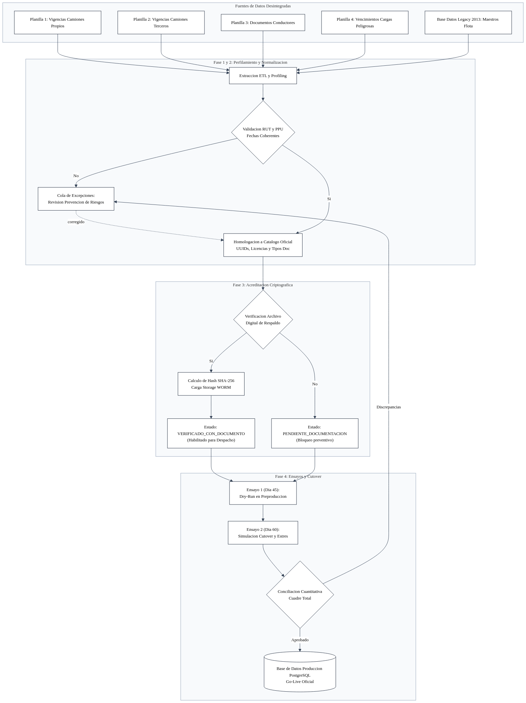
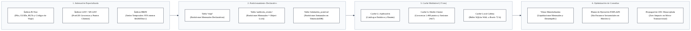

# Subdocumento 5. Modelo y gestión de datos

audIT, Empresa N.º 10. Licitación TFEP-01/2026, Caso 10 Transporte de Carga. Oferta Técnica, Sobre N.º 2. Informe Preparatorio 2. Archivo AUDIT-Subdocumento5.pdf.

## Resolución de observaciones del Informe 1

El FEP01, Artículo 46, p. 28 pide resolver en cada informe las observaciones de la instancia anterior, con trazabilidad entre observación, respuesta y sección modificada. La tabla reúne las observaciones del Informe 1 que corresponden a este documento y la sección donde se resuelve cada una.

**Resolución de las observaciones del Informe 1, conforme a FEP01, Artículo 46, p. 28**

| N.º | Observación | Respuesta | Sección modificada |
|---|---|---|---|
| 13 | El Subdocumento 5 abre con la bitácora interna del grupo de trabajo. | Se acepta. Se acoge la observación. La respuesta de trabajo propone la siguiente medida, cuya implementación no se acredita en este lote: «Se elimina por completo la sección de bitácora interna; el documento inicia con el marco conceptual, alcance y gobierno del modelo de datos de la empresa.». Su cierre requiere examen de la fuente y de la evidencia correspondiente; no se declara realizada esa revisión para capítulos ajenos al lote S1/S2/S9 y al cálculo de S4. | Sección 5.1. |
| 81 | El diccionario cubre 6 entidades y ninguna es la evidencia de jornada, exigida para resistir impugnaciones. | Se acepta. Se acoge la observación. La respuesta de trabajo propone la siguiente medida, cuya implementación no se acredita en este lote: «Se modela exhaustivamente la entidad `EvidenciaJornada` con cascada probatoria, estampilla de tiempo inmutable, coordenadas y firma digital SHA-256 para resistir impugnaciones en sede laboral.». Su cierre requiere examen de la fuente y de la evidencia correspondiente; no se declara realizada esa revisión para capítulos ajenos al lote S1/S2/S9 y al cálculo de S4. | Sección 5.7. |
| 82 | No hay diagrama Entidad-Relación (DER) en el documento. | Se acepta. Se acoge la observación. La respuesta de trabajo propone la siguiente medida, cuya implementación no se acredita en este lote: «Se incorpora el Diagrama Entidad-Relación completo en notación cuervo (*Crow's Foot*), cubriendo la totalidad de entidades transaccionales, telemáticas y de auditoría.». Su cierre requiere examen de la fuente y de la evidencia correspondiente; no se declara realizada esa revisión para capítulos ajenos al lote S1/S2/S9 y al cálculo de S4. | Sección 5.7 (Figura 5.1). |
| 83 | Contradicción de residencia: copia fuera de sitio en Azure East US 2 mientras S4 sostiene residencia en Chile. | Se acepta. Se propone Chile Central como región primaria y Brazil South como región secundaria, sujeto a la arquitectura de S4.2.5. La región extranjera no se considera por sí sola base jurídica para transferir datos personales: antes de activar la réplica, el responsable debe identificar las partes y documentar un mecanismo aplicable del artículo 27 y las condiciones y salvaguardias del artículo 28 de la Ley N.º 21.719. Si no se acredita una base aplicable, la réplica de datos personales queda deshabilitada. La decisión y su entrada en operación requieren validación jurídica. | S5 §5.1.6 y S4 §4.2.5. |
| 84 | El motor de bases de datos de series de tiempo y el bus de mensajería quedan indefinidos. | Se acepta. Se acoge la observación. La respuesta de trabajo propone la siguiente medida, cuya implementación no se acredita en este lote: «Se decide y formaliza TimescaleDB sobre PostgreSQL para series temporales telemáticas y Apache Kafka como bus distribuido de mensajería de eventos.». Su cierre requiere examen de la fuente y de la evidencia correspondiente; no se declara realizada esa revisión para capítulos ajenos al lote S1/S2/S9 y al cálculo de S4. | Sección 5.5. |
| 85 | La sección 1.1 es la bitácora interna del grupo de trabajo. | Se acepta. Se acoge la observación. La respuesta de trabajo propone la siguiente medida, cuya implementación no se acredita en este lote: «Se elimina íntegramente la bitácora interna, abriendo el documento con la descripción conceptual del gobierno y ciclo de vida de los datos corporativos.». Su cierre requiere examen de la fuente y de la evidencia correspondiente; no se declara realizada esa revisión para capítulos ajenos al lote S1/S2/S9 y al cálculo de S4. | Sección 5.1. |
| 86 | Prosa hinchada y escasez de figuras (dos figuras en 21 páginas), no citadas desde el texto. | Se acepta. Se acoge la observación. La respuesta de trabajo propone la siguiente medida, cuya implementación no se acredita en este lote: «Se reescribe el texto en tono técnico riguroso y se incorporan diagramas de arquitectura de datos (DER, flujo de eventos) debidamente citados e interpretados analíticamente.». Su cierre requiere examen de la fuente y de la evidencia correspondiente; no se declara realizada esa revisión para capítulos ajenos al lote S1/S2/S9 y al cálculo de S4. | Subdocumento 5 completo. |
| 87 | El tratamiento de revocación del consentimiento frente a la retención legal queda pendiente de validar. | Se acepta. El ensayo de revocación cesa accesos comprendidos por el permiso y conserva evidencia con obligación de retención. Se comprueban plazos por dominio y correcciones trazables, sin eliminación automática de jornada por una revocación. Esta comprobación de diseño en S9 no acredita revisión completa del modelo de S5. | T-17 CP-SEC-05/CP-SEC-08/CP-INT-25; cotejo del modelo S5. |

## 5 Modelo y gestión de datos

> **Resumen de apertura.**
>
> audIT Soluciones Tecnológicas SpA presenta el modelo y gestión integral de datos para Transportes Curimón S.A., estructurado bajo el paradigma de Diseño Guiado por el Dominio (DDD), persistencia políglota y un gobierno de datos maestros (MDM) con principio de Registro Maestro Único. La solución erradica la saturación transaccional desacoplando la ingesta de telemetría de **41.000.000 km/año**, asegura la evaluación bloqueante del despacho en menos de 2 segundos (Caso, RT-09.01, p. 32), sanea **6.000** fechas de vigencia históricas mediante verificación documental individual con hash criptográfico, y garantiza estricto cumplimiento de la Ley 21.719 mediante cifrado a nivel de campo (Caso, RT-11.10, p. 32).
>
> **Qué recibe Transportes Curimón S.A.**
> - Modelo de dominio DDD con agregados tácticos y disociación estricta entre tractocamión y semirremolque.
> - Gobierno de datos maestros (MDM) y catálogo con linaje automatizado bajo la norma ISO/IEC 25012.
> - Persistencia políglota clasificada bajo el Teorema CAP con segregación estricta OLTP versus Lakehouse analítico.
> - Plan de migración histórica en cuatro fases con acreditación documental individual y conciliación matemática al peso.

## 5.1 Modelo

El modelo de datos de audIT para Transportes Curimón S.A. define formalmente los dominios de información, límites transaccionales y entidades del negocio logístico. La estructura resuelve integralmente las patologías del software legado de 2013, reemplazando un esquema relacional plano por un modelo guiado por el dominio (DDD) que garantiza coherencia en tiempo real.

### 5.1.1 Identificación y Descripción de Entidades del Modelo de Datos

El modelo de datos organiza las exigencias operacionales y regulatorias del transporte de carga mediante cuatro decisiones: (i) encapsular invariantes de negocio en agregados tácticos, (ii) desacoplar la telemetría de las tablas transaccionales, (iii) distinguir tractocamión y semirremolque conforme al D.S. N.º 298 (Ministerio de Transportes, 1995), y (iv) consolidar los datos maestros bajo el principio de Registro Maestro Único (FEP02, RT-05.09, p. 9). La Tabla 5.1 resume el modelo.

**Tabla 5.1.** Arquitectura y capacidades del modelo de datos audIT

| **Dimensión** | **Línea Base Heredada** | **Diseño Canónico audIT** | **Impacto Operacional en Curimón** |
|---|---|---|---|
| Paradigma de modelado | Esquema relacional sin agregados | Domain-Driven Design (DDD) con agregados e invariantes (FEP02, RT-02.13, p. 8) | Validación en memoria, respuesta de despacho en $\le 2$ s |
| Ingesta telemática | Inserción síncrona en tablas OLTP | Arquitectura Fast-Data desacoplada (TimescaleDB / Azure Event Hubs) y buffer offline | Aísla pings GPS del motor central, resiste sombras > 80 km |
| Gobernanza de activos | Entidad única genérica CAMION | Disociación estricta TRACTOCAMION y SEMIRREMOLQUE | Controla vencimientos cruzados y compatibilidad química (DS 298) |
| Datos maestros (MDM) | Entidades dispersas en planillas | MDM de Registro Único (*Golden Record*) con Capa Anticorrupción | Elimina duplicidad en 454 choferes, 374 camiones y 84 clientes |
| Estrategia desempeño | Índices básicos sin partición | Particionamiento mensual, índices GiST/BRIN y caché L2 Redis | Geocercas en < 5 ms e indexación compacta con árboles BRIN |
| Saneamiento vigencias | Carga masiva sin contraste | Verificación documental individual con hash SHA-256 en WORM | Sanea 4 planillas (≈ 6.000 fechas) y erradica multas |
| Seguridad y datos | Cifrado de disco genérico | Cifrado a nivel de campo (FLE AES-256-GCM) y anonimización en QA | Cumplimiento irrestricto de Ley 21.719 en 258 choferes externos |
| Retención legal | Plazos genéricos sin norma | Matriz ajustada a Capítulo 15 del Caso (10a, 6a, 5a, vigencia+5a, 2a) | Certeza probatoria laboral, tributaria (SII) y sobreestadías |

La Tabla 5.1 muestra las decisiones principales; su desempeño y los controles regulatorios asociados requieren la verificación descrita en S9.

### 5.1.2 Dominios de información y modelo conceptual

La arquitectura de datos se estructura en seis contextos delimitados con límites explícitos. En la Figura 5.1 se despliega el modelo conceptual y relacional de persistencia de datos.

*Figura 5.1. Modelo conceptual y relacional de persistencia de datos*

Fuente: Elaboración propia.

Los seis agregados raíz gobiernan las reglas de negocio de la operación:
- **Agregado Viaje (Core Domain):** Orquesta la máquina de estados determinista de seis estados operacionales: el ciclo estándar `PROGRAMADO` $\to$ `EN_CARGA` $\to$ `EN_RUTA` $\to$ `EN_DESCARGA` $\to$ `CERRADO`, y la transición de excepción terminal `CANCELADO_RECHAZADO` (activada ante anomalías documentales insalvables, revocación del transportista o rechazo de carga en destino). Ejecuta el método bloqueante `asignarRecursos()` validando en memoria: aptitud técnica del tracto, compatibilidad de rampla (DS 298) y descanso legal del conductor (Art. 25 bis). Cuenta con el método `suspenderPorTramiteAduanero()` para congelar sobreestadías durante cierres de Los Libertadores (Caso, RT-10.05, p. 32).
- **Agregado Tractocamion:** Custodia vigencias técnicas del vehículo motor (revisión técnica, SOAP, permiso de circulación) y administra el estado de telemetría CANbus/FMS (SAE J1939 activo en 61 unidades propias).
- **Agregado Semirremolque:** Modela los 210 equipos de arrastre propios y los de terceros, implementando la regla `cumpleNormaEstanqueDS298()` para asegurar que ninguna carga química o combustible sea despachada en carrocerías sin prueba de estanqueidad vigente.
- **Agregado Conductor:** Gobierna el control estricto de jornada bajo el Art. 25 bis (máximo 5 horas continuas de conducción y 2 horas de descanso mínimo) y custodia el consentimiento bajo la Ley 21.719 (Ministerio de Hacienda, 2024).
- **Agregado Transportista:** Modela la relación comercial con los 148 transportistas externos, contratos marco, tarifas pactadas y reglas de liquidación mensual.
- **Agregado OrdenTransporte:** Representa las órdenes de los 84 clientes, tarifas acordadas, geocercas de origen/destino y especificaciones de carga peligrosa.

### 5.1.3 Estrategia de Gestión de Datos Maestros (MDM)

En cumplimiento de FEP02, RT-05.09, p. 9, se implementa un marco centralizado de Master Data Management (MDM) con principio de Registro Maestro Único (*Golden Record*), visualizado en la Figura 5.2.

*Figura 5.2. Gestión de Datos Maestros (MDM) y Capa Anticorrupción*

Fuente: Elaboración propia.

La plataforma audIT es la fuente exclusiva de verdad para Conductores, Habilitaciones y Flota, mientras que el ERP de 2013 retiene la tuición de razones sociales y datos bancarios de transportistas y clientes. La normalización se rige por claves naturales estrictas: RUT chileno validado por Módulo 11 para personas y Placa Patente Única (PPU) del Registro Civil para vehículos.

### 5.1.4 Diccionario de datos de las entidades centrales

A continuación se formalizan los esquemas de atributos de las entidades centrales del modelo. Las Tablas 5.2 a 5.5 describen conductor, activos vehiculares, vigencias y custodia probatoria; las Tablas 5.8 y 5.9 describen consentimiento y viaje.

**Tabla 5.2.** Entidad CONDUCTOR (196 propios y 258 externos)

| **Atributo** | **Tipo de Dato** | **Dominio / Formato** | **Req.** | **Sensibilidad y Tratamiento** |
|---|---|---|---|---|
| id_conductor | UUIDv4 | Identificador global | Sí | Operacional. Clave primaria B-Tree |
| id_transportista | UUIDv4 | FK hacia TRANSPORTISTA | No | Operacional. Nulo si es conductor propio Curimón |
| rut_conductor | VARCHAR(12) | Formato nacional con DV | Sí | **Personal**. Cifrado FLE (AES-256-GCM) |
| nombre_completo | VARCHAR(120) | Texto alfabético | Sí | **Personal**. Cifrado FLE (AES-256-GCM) |
| clase_licencia | VARCHAR(5) | 'A5', 'A4', 'A2' | Sí | Operacional. Validación de aptitud técnica |
| estado_operativo | ENUM | 'HABILITADO', 'BLOQUEADO' | Sí | Operacional. Control bloqueo despacho (Caso, RT-09.01, p. 32) |

La entidad Conductor asegura la protección de datos personales de los 258 choferes externos bajo la Ley 21.719 mediante cifrado criptográfico de campo.

**Tabla 5.3.** Entidades TRACTOCAMION y SEMIRREMOLQUE (374 tractos y 210 ramplas)

| **Atributo** | **Tipo de Dato** | **Dominio / Formato** | **Req.** | **Sensibilidad y Tratamiento** |
|---|---|---|---|---|
| id_tracto | UUIDv4 | Identificador global | Sí | Operacional. Clave primaria |
| patente | VARCHAR(8) | Formato PPU nacional | Sí | Operacional. Índice B-Tree único |
| tipo_propiedad | ENUM | 'PROPIO', 'TERCERO' | Sí | Operacional. Filtro de auditoría y liquidación |
| canbus_activo | BOOLEAN | TRUE, FALSE | Sí | Operacional. TRUE en 61 unidades iniciales |
| id_semirremolque | UUIDv4 | Identificador global | Sí | Operacional. Clave primaria |
| tipo_carroceria | ENUM | 'RAMPLA', 'ESTANQUE', 'TOLVA' | Sí | Operacional. Compatibilidad química DS 298 |
| capacidad_ton | NUMERIC(5,2) | 1.00 a 45.00 ton | Sí | Operacional. Restricción física de carga |

La segregación entre unidad tractora y equipo de arrastre de la Tabla 5.3 permite verificar combinaciones seguras en el transporte de cargas peligrosas.

**Tabla 5.4.** Entidad VIGENCIA_HABILITACION (Núcleo de las ≈ 6.000 fechas vivas)

| **Atributo** | **Tipo de Dato** | **Dominio / Formato** | **Req.** | **Sensibilidad y Tratamiento** |
|---|---|---|---|---|
| id_vigencia | UUIDv4 | Identificador global | Sí | Operacional. Clave primaria |
| id_sujeto | UUIDv4 | FK polimórfica (Tracto/Rampla/Chofer) | Sí | Operacional. Índice compuesto con tipo |
| tipo_sujeto | ENUM | 'TRACTO', 'RAMPLA', 'CONDUCTOR' | Sí | Operacional. Discriminador de activo |
| tipo_documento | ENUM | Catálogo oficial de 12 tipos | Sí | Operacional. Rev. Técnica, SOAP, DS 298 |
| fecha_vencimiento | DATE | Fecha calendario | Sí | Operacional. Disparador de alertas preventivas |
| estado_verificacion | ENUM | 'VERIFICADO', 'PENDIENTE' | Sí | **Solo 'VERIFICADO' autoriza flete** |
| id_documento | UUIDv4 | FK hacia DOCUMENTO_RESPALDO | Sí | Operacional. Evidencia documental obligatoria |

La estructura polimórfica de la Tabla 5.4 resuelve el control unificado de las 6.000 vigencias vivas, impidiendo que fechas vencidas autoricen despachos.

**Tabla 5.5.** Entidad DOCUMENTO_RESPALDO (Custodia Criptográfica)

| **Atributo** | **Tipo de Dato** | **Dominio / Formato** | **Req.** | **Sensibilidad y Tratamiento** |
|---|---|---|---|---|
| id_documento | UUIDv4 | Identificador global | Sí | Operacional. Clave primaria |
| hash_sha256 | CHAR(64) | Hash criptográfico hexadecimal | Sí | **Garantía de inalterabilidad probatoria** |
| uri_almacenamiento | VARCHAR(500) | URI Object Storage WORM | Sí | Operacional. Almacenamiento inmutable |
| fecha_carga | TIMESTAMPTZ | Sello UTC de subida | Sí | Operacional. Trazabilidad temporal auditada |

El sellado con hash SHA-256 de la Tabla 5.5 fortalece la trazabilidad e integridad verificable de los documentos ante auditorías o controversias.

### 5.1.5 Evidencia de jornada, cascada probatoria y cadena de custodia

Para apoyar la validación de las horas de conducción y descanso exigidas por el Artículo 25 bis del Código del Trabajo ((Ministerio del Trabajo, 2003)), se modela `EVIDENCIA_JORNADA` con cinco niveles canónicos y un nivel 0 reservado al registro voluntario. El origen instrumental, el estado de validez, el nivel, la modalidad de adhesión y el veredicto se conservan como dimensiones distintas, de acuerdo con S3, S9 y T-17.

**Tabla 5.6.** Niveles de evidencia de jornada y uso en la validación

| **Origen o código conservado** | **Nivel canónico** | **Condición de interpretación** | **Modalidad y veredicto esperado** |
|---|---|---|---|
| Tacógrafo digital descargado (`TACO_DIG`) | 1 | Conservar original, identidad y vínculo a vehículo/viaje; validar integridad antes de asignar | Se evalúa con los demás controles de asignación; un incumplimiento legal siempre bloquea |
| Equipo a bordo con conductor identificado (p. ej., código de origen CAN o GPS) | 2 | Solo se asigna este nivel si la identidad del conductor y el vínculo al evento están verificados; el código instrumental no basta | En modalidad completa, el nivel 2 es la evidencia prevista por S3; el veredicto sigue sujeto a los controles legales y operacionales |
| Telemetría de fábrica (`TEL_FAB`) | 3 | Lectura autorizada, de solo lectura, con origen, cobertura y hora de recepción trazables | Se evalúa como nivel 3; no se infiere identidad personal ni descanso únicamente desde telemetría del vehículo |
| Reposo del camión (`REPOSO_CAM`) | 4 | Sin coordenadas; acredita estado del vehículo, no descanso personal | En modalidad de datos requiere atestación firmada de nivel 5 para asignar con marca; sin ella bloquea |
| Atestación firmada del transportista (`ATEST_TRAN`) | 5 | Firma, responsable, fecha y viaje identificados y validados | Asignación con marca y responsabilidad registrada; en modalidad sin adhesión habilita solo la validación documental acompañada de atestación válida |
| Registro voluntario del conductor (`REG_COND`) | 0 | Captura identificada y trazable, sin elevar su valor probatorio | Informativo; nunca es requisito ni cambia el veredicto |
| Evento de portería | — | Puede complementar la trazabilidad de entrada o salida; no acredita por sí mismo jornada o descanso | No crea un nivel ni habilita asignación por sí solo |
| Sin evidencia (`SIN_EVIDENCIA`) | `NULL` | No existe una fuente válida asociada | Bloquea, salvo la excepción acotada de RN-04; nunca levanta un bloqueo legal |
| Código fuente desconocido (`CODIGO_FUENTE_DESCONOCIDO`) | `NULL` | Conservar el código original sin asignarle nivel hasta homologarlo | Rechaza la integración y bloquea el veredicto habilitante |
| Evidencia inválida (`EVIDENCIA_INVALIDA`) | `NULL` | Conservar el artefacto y el motivo de rechazo para auditoría, sin tratarlo como nivel 0 | Bloquea el veredicto habilitante |

El nivel clasifica la evidencia y no certifica por sí solo su valor judicial. Los códigos de origen (CAN, GPS, portería u otro) se conservan sin convertirlos en niveles: CAN instalado en un equipo a bordo no equivale a telemetría de fábrica. Las plataformas de terceros se integran únicamente mediante lectura o exportación autorizada; no se presume API ni webhook.

La evaluación de asignación vinculada conserva por separado `modalidad_adhesion`, `veredicto_asignacion`, versión de regla y marca temporal, junto con las referencias a conductor, viaje y evidencia. La modalidad completa aplica la evidencia de nivel 2 prevista por S3; la modalidad de datos requiere reposo de nivel 4 complementado por atestación firmada de nivel 5 y produce asignación con marca; sin adhesión, la validación documental solo habilita con atestación válida y también deja marca. La falta de fuente bloquea, salvo la excepción acotada de RN-04. Un incumplimiento legal bloquea en todas las modalidades y el nivel 0 nunca modifica el resultado. Estos casos se cotejan con T-17, CP-SYS-05 y CP-UAT-09.

En la Tabla 5.7 se especifican los atributos de `EVIDENCIA_JORNADA`. La ubicación, odómetro y velocidad se guardan solo cuando la fuente los proporciona; no se derivan valores ficticios para completar campos ausentes.

**Tabla 5.7.** Entidad EVIDENCIA_JORNADA (Custodia y fidelidad probatoria)

| **Atributo** | **Tipo de Dato** | **Dominio / Formato** | **Req.** | **Sensibilidad y Tratamiento** |
|---|---|---|---|---|
| id_evidencia | UUIDv4 | Identificador global | Sí | Operacional. Clave primaria |
| id_conductor | UUIDv4 | FK hacia CONDUCTOR | Sí | Operacional. Índice con marca temporal |
| marca_tiempo_utc | TIMESTAMPTZ | Estampa UTC sincronizada | Sí | Operacional. Reloj atómico / GNSS a bordo |
| estado_evidencia | ENUM | `VALIDA`, `SIN_EVIDENCIA`, `CODIGO_FUENTE_DESCONOCIDO`, `EVIDENCIA_INVALIDA` | Sí | Estado de recepción/validación; distinto del nivel 0 |
| codigo_fuente | VARCHAR(80) | Código original recibido; nullable si no existe fuente | No | Conserva el origen sin homologarlo ni convertirlo en nivel |
| nivel_cascada | SMALLINT | `NULL` o 0–5; 0 solo para `REG_COND`; 1–5 para evidencia canónica válida | No | `NULL` en ausencia, código desconocido o evidencia inválida; obligatorio si `estado_evidencia=VALIDA` |
| odometro_km | NUMERIC(9,2) | Kilometraje acumulado, si la fuente lo entrega | No | Nullable; nunca se completa con cero por falta de medición |
| velocidad_kmh | NUMERIC(5,2) | Velocidad instantánea, si la fuente la entrega | No | Nullable; nunca se completa con cero por falta de medición |
| hash_sha256 | CHAR(64) | Hash criptográfico actual | Sí | **Garantía de inalterabilidad encadenada** |
| hash_previo | CHAR(64) | Hash del registro anterior; nullable en el primer registro de la cadena | No | **Encadenamiento criptográfico (Hash Chain)** |
| evidencia_rect_id | UUIDv4 | FK autorreferencial (nullable) | No | Operacional. Enlace a rectificación auditable |

La restricción del diccionario exige que `VALIDA` tenga código de fuente conocido y nivel entre 0 y 5; el nivel 0 solo puede mapear a `REG_COND`. `SIN_EVIDENCIA` requiere código y nivel nulos; `CODIGO_FUENTE_DESCONOCIDO` conserva el código recibido y deja el nivel nulo; `EVIDENCIA_INVALIDA` conserva el artefacto y deja el nivel nulo. Así, la ausencia no se confunde con el registro voluntario. Si una posición se recibe, sus coordenadas se almacenan en el registro de telemetría correspondiente con latitud y longitud ambas presentes o ambas ausentes, sin inventarlas en `EVIDENCIA_JORNADA`. Si existen registros previos con códigos o niveles distintos, se conserva el valor original y se migra mediante una tabla de mapeo revisada; códigos sin equivalencia quedan como desconocidos y no se renumeran silenciosamente. El hash previo es nulo únicamente en el primer elemento de la cadena.

La evaluación de asignación se registra siempre, incluso cuando no existe una fila válida de `EVIDENCIA_JORNADA`. Su registro conserva `estado_evidencia`, `modalidad_adhesion` (`COMPLETA`, `DATOS` o `SIN_ADHESION`), `veredicto_asignacion` (`HABILITADA`, `HABILITADA_CON_MARCA`, `BLOQUEADA` o `EXCEPCION_RN04_APROBADA`), versión de regla y sello temporal, vinculados al viaje y al conductor. La fuente y el nivel nunca se reutilizan para representar modalidad o resultado; si no hay evidencia, el estado es `SIN_EVIDENCIA` y el nivel queda `NULL`. La excepción RN-04 requiere las autorizaciones y trazabilidad previstas por esa regla y nunca permite pasar por alto un incumplimiento legal.

Como se desprende de la Tabla 5.7, cualquier rectificación derivada de auditoría laboral se procesa mediante una nueva tupla vinculada, preservando el registro original inalterable. El mecanismo de preservación criptográfica y almacenamiento inmutable se ilustra en la Figura 5.3.

*Figura 5.3. Cadena de custodia forense append-only y almacenamiento inmutable de jornada*

Fuente: Elaboración propia.

Como ilustra la Figura 5.3, los privilegios de modificación y borrado (`UPDATE`, `DELETE`, `TRUNCATE`) se revocan a nivel de base de datos (FEP02, RT-16.07, p. 12), transfiriendo bloques consolidados a almacenamiento WORM con bloqueo legal.

### 5.1.6 Soberanía y permisos bajo la Ley N.º 21.719

En la Tabla 5.8 se parametrizan los permisos de consentimiento de transportistas y choferes bajo la Ley 21.719 ((Ministerio de Hacienda, 2024)).

**Tabla 5.8.** Entidad CONSENTIMIENTO_DATOS (Soberanía y Ley N.º 21.719)

| **Atributo** | **Tipo de Dato** | **Dominio / Formato** | **Req.** | **Sensibilidad y Tratamiento** |
|---|---|---|---|---|
| id_consentimiento | UUIDv4 | Identificador global | Sí | Operacional. Clave primaria |
| id_transportista | UUIDv4 | FK hacia TRANSPORTISTA | Sí | Operacional. Dueño de camión subcontratado |
| comparte_posicion | BOOLEAN | TRUE, FALSE | Sí | **Sensible**. Permiso GPS en viaje activo |
| comparte_telemetria | BOOLEAN | TRUE, FALSE | Sí | **Sensible**. Permiso lectura odómetro/CANbus |
| autoriza_clientes | JSONB | Lista de IDs de mandantes | Sí | **Sensible**. Whitelist de clientes autorizados |
| fecha_otorgamiento | TIMESTAMPTZ | Sello UTC de autorización | Sí | Operacional. Respaldo legal probatorio |
| fecha_revocacion | TIMESTAMPTZ | Sello UTC (nullable) | No | Operacional. Cese inmediato de transmisión |

La parametrización de la Tabla 5.8 registra el permiso y la revocación del transportista externo sin sustituir la evaluación de la base de tratamiento ni las obligaciones de retención. El ciclo de vida de los datos personales y los mecanismos de supresión segura se representan en la Figura 5.4.

La réplica propuesta en Brazil South constituye una transferencia internacional cuando incluye datos personales. Su ubicación geográfica no acredita por sí sola un mecanismo habilitante ni que el país ofrezca nivel adecuado. Antes de activarla, se debe identificar al responsable y al destinatario y documentar una vía aplicable del artículo 27 y las condiciones y salvaguardias del artículo 28 de la Ley N.º 21.719. La Agencia fiscaliza estas operaciones conforme al artículo 29. Si no se documenta una vía aplicable, los datos personales no se replican fuera de Chile. La revisión jurídica es una condición previa de puesta en operación.

*Figura 5.4. Soberanía de datos, gestión de consentimiento y ciclo de vida bajo la Ley 21.719*

Fuente: Elaboración propia.

Como se esquematiza en la Figura 5.4, ante una solicitud de supresión de datos, los registros obligatorios por ley laboral (5 años), tributaria (6 años) o de siniestros (10 años) se bloquean operativamente sin destruirse anticipadamente. Concluido el período legal, se ejecuta la destrucción criptográfica irreversible (*crypto-shredding*) de las llaves en Azure Key Vault bajo la norma NIST SP 800-88 Rev. 1 ((NIST, 2014)).

**Tabla 5.9.** Entidad VIAJE (Transacción Central, 96.000 viajes/año)

| **Atributo** | **Tipo de Dato** | **Dominio / Formato** | **Req.** | **Sensibilidad y Tratamiento** |
|---|---|---|---|---|
| id_viaje | UUIDv4 | Identificador global | Sí | Operacional. Clave primaria |
| codigo_viaje | VARCHAR(20) | Formato VJ-YYYYMM-XXXXXX | Sí | Operacional. Identificador unívoco |
| id_tracto | UUIDv4 | FK hacia TRACTOCAMION | Sí | Operacional. Validación técnica bloqueante |
| id_semirremolque | UUIDv4 | FK hacia SEMIRREMOLQUE | No | Operacional. Exigido en cargas con rampla |
| id_conductor | UUIDv4 | FK hacia CONDUCTOR | Sí | Operacional. Validación jornada Art. 25 bis |
| peso_origen_kg | NUMERIC(8,2) | Peso báscula de ticket | Sí | Operacional. Control sobrepesos |
| estado_viaje | ENUM | 6 estados operacionales | Sí | Operacional. Máquina de estados finita |

La entidad Viaje consolida el ciclo de vida de los 96.000 fletes anuales, garantizando trazabilidad integral en sus seis estados formales:
`PROGRAMADO`, `EN_CARGA`, `EN_RUTA`, `EN_DESCARGA`, `CERRADO` y el estado terminal `CANCELADO_RECHAZADO`.

## 5.2 Gestión de datos

La gestión de datos de audIT define la gobernanza operacional del dato, los motores de persistencia justificados frente a los compromisos de disponibilidad y latencia, y las políticas de retención, respaldo y seguridad.

### 5.2.1 Justificación de motores y paradigmas de persistencia (Teorema CAP)

En cumplimiento de FEP02, RT-05.02, p. 8, audIT adopta una arquitectura de persistencia políglota, seleccionando motores según su tolerancia a particiones y consistencia. En la Tabla 5.2.1 se detalla la clasificación formal y en la Figura 5.5 se ilustra la distribución frente al Teorema CAP.

**Tabla 5.10.** Persistencia políglota y clasificación CAP

| **Capa / Dominio** | **Clase CAP** | **Motor Tecnológico** | **Justificación Operacional** |
|---|---|---|---|
| Transaccional Maestra | Sistema CP | PostgreSQL 16 Flexible Server | Consistencia estricta (ACID) en asignación, vigencias y DET. Preferible encolar a autorizar chofer fatigado |
| Telemetría y Streaming | Sistema AP | TimescaleDB / Azure Event Hubs | Disponibilidad extrema y consistencia eventual (BASE) para absorber 120M eventos anuales |
| Búfer a Bordo en Cabina | Persistencia Local ACID | SQLite 3 embebido con WAL | Persistencia transaccional local desacoplada de la red con modo WAL, 72 h a 288 h de autonomía offline y sincronización asíncrona hacia la nube |
| Caché y Baja Latencia | En memoria | Azure Managed Redis, con migración planificada desde Azure Cache for Redis antes de su retiro | Evaluación de 1.400 geocercas y sesiones activas en < 5 ms; compatibilidad y umbrales sujetos a pruebas S9 |
| Documentos y Evidencia | Inmutable | Azure Blob Storage WORM | Custodia inalterable de DETs, firmas y actas con retención bloqueada contra administradores |

La selección políglota de la Tabla 5.2.1 garantiza que cargas analíticas y masivas de telemetría no degraden las transacciones críticas del negocio.

*Figura 5.5. Clasificación de motores y almacenamiento bajo el Teorema CAP*

Fuente: Elaboración propia.

### 5.2.2 Segregación arquitectónica OLTP versus analítica (Lakehouse)

Para dar cumplimiento a FEP02, RT-05.05, p. 9, se aísla de raíz la base transaccional de producción respecto del consumo analítico de reportería y cálculo de costo por kilómetro. La propagación de datos ocurre en tiempo casi real (< 60 s) mediante captura de cambios (CDC Debezium) y Kafka hacia el repositorio analítico (Delta Lake), como esquematiza la Figura 5.6.

*Figura 5.6. Segregación transaccional OLTP y analítica OLAP mediante CDC*

Fuente: Elaboración propia.

El modelo de costeo por viaje (Caso, RT-05.29, p. 31) administra el desfase inherente de las liquidaciones de combustible (hasta 40 días) y peajes mensuales, emitiendo una versión preliminar en no más de 24 horas y una versión consolidada definitiva post-cierre sin sobrescribir los registros originales.

### 5.2.3 Políticas de gobernanza, calidad y retención histórica

En cumplimiento de FEP02, RT-05.04, p. 8, la calidad del dato se gobierna formalmente bajo el estándar internacional ISO/IEC 25012 (ISO, 2008), con las métricas y controles descritos en la Tabla 5.2.3.

**Tabla 5.11.** Métricas de calidad de datos bajo ISO/IEC 25012

| **Dimensión ISO 25012** | **Métrica Comprometida** | **Mecanismo de Control en la Solución** |
|---|---|---|
| Completitud (*Completeness*) | $\ge 99{,}8$% campos obligatorios | Validación bloqueante en API, impidiendo viajes con chofer o activo nulo |
| Exactitud (*Accuracy*) | 100 % RUT válidos y patentes PPU | Validación Módulo 11 y cotejo automático con padrón oficial |
| Consistencia (*Consistency*) | 100 % correspondencia activa | Reglas de negocio que impiden carrocerías no aptas bajo DS 298 |
| Credibilidad (*Credibility*) | 100 % marcas temporales UTC | Sincronización NTP estrato 1 y reloj GNSS satelital a bordo |
| Accesibilidad (*Accessibility*) | Disponibilidad $\ge 99{,}9$% 24/7 | Clúster PostgreSQL multizona con réplicas de lectura dedicadas |

La adhesión a la Tabla 5.2.3 previene el ingreso de información corrupta o incompleta al ecosistema transaccional.

**Auditoría forense inalterable Append-Only (Caso, RT-05.03, p. 30).** Toda modificación sobre entidades de flota, conductores y viajes dispara un trigger que genera un registro JSONB inmutable en la tabla particionada `auditoria_evento`. Los permisos `UPDATE`, `DELETE` y `TRUNCATE` se revocan formalmente a nivel de base de datos (FEP02, RT-16.07, p. 12). Cada registro incorpora un hash encadenado SHA-256 (*hash chain*), replicándose periódicamente a almacenamiento WORM con bloqueo legal.

**Respaldo 3-2-1-1-0 y matriz de retención legal.** Para asegurar RTO $\le 4 horas y RPO \le 15$ minutos (FEP02, RT-07.04, p. 17), se implementa la política 3-2-1-1-0. En la Tabla 5.2.3 se define la matriz de retención legal y tiempos objetivos por dominio de datos.

**Tabla 5.12.** Matriz de respaldo, retención y RTO por dominio

| **Dominio de Datos** | **Retención Exigida** | **Frecuencia y Estrategia** | **RTO** |
|---|---|---|---|
| Jornada de conducción y evidencia | Mínimo 5 años | WAL streaming continuo + diario consolidado | $\le 2$ horas |
| DET y antecedentes del viaje | 6 años (SII) | WAL streaming continuo + diario consolidado | $\le 2$ horas |
| Antecedentes de siniestros | 10 años | Consolidado diario + WORM mensual | $\le 4$ horas |
| Habilitaciones conductores y flota | Vigencia + 5 años | Consolidado diario | $\le 2$ horas |
| Registros carga peligrosa (DS 298) | 5 años | Consolidado diario + WORM mensual | $\le 2$ horas |
| Tiempos en recintos de clientes | 3 años | Consolidado diario | $\le 4$ horas |
| Liquidaciones a transportistas | 6 años | Diario + pre y post cierre mensual | $\le 2$ horas |
| Series de posición y telemetría | 2 años en línea | Micro-batch continuo en TimescaleDB | $\le 4$ horas |

Cumplidos los plazos de la Tabla 5.2.3, los datos personales de conductores se eliminan mediante destrucción criptográfica (*crypto-shredding*) de las llaves en Azure Key Vault bajo NIST SP 800-88 (NIST, 2014), garantizando su irrecuperabilidad absoluta.

## 5.3 Estrategia de migración

Transportes Curimón S.A. administra cerca de 6.000 vigencias dispersas en cuatro planillas sin validación referencial. En cumplimiento de Caso, RT-05.15, p. 30, ningún registro migrado se considerará habilitante para despachar sin su correspondiente verificación documental individual. En la Tabla 5.3 se detalla el alcance cuantitativo y en la Figura 5.7 el flujo metodológico en cuatro fases.

**Tabla 5.13.** Alcance de migración histórica del Caso 10

| **Dominio Histórico a Migrar** | **Volumen del Caso 10** | **Criterio de Aceptación y Conciliación** |
|---|---|---|
| Maestros de flota y semirremolques | 100 % (374 tractos y 210 ramplas) | Conciliación 1:1 contra padrón oficial Registro Civil |
| Maestros conductores y transportistas | 100 % (454 choferes y 148 dueños) | Validación RUT Módulo 11 y contratos marco vigentes |
| Maestro de clientes y geocercas | 100 % (84 clientes y 1.400 puntos) | Validación de direcciones y polígonos geoespaciales |
| Vigencias de habilitación vivas | ≈ 6.000 registros en 4 planillas | Verificación documental individual con hash SHA-256 |
| Histórico de viajes operacionales | 5 años (≈ 480.000 viajes) | Conciliación de totales, códigos de flete y fechas |
| Histórico de liquidaciones | 6 años (≈ 10.656 liquidaciones) | Cuadre financiero al peso contra libros del ERP 2013 |
| Histórico de siniestros | 100 % de antecedentes disponibles | Integridad de expedientes legales y peritajes |

La volumetría de la Tabla 5.3 se procesa a través de cuatro fases cronológicas:
- **Fase 1: Perfilamiento y Extracción (Días 1 a 15):** Diagnóstico algorítmico de inconsistencias, RUTs erróneos y fechas caducadas en las planillas y ERP heredado.
- **Fase 2: Homologación y Normalización (Días 16 a 35):** Limpieza, estandarización de catálogos y resolución de discrepancias con Tráfico y Prevención de Riesgos.
- **Fase 3: Acreditación Documental y Hash Criptográfico (Días 36 a 50):** Carga de archivos digitalizados, sellado SHA-256 en WORM y clasificación de pendientes bajo cuarentena.
- **Fase 4: Ensayos de Migración (Mock Runs) y Transición Final (Días 51 a 65):** Ensayos en seco (*dry-run*) en Preproducción (FEP02, RT-05.13, p. 9), prueba de estrés de validación bloqueante y conciliación matemática al peso con firma de Acta formal (FEP02, RT-05.14, p. 9).

*Figura 5.7. Metodología de extracción, saneamiento, carga y conciliación histórica*

Fuente: Elaboración propia.

El procedimiento metodológico ilustrado en la Figura 5.7 asegura la trazabilidad y consistencia de los datos migrados desde las planillas y bases heredadas hacia la nueva arquitectura, garantizando que ninguna inconsistencia alcance el entorno de producción.

## 5.4 Estrategia de desempeño

El pliego de licitación establece como requerimiento mandatorio de desempeño que el algoritmo de verificación de despacho debe resolver en no más de 30 segundos (Caso, RT-09.01, p. 32). Como valor agregado de alta eficiencia para los 96.000 viajes anuales de Transportes Curimón S.A., audIT SpA optimiza dicho tiempo de respuesta a menos de 2 segundos mediante una arquitectura de indexación especializada, particionamiento declarativo y memoria distribuida L2 en Redis, esquematizada en la Figura 5.8.

*Figura 5.8. Estrategia integral de desempeño de base de datos*

Fuente: Elaboración propia.

Como se esquematiza en la Figura 5.8, la combinación de indexación avanzada, particionamiento y memoria distribuida asegura tiempos de respuesta deterministas bajo alta demanda transaccional.

La estrategia comprende cuatro mecanismos sinérgicos:
- **Indexación especializada:** Índices B-Tree en claves foráneas y RUTs para consultas puntuales de verificación, índices geoespaciales GiST/SP-GiST (PostGIS) sobre las 1.400 geocercas para optimizar `ST_Contains()` en menos de 5 ms, e índices BRIN (*Block Range Indexes*) en series de telemetría y auditoría cronológica, los cuales agrupan metadatos por rangos físicos de bloques de disco en lugar de indexar cada tupla, reduciendo drásticamente la huella en memoria RAM respecto de índices B-Tree equivalentes.
- **Particionamiento horizontal declarativo:** La tabla transaccional `viaje` se particiona por rango mensual, concentrando el 90 % de las consultas en la partición activa. Las tablas de telemetría se particionan automáticamente en TimescaleDB (*hypertables*), facilitando su archivado en frío sin bloqueos de tabla.
- **Caché distribuida de baja latencia:** servicio Redis administrado multizona para sesiones, habilitaciones vigentes y geocercas. La continuidad desde Azure Cache for Redis hacia Azure Managed Redis se programa antes del retiro del servicio de origen, con compatibilidad, migración y criterios de reversa coordinados en S7 y aceptados mediante pruebas S9; no se declara esa migración como ejecutada.
- **Vistas materializadas concurrentes:** Refrescadas de forma asincrónica en segundo plano mediante actualización concurrente de vistas materializadas para pre-liquidaciones y consumos de combustible, aislando el tráfico diurno de la torre.

La arquitectura de datos de audIT SpA proporciona un marco robusto y escalable que asegura integridad transaccional, soberanía de información y alta fidelidad analítica para Transportes Curimón S.A.

## Referencias

ISO. (2008). *ISO/IEC 25012. Software engineering. Software product Quality Requirements and Evaluation (SQuaRE). Data quality model*.

Ministerio de Hacienda. (2024). *Ley N.º 21.719 sobre protección y tratamiento de datos personales*.

Ministerio de Transportes. (1995). *Decreto Supremo N.º 298. Reglamento de transporte de cargas peligrosas por calles y caminos*.

Ministerio del Trabajo. (2003). *Decreto con Fuerza de Ley N.º 1. Texto refundido, coordinado y sistematizado del Código del Trabajo. Artículo 25 bis sobre jornada de choferes de vehículos de carga terrestre interurbana*. Biblioteca del Congreso Nacional de Chile. https://www.bcn.cl/leychile/navegar?idNorma=207436

NIST. (2014). *NIST Special Publication 800-88 Revision 1. Guidelines for media sanitization*.

Transportes Curimón S.A. (2026). *Bases técnicas del Caso 10, Transporte de Carga: Licitación Pública Internacional N.º TFEP-01/2026* (Documento FEP03).

Transportes Curimón S.A. (2026). *Bases técnicas transversales para la preparación de la propuesta: Licitación Pública Internacional N.º TFEP-01/2026* (Documento FEP02).

## Declaración de uso de IA

Conforme al Comunicado 10, sección 7.2, cada sección de este subdocumento y cada formulario asociado declara la herramienta de inteligencia artificial generativa usada, su finalidad, el nivel de uso en texto y en diagramas según la escala oficial de esa sección, y quién revisó y qué verificó. Esta declaración se consolida en el Formulario A-6.

| Sección | Herramienta | Finalidad del uso | Nivel en texto | Nivel en diagramas | Revisión humana (quién y qué verificó) |
|---|---|---|---|---|---|
| Introducción | Claude Opus 5.5 en Claude Code | Ajuste estilístico de redacción introductoria | Bajo | Ninguno | Rol corporativo de Auditoría y Aseguramiento Tecnológico: verificación de consistencia con Caso 10 y FEP01; identificar a la persona y registrar su revisión en A-6 |
| 5.1 Modelo | Claude Opus 5.5 en Claude Code | Estructuración de dominios, diccionario de entidades y máquinas de estado | Medio | Bajo | Rol corporativo de Auditoría y Aseguramiento Tecnológico: verificación de agregados DDD, Ley 21.719 y D.S. 298; identificar a la persona y registrar su revisión en A-6 |
| 5.2 Gestión de datos | Claude Opus 5.5 en Claude Code | Clasificación Teorema CAP, particionamiento y políticas ISO 25012 | Medio | Bajo | Rol corporativo de Auditoría y Aseguramiento Tecnológico: validación de PostgreSQL, TimescaleDB, CDC y Lakehouse; identificar a la persona y registrar su revisión en A-6 |
| 5.3 Estrategia de migración | Claude Opus 5.5 en Claude Code | Estructuración metodológica de migración histórica en 4 fases | Medio | Bajo | Rol corporativo de Auditoría y Aseguramiento Tecnológico: validación de saneamiento de 6.000 vigencias y conciliación al peso; identificar a la persona y registrar su revisión en A-6 |
| 5.4 Estrategia de desempeño | Claude Opus 5.5 en Claude Code | Estrategia de indexación BRIN/GiST y dimensionamiento de latencias | Medio | Bajo | Rol corporativo de Auditoría y Aseguramiento Tecnológico: comprobación de latencias sub-2s y caché Redis; identificar a la persona y registrar su revisión en A-6 |
| 5.1.5–5.1.6, ajustes de esta revisión | OpenAI Codex (GPT-6) | Alinear la cascada de jornada y sus estados, definir nulabilidad y reglas de migración, corregir referencias y explicitar las condiciones de transferencia internacional y continuidad de Redis | Alto | Ninguno | Pendiente: la persona responsable de D3 debe verificar el modelo y las referencias legales/técnicas, e identificar su revisión en A-6 |
