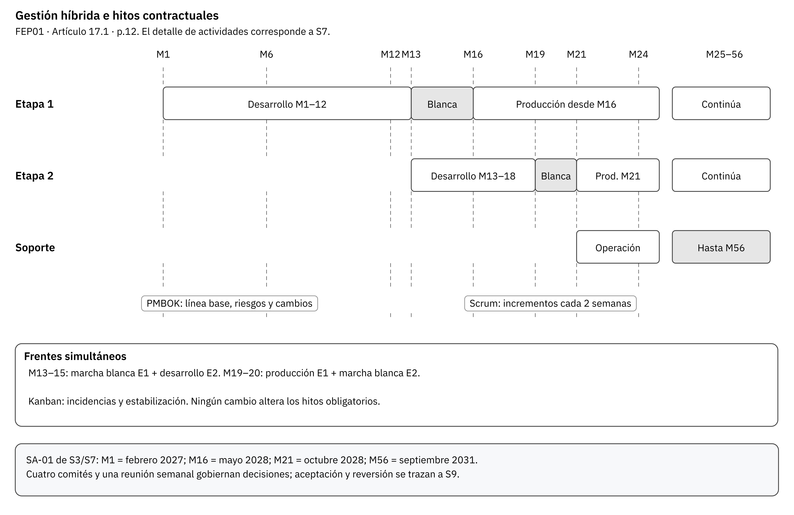
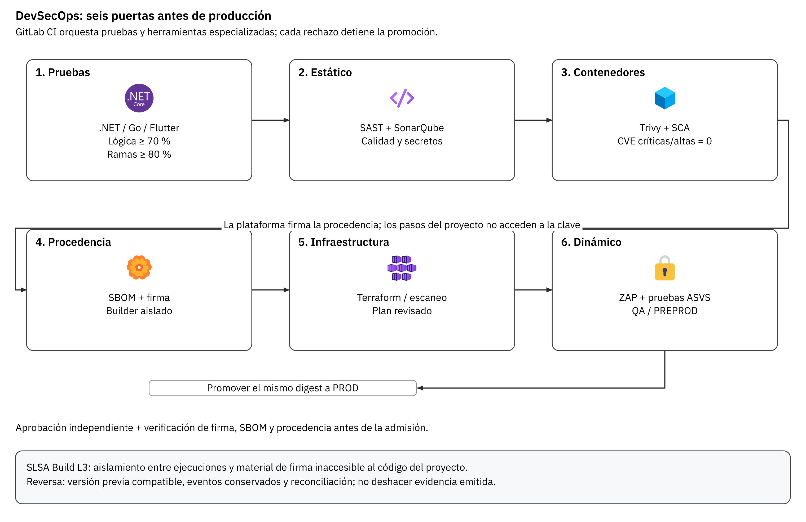

# Subdocumento 6. Metodologías

audIT, Empresa N.º 10. Licitación TFEP-01/2026, Caso 10 Transporte de Carga. Oferta Técnica, Sobre N.º 2. Informe Preparatorio 2. Archivo AUDIT-Subdocumento6.pdf. Anexos: Formulario T-9 en el archivo AUDIT-Formulario-T-9.pdf, Formulario T-10 en el archivo AUDIT-Formulario-T-10.pdf.

## 6 Metodologías

La gestión combina PMBOK para alcance, adquisiciones, riesgos y cambios; Scrum para incrementos de software; Kanban para incidencias y estabilización. S3/T-12 fija 28 RF y 14 RNF —catálogo de la oferta, no número de requisitos impuestos por el Caso—; S7 organiza paquetes e hitos y S9 establece aceptación y evidencia. Los Formularios T-9/T-10 acompañan el capítulo como archivos propios conforme al Comunicado 10.

El CLIENTE recibe una línea base controlada, responsables y decisiones registradas, incrementos trazados a requisitos y un flujo DevSecOps con bloqueo de promoción ante incumplimiento. El contrato conserva 56 meses, con desarrollo E1 M1–12, marcha blanca E1 M13–15, producción E1 M16, desarrollo E2 M13–18, marcha blanca E2 M19–20 y operación completa M21–56 (FEP01 · Artículo 17.1° · p.12). La metodología no acredita por sí sola que esos resultados ya se hayan obtenido.

La infraestructura y el montaje requieren planificación predictiva por terminal y unidad; las interfaces, contratos y modelos de costo requieren validación iterativa con usuarios; los incidentes 24x7 requieren flujo con prioridad y escalamiento. Los frentes se sincronizan mediante los comités contractuales y las puertas de S9, sin alterar hitos obligatorios.

## 6.1 Metodología de gestión del proyecto

La gestión del proyecto adopta las directrices de la guía PMBOK (Project Management Institute, 2021), adaptada específicamente a las restricciones operativas y contractuales del transporte de carga por carretera y la logística interurbana (FEP01, Artículo 4.3, p. 5, FEP02, RT-19.01, p. 33). Este marco mantiene trazabilidad verificable sobre la línea base de alcance, tiempo y costo, articulando la relación contractual con Transportes Curimón S.A. mediante canales formales de rendición de cuentas.

### 6.1.1 Marco híbrido de gestión: PMBOK y enfoques ágiles

La administración del contrato se fundamenta en un modelo de ciclo de vida híbrido, el cual combina procesos predictivos para los compromisos contractuales vinculantes con ciclos adaptativos para la construcción de los módulos de software. La justificación de este enfoque dual se resume en los siguientes ejes operativos:
- **Capa Predictiva (PMBOK 7):** Aplica a la gestión de la Ruta Crítica contractual del Artículo 17°, la entrega de hitos del Formulario E-25, la integración del parque de **374** camiones, distinguiendo equipos existentes y las **182** instalaciones previstas en T-11 (Caso, numeral 14.1, p. 29), las adecuaciones de salas técnicas y la obtención de recepciones provisorias y definitivas.
- **Capa Adaptativa (Scrum):** Aplica al diseño y programación de los módulos aplicativos (torre de control, despacho, portal de transportistas, aplicación de conductores y analítica). Se estructura en iteraciones cortas (sprints de 2 semanas) con entregables potencialmente desplegables, lo que permite retroalimentación temprana de las contrapartes operativas de Curimón sin comprometer los plazos mayores de entrega.
- **Capa de Flujo Continuo (Kanban):** Aplica a la atención de incidencias durante las marchas blancas contractuales: Etapa 1 en los meses 13–15 y Etapa 2 en los meses 19–20 (FEP01, Artículo 17.1, p. 12). También cubre la gestión de parches y solicitudes de servicio durante la operación de los meses 21–56.

**Decisión D-01. Adopción de marco de gestión híbrido predictivo-ágil**

| Se decide | Se descarta | Criterio | Fuente |
|---|---|---|---|
| Implementar gobernanza predictiva PMBOK para control contractual e hitos combinada con Scrum en iteraciones de dos semanas para software | Enfoque puramente predictivo tipo cascada y enfoque puramente ágil sin línea base | El transporte crítico exige certidumbre contractual de plazos de implantación junto con flexibilidad en diseño de interfaces y analítica | FEP01, Artículo 4.3, p. 5, FEP02, RT-19.01, p. 33 |

La articulación temporal del marco de gestión y su integración con los hitos contractuales de la licitación se ilustra en la Figura 6.1.

*Figura 6.1. Gobernanza temporal del proyecto y articulación de fases, etapas y marchas blancas*

Fuente: Elaboración propia.

La Figura 6.1 representa el solapamiento desde M13: la estabilización de E1 y la construcción de E2 usan equipos y capacidad segregados. M25–56 aparece como tramo comprimido, identificado expresamente; el detalle mensual y las fechas derivadas de SA-01 corresponden a S7.

### 6.1.2 Gobernanza de interesados y plan de comunicaciones

La gestión eficaz de los grupos de interés resulta determinante debido a la dispersión geográfica de las faenas y la multiplicidad de actores involucrados en la cadena logística. Se identifican y clasifican los siguientes actores clave:
- **Patrocinador Ejecutivo y Dirección de Transporte Curimón:** Enfocados en retorno de inversión, continuidad operacional del negocio y cumplimiento de contratos de flete minero, vitivinícola y retail.
- **Supervisores de Tráfico y Operadores de Torre de Control:** Usuarios intensivos de la plataforma, orientados a la visibilidad en tiempo real, alertas de desvío y cumplimiento de itinerarios.
- **Conductores de Flota Propia y Terceros:** **454** (Caso, numeral 14.1, p. 29) conductores que interactúan directamente con la aplicación móvil y los sensores de cabina, priorizando la ergonomía, simplicidad y registro certero de jornadas laborales conforme al Artículo 25 bis del Código del Trabajo.
- **Transportistas Terceros y Dueños de Camiones:** Propietarios de los 226 camiones subcontratados, interesados en la liquidación expedita de servicios y visibilidad telemática homologada.
- **Organismos Fiscalizadores (Dirección del Trabajo, MTT, SEC):** Entidades que auditan la legalidad del transporte, pesos por eje, transporte de sustancias peligrosas y registros de jornada.

Conforme a la exigencia técnica de las bases (FEP02, RT-19.05, p. 33), audIT implementará desde el primer mes del contrato un **Espacio Colaborativo Digital** unificado en la nube de acceso seguro 24/7 para el equipo del proyecto y la contraparte técnica de Curimón. Este repositorio centralizado alojará la documentación formal, especificaciones de diseño, minutas firmadas, registro vivo de riesgos conforme a la norma ISO 31000 (ISO, 2018; FEP02, RT-19.04, p. 33) y el catálogo de solicitudes de cambio.

El jefe de proyecto tiene dedicación exclusiva durante la implementación y centraliza línea base, cambios, riesgos y seguimiento, conforme a RT-19.01. S7/T-15 dimensiona esa dedicación y los frentes simultáneos; las actas identifican contraparte, responsable de acción y plazo de cierre.

### 6.1.3 Gestión de adquisiciones e integración contractual

La gestión de adquisiciones se estructura para mitigar riesgos de desabastecimiento en la cadena de suministros tecnológicos que pudieran afectar la Ruta Crítica:
- **Adquisición e instalación de componentes vehiculares:** La base de T-11 contempla 182 equipos iWave G26I para 148 camiones propios y 34 de terceros sin equipo, más 19 unidades de reposición; contempla 182 lectores CAN CANCrocodile más 19 de reposición. La compra corresponde al CLIENTE. La adquisición, instalación y puesta en servicio se programan con los paquetes y fechas de S7; los 22 equipos previstos para crecimiento de la flota propia se compran durante la operación (T-11; Caso, numeral 14.1, p. 29). Esta secuencia sustituye una fecha de compra anticipada no conciliada con el cronograma.
- **Niveles de servicio durante Operación:** Los mínimos mensuales de disponibilidad se aplican por criticidad según FEP01, Artículo 78.2, p. 40: 99,9 % para servicios críticos y 99,5 % para servicios de nivel alto; los niveles medio y bajo tienen umbrales propios. El 99,5 % no es un SLA uniforme para todos los servicios ni reemplaza las metas y mediciones de las etapas de desarrollo y marcha blanca, que se detallan en S9.
- **Conectividad Celular Multicarrier:** Contratos de conectividad telemática con SIM card industriales en modalidad APN privada sobre redes de telecomunicaciones de cobertura nacional, con conmutación automática entre operadores para minimizar zonas de silencio.

### 6.1.4 Comités de gobernanza, cadencias y mecanismos de decisión

El control directivo y operacional del contrato se estructura en estricto apego al marco de gobernanza mandatado por las bases de licitación (FEP01, Artículo 71, p. 37). La interacción formal entre audIT y Transportes Curimón S.A. se canaliza a través de las cinco instancias que se detallan en la Tabla 6.1.

**Tabla 6.1.** Instancias formales de gobernanza, participantes y cadencias

| Instancia | Frecuencia | Participantes obligatorios | Propósito y alcance decisional |
|---|---|---|---|
| Comité Ejecutivo | Mensual | Patrocinador de Curimón, Gerencia de audIT, Administrador del Contrato. | Dirección estratégica, resolución de bloqueos contractuales, aprobación de modificaciones de alcance y evaluación de riesgos mayores. |
| Comité de Proyecto | Quincenal | Contraparte Técnica de Curimón, Jefe de Proyecto de audIT. | Seguimiento riguroso de la Carta Gantt, estado de paquetes de trabajo EDT, control de hitos y acuerdos de ejecución técnica. |
| Comité de Arquitectura | Mensual | Arquitecto de Solución, Oficial de Ciberseguridad, referentes de TI de Curimón. | Aprobación formal de decisiones técnicas (ADR), control de deuda técnica, revisión de estándares de interoperabilidad y seguridad. |
| Comité de Operación | Mensual (desde M13) | Líder de Operación, Jefatura de Mesa de Ayuda, Contraparte Técnica de Curimón. | Verificación del cumplimiento de acuerdos SLA, gestión de problemas recurrentes, indicadores de marcha blanca y mejora continua. |
| Reunión de Seguimiento | Semanal | Equipos de ingeniería y especialistas de ambas partes. | Coordinación táctica operativa, revisión de impedimentos inmediatos y compromisos semanales de avance. |

La Tabla 6.1 asigna responsables y cadencias para resolver discrepancias técnicas u operativas. Las decisiones, responsables y fechas se conservan en actas; una demora se escala según su impacto. El escalamiento operacional transita de forma expedita desde la Reunión Semanal al Comité de Proyecto ante desviaciones operativas, elevándose al Comité Ejecutivo exclusivamente cuando existe impacto en el alcance, presupuesto o nivel de servicio convenido.

Cuando surge una contingencia o solicitud de cambio que modifique el alcance o los plazos acordados, esta debe tramitarse obligatoriamente mediante el procedimiento de control de cambios regido por el Artículo 72° de las Bases Administrativas (FEP01, Artículo 72, p. 38). La secuencia de este proceso se detalla en la Tabla 6.2.

**Tabla 6.2.** Procedimiento formal de gestión y control de cambios contractuales

| Paso | Acción requerida | Responsable formal | Criterio y resultado verificable |
|---|---|---|---|
| 1. Registro | Solicitud Formal de Cambio (RFC) en espacio colaborativo. | Parte solicitante (Curimón o audIT). | Formulario normalizado con descripción técnica, justificación operativa y urgencia asignada. |
| 2. Análisis | Evaluación de impactos en alcance, plazo, costo, riesgo y niveles de servicio. | Jefe de Proyecto y Arquitecto de Solución. | Informe de impacto en alcance, cronograma de Ruta Crítica, matriz de riesgos y disponibilidad. |
| 3. Revisión | Dictamen técnico del Comité de Arquitectura. | Contraparte Técnica y Líder Técnico de audIT. | Validación de viabilidad arquitectónica, compatibilidad con microservicios y seguridad. |
| 4. Decisión | Aprobación o rechazo formal en acta. | Comité Ejecutivo; acuerdo escrito de ambas partes. | Aprobación expresa previa a cualquier ejecución física o lógica. Límite acumulado del 20 % del valor original del contrato; no modificar objeto, garantías mínimas ni hitos obligatorios. |
| 5. Ejecución | Actualización de línea base y despliegue controlado. | Equipos de ingeniería y PMO. | Incorporación a sprint de desarrollo o ventana de mantenimiento programada. |

Conforme se establece en la Tabla 6.2, la ejecución de cualquier alteración sin la debida aprobación previa en acta del Comité Ejecutivo carecerá de validez contractual y no dará derecho a pago adicional (FEP01, Artículo 72.5, p. 38). Si se suscitaren controversias no resueltas en sede del Comité Ejecutivo en un plazo de treinta días corridos, operarán los mecanismos de mediación y arbitraje de derecho ante el Centro de Arbitraje y Mediación de Santiago (FEP01, Artículo 87, p. 45).

> **Compromiso C-01.** audIT formalizará las decisiones y acuerdos de cada sesión de comité en un plazo máximo de veinticuatro horas hábiles en el espacio colaborativo digital.
>
> Métrica: Emisión de minuta formal y registro en espacio digital en menos de 24 horas hábiles tras cada sesión de comité. Se verifica en: Registro de auditoría del repositorio colaborativo. Fuente: compromiso adicional audIT sobre las instancias de FEP01, Artículo 71, p. 37 y el espacio de RT-19.05; las bases no fijan ese plazo de minuta.

## 6.2 Metodología de desarrollo de software

El desarrollo de la solución tecnológica se estructura bajo un ciclo de vida evolutivo basado en ingeniería de software guiada por el dominio (Domain-Driven Design, DDD) y prácticas DevSecOps. Se controla deuda técnica, dependencias y tamaño de liberaciones mediante criterios de aceptación verificables.

### 6.2.1 Ciclo de vida adaptado y evolución arquitectónica

Para conciliar la alta disponibilidad exigida con la continua evolución logística de Transportes Curimón, el desarrollo de software se organiza en torno a los límites de contexto definidos en el Subdocumento 4.1. Este diseño modular desacopla los servicios transaccionales de telemetría de las interfaces de usuario y los algoritmos analíticos.
- **Gestión Evolutiva de Requerimientos:** Cada uno de los 42 requerimientos del Formulario T-12 se desglosa en Historias de Usuario documentadas en el repositorio colaborativo. Cada historia incluye criterios de aceptación redactados en formato estructurado (Gherkin: Dado, Cuando, Entonces), sirviendo de especificación viva ejecutable.
- **Diseño de Interfaces API-First:** Todo intercambio de datos entre módulos internos y con sistemas legados del cliente se realiza mediante contratos formales: especificación OpenAPI 3.1 para servicios síncronos REST y especificación AsyncAPI 2.6 para eventos telemáticos sobre Event Hubs Premium mediante protocolo Kafka (FEP01, Artículo 4.3, p. 5 y FEP02, RT-05.16, p. 12).
- **Prevención y Mitigación de Deuda Técnica:** Cada sprint de construcción reserva un 15 % de la capacidad de desarrollo para refactorización, optimización de consultas en base de datos y actualización de librerías base. Se prohíbe la acumulación de advertencias de compilación y se somete el código a inspección estática continua.

La [ficha T-19 de proceso](./formulario_t19_innovacion_2_proceso.md) se incorpora como backlog de EDT 12.2, integrado con 4.1/4.2. Sus criterios y métricas se trazan por separado de los 42 requisitos de T-12; no se modifica el significado de un requisito obligatorio para presentarlo como innovación. El piloto y las intervenciones mantienen las ventanas de S7.

### 6.2.2 Ecosistema DevSecOps unificado en GitLab CI Enterprise

GitLab CI Enterprise centraliza repositorio, incidencias, revisión, ejecución y registro de liberaciones. SonarQube, Trivy, Cosign, herramientas de prueba y Terraform se integran al mismo flujo; usar GitLab no elimina su necesidad ni acredita automáticamente SLSA nivel 3.

**Decisión D-02. Orquestación de DevSecOps en GitLab CI Enterprise**

| Se decide | Alternativa evaluada | Criterio y consecuencia | Fuente |
|---|---|---|---|
| Un solo control de versión y orquestación, con herramientas especializadas integradas | Pipelines independientes por equipo con despliegues sin registro común | Mantener ID de requisito, commit, prueba, artefacto y despliegue; asumir operación y licencias de las herramientas declaradas | FEP02 · RT-04.03–05 · p.10 |

El control de cadena de suministro adopta SLSA v1.2 Build L3: plataforma alojada y endurecida, ejecuciones aisladas entre sí y secretos de firma de procedencia inaccesibles a los pasos definidos por el proyecto. El builder genera la procedencia; un script del propio repositorio que crea una atestación y usa Cosign no basta para L3. Se verifican identidad del builder, parámetros, entradas y digest en la admisión. Es un requisito de implementación a acreditar, no una certificación ya obtenida ([SLSA, Build Track](https://slsa.dev/spec/v1.2/build-track-basics)).

El pipeline de entrega continua se ejecuta automáticamente ante cada evento de integración en el repositorio, transitando obligatoriamente por seis fases de validación, ilustradas en la Figura 6.2.

*Figura 6.2. Fases y puertas de calidad del pipeline DevSecOps unificado*

Fuente: Elaboración propia.

Como se representa en la Figura 6.2, ninguna versión de software puede alcanzar el ambiente de producción sin superar secuencialmente las seis etapas del pipeline. En la Tabla 6.3 se definen los umbrales bloqueantes parametrizados para comprobar los criterios de calidad y seguridad del artefacto.

**Tabla 6.3.** Umbrales y políticas de calidad bloqueantes en el pipeline DevSecOps

| Fase del Pipeline | Herramienta ejecutora | Métrica evaluada | Umbral bloqueante de paso a producción |
|---|---|---|---|
| 1. Pruebas | GitLab Runner / dotnet test, go test y flutter test | Cobertura de lógica de negocio y cobertura de ramas, informadas por separado | Cobertura de pruebas automatizadas de lógica de negocio ≥ 70 % (FEP02, RT-04.11, p. 10) y cobertura de ramas ≥ 80 % como meta de audIT. Ambos umbrales se reportan por separado; cero pruebas unitarias fallidas. |
| 2. Análisis estático | SonarQube Enterprise | Calidad y seguridad | Quality Gate aprobado; calificación A en mantenibilidad, deuda técnica <5 %, complejidad ≤15 por función de negocio y cero vulnerabilidades críticas/altas abiertas. |
| 3. Contenedores | Trivy Container Scanner | Vulnerabilidades CVE | Cero vulnerabilidades críticas o altas en dependencias y capas base (imágenes Distroless / Alpine). |
| 4. Firma y procedencia | Cosign / Syft (Anchore) | Integridad de artefactos | SBOM CycloneDX por artefacto, firma y procedencia verificada; aislamiento del builder y custodia de firma fuera de los pasos del proyecto. |
| 5. Infraestructura | HashiCorp Terraform | Drift y seguridad IaC | Plan de Terraform revisado, escaneo IaC con Trivy/Checkov y sin hallazgos bloqueantes; identidades, redes y configuración por ambiente comprobadas. |
| 6. Análisis dinámico | OWASP ZAP | Vulnerabilidades web | ASVS 4.0 nivel 2 mínimo contractual, trazado por control; ZAP más verificaciones manuales de autorización. Cero hallazgos críticos/altos abiertos; no se confunde un escaneo con cobertura completa de ASVS. |

Los parámetros descritos en la Tabla 6.3 bloquean automáticamente la promoción cuando no se cumplen. La detección de un solo fallo en cualquiera de estos umbrales aborta inmediatamente el pipeline de despliegue, notificando al equipo responsable a través de los canales de ingeniería sin intervención manual.

### 6.2.3 Infraestructura como código y gestión de configuración

Toda la infraestructura cloud alojada en Microsoft Azure se gestiona bajo el paradigma de Infraestructura como Código (IaC) mediante scripts de Terraform versionados en Git (FEP02, RT-03.03, p. 8). Se implementa un modelo de entornos rigurosamente aislados:
- **Segregación de Ambientes:** DEV, QA, PREPROD, PROD y DR separados, con suscripciones/grupos de recursos, redes, identidades y almacenes según la topología de S4.2; diferencias de PREPROD frente a PROD declaradas, con controles y pruebas que impiden acceso no autorizado. Datos sintéticos en DEV/QA; una seudonimización reversible no se denomina anonimización.
- **Aprovisionamiento Inmutable:** Los servidores y clusters de Azure Kubernetes Service (AKS) no admiten modificaciones manuales en caliente vía consola. Las políticas y límites de escalamiento se registran como código; el autoscaler ejecuta esas políticas sin requerir un commit por cada réplica. Cualquier cambio manual excepcional documentado o modificación de política debe quedar auditado, someterse a revisión por pares y desplegarse mediante pipeline.
- **Gestión Centralizada de Secretos:** Ninguna credencial, clave privada o cadena de conexión se almacena en el código fuente. Se utiliza Azure Key Vault integrado con identidades administradas (Managed Identities) y rotación programada automática.

### 6.2.4 Ceremonias técnicas, artefactos y criterios de salida

El trabajo colaborativo del equipo de desarrollo se organiza en torno a un flujo de trabajo de control de versiones GitFlow adaptado. Las ramas principales son:
- **Rama `main`:** Contiene versiones estables liberables y está protegida. Se exige firma criptográfica de commits y dos aprobaciones independientes del autor antes de la liberación; producción se despliega automáticamente. El registro de despliegue identifica commit, etiqueta, digest, configuración y entorno efectivo; fusionar a main no equivale a haber desplegado.
- **Rama `develop`:** Rama de integración continua donde convergen las nuevas funcionalidades validadas mediante pruebas unitarias.
- **Ramas temáticas (`feature/*`, `bugfix/*`, `hotfix/*`):** Ramas de trabajo de corta duración, sujetas obligatoriamente a revisión por pares (Peer Review) mediante Merge Requests.

La Tabla 6.4 define las condiciones para iniciar una historia y aceptar un incremento de software mediante Definition of Ready (DoR) y Definition of Done (DoD).

**Tabla 6.4.** Criterios formales de salida: Definición de Preparado y Definición de Terminado

| Nivel de control | Artefacto / Fase evaluada | Criterios de aceptación obligatorios |
|---|---|---|
| Definición de Preparado (DoR) | Historia de Usuario / Requerimiento funcional | Requerimiento trazado unívocamente al Formulario T-12. Criterios de aceptación definidos en Gherkin. Dependencias técnicas resueltas. Mockups de interfaz aprobados. |
| Revisión por Pares | Merge Request (MR) en GitLab | Al menos un revisor independiente para integración; dos aprobaciones independientes del autor antes de liberar a main/producción. Verificación de adherencia a guías de estilo, comentarios arquitectónicos y ausencia de duplicidad de código. |
| Definición de Terminado (DoD) | Incremento de Software / Release Candidate | Código fusionado en rama objetivo. Cobertura automatizada de lógica de negocio ≥ 70 % (FEP02, RT-04.11, p. 10) y cobertura de ramas ≥ 80 % como meta de audIT, con numeradores, denominadores y exclusiones reportados por separado; no se promedian ni sustituyen entre sí. Quality Gate SonarQube superado. Contenedor firmado con Cosign y registrado en Azure Container Registry con SBOM. Documentación OpenAPI actualizada. Despliegue exitoso en staging sin regresiones operativas. |

La aplicación de los criterios de la Tabla 6.4 asegura que cada módulo tecnológico entregado a Transportes Curimón cumpla con los estándares industriales de mantenibilidad, solidez arquitectónica y ciberseguridad exigidos por las bases.

> **Compromiso C-02.** audIT mantendrá un tiempo de despliegue continuo en ambiente de pruebas inferior a quince minutos para incrementos de software validados.
>
> Métrica: Despliegue automatizado en staging en menos de 15 minutos tras aprobación de Merge Request. Se verifica en: Métricas de ejecución del pipeline en GitLab CI Enterprise. Fuente: objetivo adicional audIT, trazado a FEP02 RT-04.12 y RT-03.03; no es plazo impuesto por las bases.

### 6.2.5 Cadencia, entrega y reversión verificable

Cada sprint de dos semanas incluye planificación con objetivo y criterios, reunión diaria de quince minutos, refinamiento de dependencias, revisión con representantes de torre/conductores/transportistas y retrospectiva. Se conservan backlog, diseño de interfaz, ADR, contratos, código, pruebas, SBOM y decisión de liberación. El Comité de Proyecto quincenal recibe avance por paquete, riesgos y desviaciones; la revisión de sprint es validación de producto y no reemplaza aceptación contractual.

DEV, QA, PREPROD, PROD y DR deben estar operativos en H3 (FEP02 · RT-04.01 · p.10). La rama main identifica lo liberado; develop integra incrementos y las ramas temáticas son breves. Se construye el artefacto una sola vez; su digest, firma y configuración externa permiten promoción QA → PREPROD → PROD sin recompilar (RT-04.08). DAST requiere despliegue temporal en QA/PREPROD, aunque sea la sexta puerta antes de producción. Una comprobación que exige HIL, prueba de terreno o revisión humana se registra como evidencia adicional, sin simularla dentro del pipeline.

Se elige canario para servicios y actualización por unidad para equipos a bordo. Antes de cada pase se comprueban métricas, reversa, esquema compatible y preservación de evidencia. La reversión automática retorna a la versión previa compatible, mantiene eventos no confirmados y conserva documentos emitidos; después reconcilia diferencias. Las migraciones de esquema siguen expandir–migrar–contraer y son versionadas/reversibles (RT-04.10). Contraer columnas o transformar datos de forma irreversible se posterga hasta que la versión anterior deje de necesitarlas; no se promete que toda transformación se deshaga con un rollback de contenedor.

La Tabla 6.5 declara metas de entrega propuestas para RT-04.12; se miden por contexto en operación y se ajusta capacidad si fallan, sin alterar mínimos de seguridad ni congelamientos de S7.

**Tabla 6.5.** Indicadores de entrega y restauración

| Indicador | Meta propuesta | Evidencia |
|---|---|---|
| Frecuencia de despliegue | Incremento disponible cada sprint; producción sólo en ventanas aprobadas sin congelamiento | Historial de liberaciones por servicio y calendario S7 |
| Tiempo desde commit aceptado hasta producción | ≤5 días hábiles fuera de congelamientos, con pruebas/gates completos | Marcas de commit, aceptación y despliegue; exclusiones justificadas |
| Cambios fallidos | ≤10 % de liberaciones en ventana móvil de 90 días | Reversas/incidentes ligados a digest y total de liberaciones |
| Restauración tras cambio fallido | Objetivo ≤30 min para reversa de aplicación, sin sustituir SLA de incidente ni RTO de DR | Cronómetro de detección, reversa y verificación de integridad |

La Tabla 6.5 distingue despliegue en pruebas (<15 min propuesto en C-02), lead time, reversa de una aplicación y recuperación completa de un sitio. Ninguno se infiere del éxito del pipeline. Los objetivos se verifican con S9; la aceptación E1/E2 mantiene sus marchas blancas y el régimen crítico 99,9 % del Artículo 78.2.

### 6.2.6 Evidencia asociada a T-9 y T-10

El [borrador Markdown de T-9](./formulario_t09_metodologia_gestion.md) remite a 6.1, interesados, comités, adquisiciones, cambios y calendario; el [de T-10](./formulario_t10_metodologia_desarrollo.md) remite a 6.2, ciclo de vida, herramientas, ambientes, criterios, cadencias y reversión. Los anexos son índices de evidencia del capítulo, no inventarios que reemplacen el análisis.

## Referencias

Project Management Institute. (2021). *A Guide to the Project Management Body of Knowledge and The Standard for Project Management* (7.ª ed.). Edición adoptada para esta propuesta. https://www.pmi.org/-/media/pmi/documents/public/pdf/pmbok-standards/pmbok-guide-public-faqs-1-july-2021

ISO. (2018). *ISO 31000: Risk management — Guidelines*. https://www.iso.org/standard/31000

Schwaber, K., y Sutherland, J. (2020). *The Scrum Guide*. https://scrumguides.org/scrum-guide.html

SLSA. (s.f.). *Version 1.2: Build track basics*. https://slsa.dev/spec/v1.2/build-track-basics

## Declaración de uso de IA

La revisión del 11-10-2026 corrige el diseño previo y sus figuras. La aprobación humana, los ensayos y la acreditación SLSA permanecen pendientes; el asistente no los declara realizados.

| Sección | Herramienta | Finalidad | Nivel en texto | Nivel en diagramas | Revisión humana |
|---|---|---|---|---|---|
| 6 y 6.1 | OpenAI Codex (GPT-6), sobre diseño previo | Conciliar comités, cambios, cantidades y fases con las bases y S7 | Alto | Alto | Pendiente: D3/D2 cotejan calendario, recursos y comunicaciones |
| 6.2 | OpenAI Codex (GPT-6) | Corregir herramientas, SLSA, puertas de calidad, métricas y reversión | Alto | Alto | Pendiente: D3/D1 verifican T-13/T-17 y controles de implementación |
| Formularios T-9 y T-10 en Markdown | OpenAI Codex (GPT-6) | Preparar correspondencia entre exigencia y sección/evidencia | Alto | Ninguno | Pendiente: D3 verifica referencias y aceptación del capítulo |
