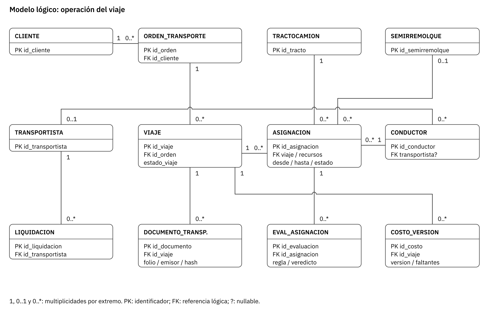
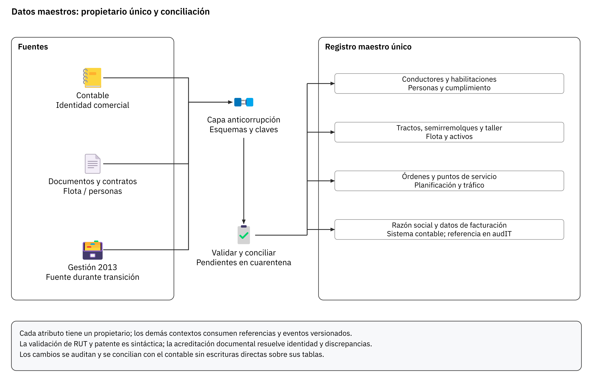
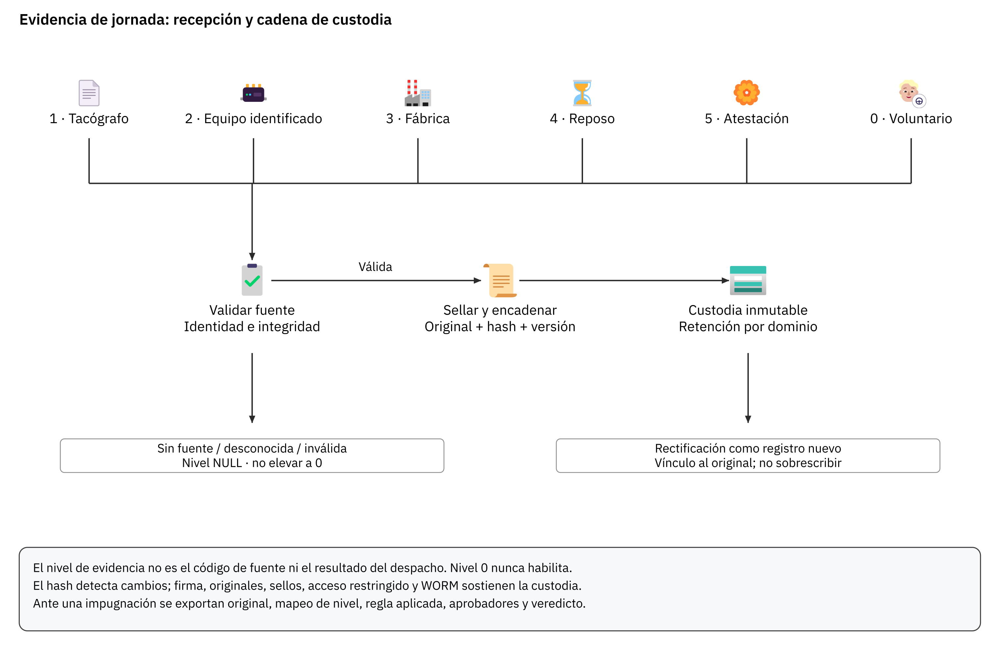
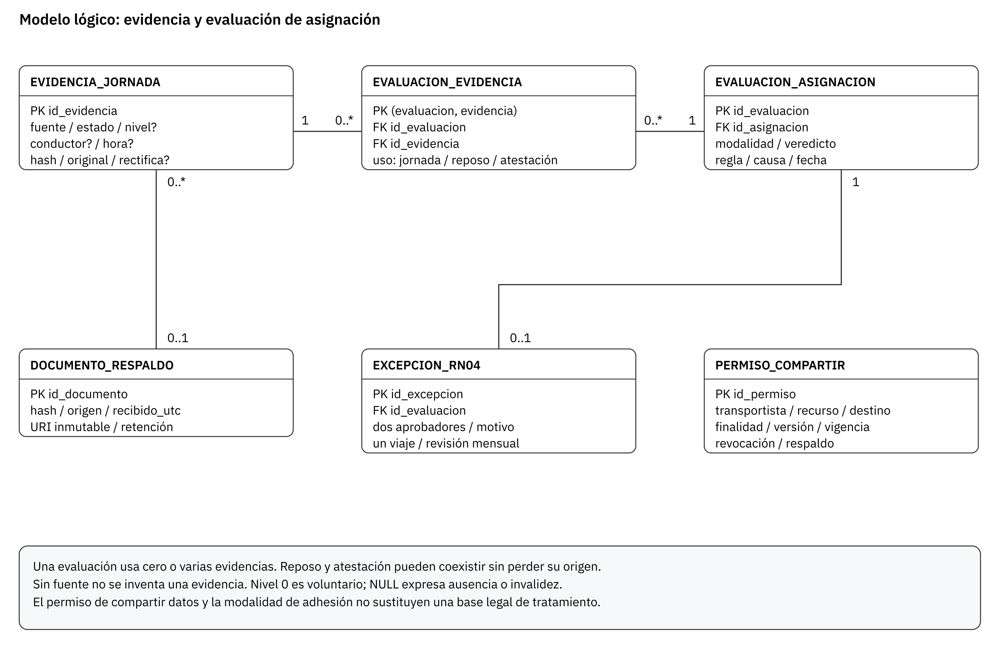
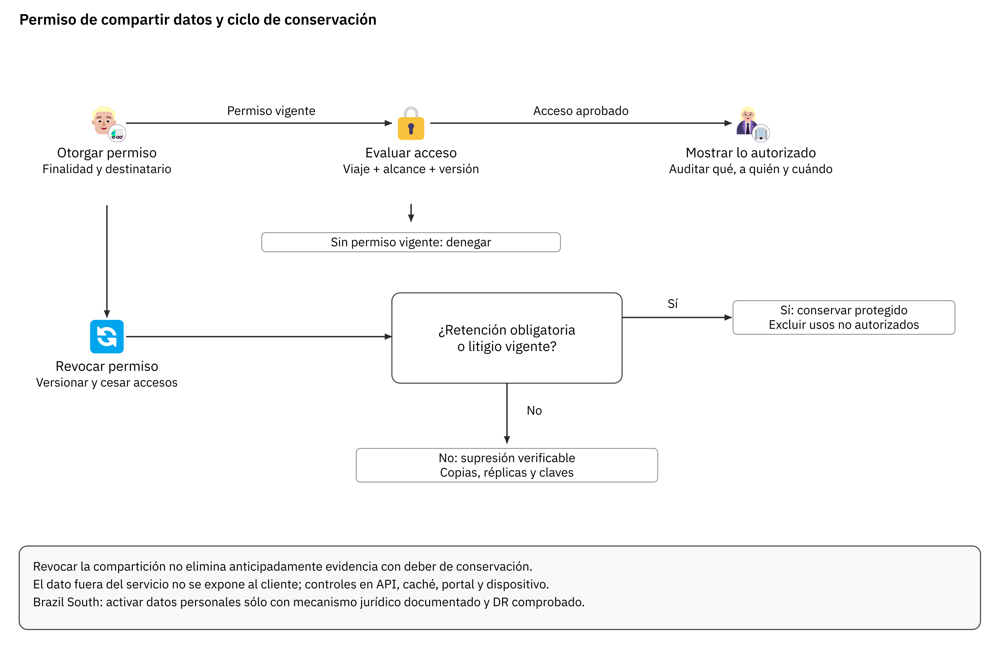
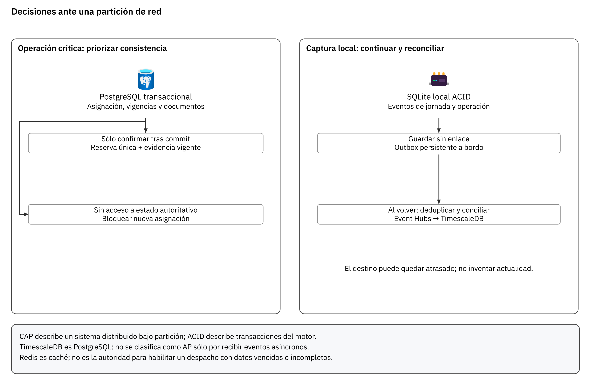
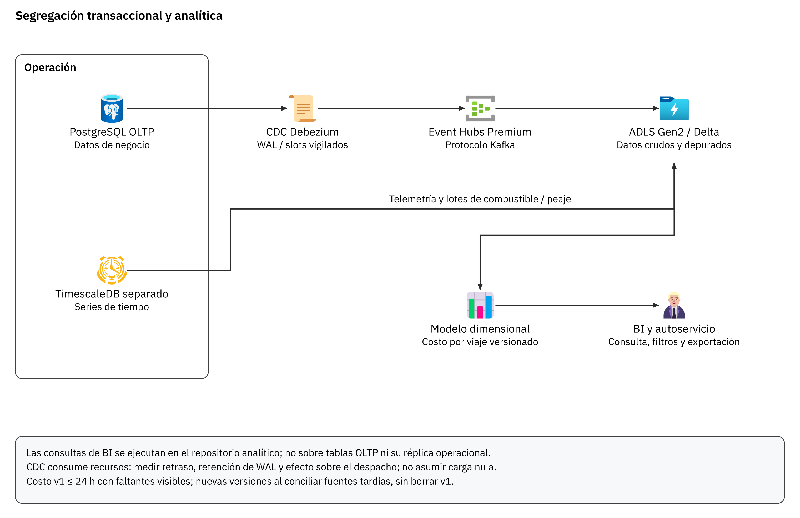
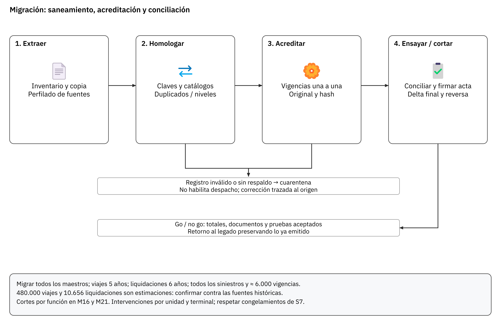
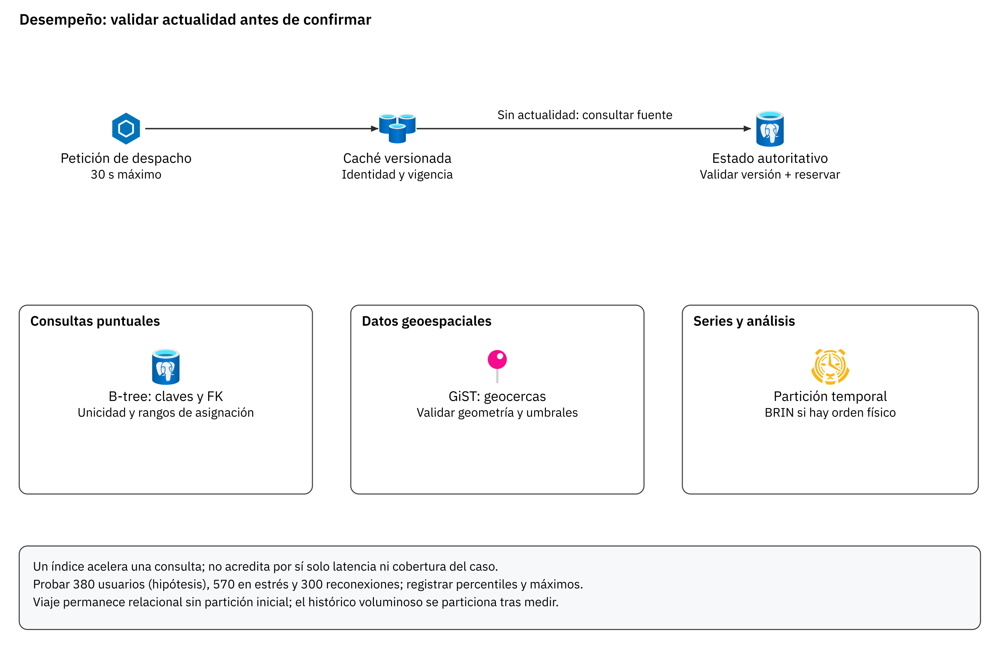

# Subdocumento 5. Modelo y gestión de datos

audIT, Empresa N.º 10. Licitación TFEP-01/2026, Caso 10 Transporte de Carga. Oferta Técnica, Sobre N.º 2. Informe Preparatorio 2. Archivo AUDIT-Subdocumento5.pdf.

## Resolución de observaciones del Informe 1

El FEP01, Artículo 46, p. 28 pide resolver en cada informe las observaciones de la instancia anterior, con trazabilidad entre observación, respuesta y sección modificada. La tabla reúne las observaciones del Informe 1 que corresponden a este documento y la sección donde se resuelve cada una.

**Resolución de las observaciones del Informe 1, conforme a FEP01, Artículo 46, p. 28**

| N.º | Observación | Respuesta | Sección modificada |
|---|---|---|---|
| 13 | El Subdocumento 5 abre con la bitácora interna del grupo de trabajo. | Se acepta. Se acoge la observación. Se implementa en la Sección 5.1, eliminando por completo la sección de bitácora interna; el documento inicia con el marco conceptual, alcance y gobierno del modelo de datos de la empresa. | Sección 5.1. |
| 81 | El diccionario cubre 6 entidades y ninguna es la evidencia de jornada, exigida para resistir impugnaciones. | Se acepta. S5 incorpora la entidad EVIDENCIA_JORNADA. Sus niveles siguen el contrato del Subdocumento 3: niveles 1 a 5, nivel 0 solo para el registro voluntario del conductor y nulo para la fuente desconocida o inválida, y el dominio nivel_cascada del anexo de diccionario usa los mismos niveles. Origen instrumental, modalidad, nivel y veredicto se registran por separado | S5 §5.1.5 y anexo de diccionario, EVIDENCIA_JORNADA; S3, evidencia y veredicto; S9 §9.1.1; T-17 CP-SYS-05 y CP-UAT-09 |
| 82 | No hay diagrama Entidad-Relación (DER) en el documento. | Se acepta. La sección 5.1.2 incluye el diagrama entidad-relación en notación de pata de gallo (Figura 5.1), con las entidades transaccionales, telemáticas y de auditoría | Sección 5.1.2 (Figura 5.1) |
| 83 | Contradicción de residencia: copia fuera de sitio en Azure East US 2 mientras S4 sostiene residencia en Chile. | Se acepta. La residencia primaria es Chile Central y la réplica secundaria es Brazil South, sin referencias a East US 2. La réplica de datos personales a Brazil South es una transferencia internacional y se activa solo con la vía habilitante documentada | S5 §5.1.6 y S4 §4.3.2 |
| 84 | El motor de bases de datos de series de tiempo y el bus de mensajería quedan indefinidos. | Se acepta. La sección 5.2.1 fija TimescaleDB sobre PostgreSQL, en un servidor separado, para las series de tiempo, y Azure Event Hubs Premium con protocolo Kafka como bus de eventos, sin un clúster Apache Kafka propio | S5 §5.2.1 y S4 §4.1.1 |
| 85 | La sección 1.1 es la bitácora interna del grupo de trabajo. | Se acepta. Se acoge la observación. Se implementa en la Sección 5.1, eliminando íntegramente la bitácora interna y abriendo el documento con la descripción conceptual del gobierno y ciclo de vida de los datos corporativos. | Sección 5.1. |
| 86 | Prosa hinchada y escasez de figuras (dos figuras en 21 páginas), no citadas desde el texto. | Se acepta. Se acoge la observación. Se implementa en el Subdocumento 5 completo, reescribiendo el texto en tono técnico riguroso e incorporando diagramas de arquitectura de datos (DER, flujo de eventos) debidamente citados e interpretados analíticamente. | Subdocumento 5 completo. |
| 87 | El tratamiento de revocación del consentimiento frente a la retención legal queda pendiente de validar. | Se acepta. La revocación cesa los accesos cubiertos por el permiso y conserva la evidencia sujeta a retención legal, con rectificaciones trazables y sin eliminación automática de la jornada. S5 lo modela en la sección 5.1.6 y el Formulario T-17 lo comprueba en CP-SEC-05, CP-SEC-08 y CP-INT-25 | S5 §5.1.6; T-17 CP-SEC-05, CP-SEC-08 y CP-INT-25; S9 §9.1.1 |

## 5 Modelo y gestión de datos

El modelo conserva el viaje ocurrido y sus respaldos sin mezclarlo con el costo estimado, el documento fiscal o el permiso de compartir datos. S3 fija reglas y alcance; S4.1 define servicios y contratos; S6/S7 organizan su construcción y migración; S9 comprueba que una decisión pueda reconstruirse a partir de la evidencia original. El CLIENTE recibe modelos por dominio, diccionario de atributos, gobierno de maestros, plazos de conservación y criterios de conciliación.

## 5.1 Modelo

Los seis contextos canónicos tienen propietarios explícitos. Compartir una identidad o referenciar un viaje no autoriza a un servicio a escribir en la base de otro. Las claves globales facilitan correlación y deduplicación; las restricciones de negocio se implementan en el contexto responsable.

### 5.1.1 Decisiones del modelo

La Tabla 5.1 vincula cada decisión con una necesidad del Caso, sin atribuir al legado un esquema que no se ha levantado.

**Tabla 5.1.** Decisiones de modelado y efecto operacional

| Decisión | Necesidad | Consecuencia verificable |
|---|---|---|
| Separar orden, viaje y asignación | Distinguir servicio solicitado, recursos reservados y recorrido efectivo | Reasignar recursos no borra la historia ni cancela automáticamente el viaje |
| Distinguir tracto y semirremolque | Aptitud y combinaciones de carga | Vigencias y compatibilidad por activo, no por una entidad genérica de camión |
| Evidencia, evaluación y permisos separados | Jornada impugnable y control del dato de terceros | Reconstruir qué fuentes se usaron, con qué regla y quién autorizó una excepción |
| Maestros con propietario único | Cuatro planillas de ≈6.000 vigencias y sistemas existentes | Identidad, respaldo y discrepancias conciliados antes de habilitar |
| Separar negocio, series y análisis | Asignación ≤30 s y ráfagas de reconexión | Ensayar cargas simultáneas y consultas de BI aisladas del OLTP |
| Versionar costo y liquidación | Combustible tardío y liquidación mensual | v1 ≤24 h con faltantes; posteriores versiones sin sobrescritura |

La Tabla 5.1 fija la estructura que se comprueba en S9. El cifrado y los índices son controles complementarios; ninguno acredita por sí solo cumplimiento legal, exactitud documental o latencia.

### 5.1.2 Dominios de información y modelo conceptual

La arquitectura de datos se estructura en seis contextos delimitados con límites explícitos. En la Figura 5.1 se despliega el modelo conceptual y relacional de persistencia de datos.

*Figura 5.1. Modelo lógico de las relaciones críticas del viaje*

Fuente: Elaboración propia.

Fuente: elaboración de audIT.

La Figura 5.1 separa el ciclo del viaje de las asignaciones: una orden genera cero o varios viajes y cada viaje conserva cero o varias asignaciones históricas. Cada asignación confirmada identifica conductor, tracto y, cuando la carga lo exige, semirremolque; no puede solaparse con otra activa para esos recursos. Documento, costo y evaluación mantienen su identificador y relación con el viaje o la asignación. En el gráfico, EVAL_\allowbreak{}ASIGNACION abrevia EVALUACION_\allowbreak{}ASIGNACION y DOCUMENTO_\allowbreak{}TRANSP. abrevia DOCUMENTO_\allowbreak{}TRANSPORTE.

Los contextos gobiernan estos agregados: Planificación conserva OrdenTransporte y la reserva de Asignación; Operación conserva Viaje y su ejecución; Flota conserva Tractocamion y Semirremolque; Personas conserva Conductor, EvidenciaJornada y EvaluacionAsignacion; Liquidación conserva CostoVersion y Liquidacion. Transportista y Cliente tienen identidad compartida con un propietario de atributo declarado en MDM.

El ciclo propuesto del viaje es `PROGRAMADO $\rightarrow$ EN_\allowbreak{}CARGA $\rightarrow$ EN_\allowbreak{}RUTA $\rightarrow$ EN_\allowbreak{}DESCARGA $\rightarrow$ CERRADO`, con `CANCELADO` como excepción trazable. `BLOQUEADA` es resultado de una evaluación de asignación, no un sexto estado que termine el viaje por fatiga: puede buscarse otro recurso y volver a evaluar. El rechazo de carga en destino conserva evento, motivo y resolución; no elimina recorrido ni costos ya incurridos. Un cierre de frontera registra demora y causa; su efecto sobre cobros depende de la regla contractual, sin congelar sobreestadías automáticamente por RT-10.05.

### 5.1.3 Estrategia de Gestión de Datos Maestros (MDM)

En cumplimiento de FEP02, RT-05.09, p. 11, se implementa un marco centralizado de Master Data Management (MDM) con principio de Registro Maestro Único (*Golden Record*), visualizado en la Figura 5.2.

*Figura 5.2. Gestión de Datos Maestros (MDM) y Capa Anticorrupción*

Fuente: Elaboración propia.

Fuente: elaboración de audIT.

La Figura 5.2 identifica propietarios y conciliación: Personas gobierna conductor/evidencia/habilitación; Flota, activos y taller; Planificación, órdenes y puntos de servicio; el contable conserva identidad comercial y de facturación según el contrato de integración. Las tarifas operacionales cambian de autoridad por función en M16/M21 según S3; no existe doble escritura maestra.

Cada registro mantiene ID global y clave natural validada. El RUT usa validación sintáctica de dígito verificador y contraste documental; la patente se normaliza y contrasta con antecedentes autorizados. No se promete una API del Registro Civil ni una consulta oficial automática sin acceso acreditado. Los duplicados o fuentes contradictorias quedan en cuarentena con resolución del propietario y trazabilidad del origen.

### 5.1.4 Diccionario de datos y restricciones

El \hyperref[sec:05-anexo-diccionario]{anexo de diccionario} entrega por atributo nombre, tipo, dominio, obligatoriedad, propietario y sensibilidad, conforme a FEP02, RT-05.01, p. 11 y Comunicado 10 · capítulo 5. Las Figura 5.1 y Figura 5.4 muestran relaciones legibles; el cuerpo analiza las restricciones que determinan la operación.

Una vigencia referencia exactamente un conductor, un tracto o un semirremolque mediante tres FK nullable y un `CHECK` de un único sujeto. Se evita una FK polimórfica que PostgreSQL no pueda comprobar. El estado `VERIFICADO` requiere respaldo y fecha de verificación; también se comprueba vencimiento, tipo requerido y eventual revocación. Una fecha futura en una planilla no equivale a aptitud acreditada.

El viaje puede programarse sin recursos ni peso definitivo. La asignación sólo se confirma con recursos y evaluación válida; pasar a `EN_\allowbreak{}RUTA` requiere además carga definitiva y documento conforme. La posición se almacena con latitud y longitud ambas presentes o ambas ausentes. Identidad, velocidad, odómetro y hora del evento se dejan nulos cuando la fuente no los proporciona; la hora de recepción y la procedencia siempre quedan registradas. No se generan ceros para representar desconocimiento.

### 5.1.5 Evidencia de jornada, cascada y cadena de custodia

La evidencia se clasifica conforme al Subdocumento 3: fuente instrumental, nivel, estado, modalidad y veredicto son dimensiones distintas. La Tabla 5.2 conserva la correspondencia canónica.

**Tabla 5.2.** Niveles de evidencia de jornada y uso en la validación

| **Origen o código conservado** | **Nivel canónico** | **Condición de interpretación** | **Modalidad y veredicto esperado** |
|---|---|---|---|
| Tacógrafo digital descargado (`TACO_\allowbreak{}DIG`) | 1 | Conservar original, identidad y vínculo a vehículo/viaje; validar integridad antes de asignar | Se evalúa con los demás controles de asignación; un incumplimiento legal siempre bloquea |
| Equipo a bordo con conductor identificado (p. ej., código de origen CAN o GPS) | 2 | Solo se asigna este nivel si la identidad del conductor y el vínculo al evento están verificados; el código instrumental no basta | En modalidad completa, el nivel 2 es la evidencia prevista por S3; el veredicto sigue sujeto a los controles legales y operacionales |
| Telemetría de fábrica (`TEL_\allowbreak{}FAB`) | 3 | Lectura autorizada, de solo lectura, con origen, cobertura y hora de recepción trazables | Se evalúa como nivel 3; no se infiere identidad personal ni descanso únicamente desde telemetría del vehículo |
| Reposo del camión (`REPOSO_\allowbreak{}CAM`) | 4 | Sin coordenadas; acredita estado del vehículo, no descanso personal | En modalidad de datos requiere atestación firmada de nivel 5 para asignar con marca; sin ella bloquea |
| Atestación firmada del transportista (`ATEST_\allowbreak{}TRAN`) | 5 | Firma, responsable, fecha y viaje identificados y validados | Asignación con marca y responsabilidad registrada; en modalidad sin adhesión habilita solo la validación documental acompañada de atestación válida |
| Registro voluntario del conductor (`REG_\allowbreak{}COND`) | 0 | Captura identificada y trazable, sin elevar su valor probatorio | Informativo; nunca es requisito ni cambia el veredicto |
| Evento de portería | — | Puede complementar la trazabilidad de entrada o salida; no acredita por sí mismo jornada o descanso | No crea un nivel ni habilita asignación por sí solo |
| Sin evidencia (`SIN_\allowbreak{}EVIDENCIA`) | `NULL` | No existe una fuente válida asociada | Bloquea, salvo la excepción acotada de RN-04; nunca levanta un bloqueo legal |
| Código fuente desconocido (`CODIGO_\allowbreak{}FUENTE_\allowbreak{}DESCONOCIDO`) | `NULL` | Conservar el código original sin asignarle nivel hasta homologarlo | Rechaza la integración y bloquea el veredicto habilitante |
| Evidencia inválida (`EVIDENCIA_\allowbreak{}INVALIDA`) | `NULL` | Conservar el artefacto y el motivo de rechazo para auditoría, sin tratarlo como nivel 0 | Bloquea el veredicto habilitante |

El nivel clasifica la evidencia y no certifica por sí solo su valor judicial. Los códigos de origen (CAN, GPS, portería u otro) se conservan sin convertirlos en niveles: CAN instalado en un equipo a bordo no equivale a telemetría de fábrica. Las plataformas de terceros se integran únicamente mediante lectura o exportación autorizada; no se presume API ni webhook.

La evaluación de asignación vinculada conserva por separado `modalidad_\allowbreak{}adhesion`, `veredicto_\allowbreak{}asignacion`, versión de regla y marca temporal, junto con las referencias a conductor, viaje y evidencia. La modalidad completa aplica la evidencia de nivel 2 prevista por S3; la modalidad de datos requiere reposo de nivel 4 complementado por atestación firmada de nivel 5 y produce asignación con marca; sin adhesión, la validación documental solo habilita con atestación válida y también deja marca. La falta de fuente bloquea, salvo la excepción acotada de RN-04. Un incumplimiento legal bloquea en todas las modalidades y el nivel 0 nunca modifica el resultado. Estos casos se cotejan con T-17, CP-SYS-05 y CP-UAT-09.

El origen recibido se conserva sin renumeración silenciosa. Una descarga de tacógrafo, un evento de equipo o una atestación mantiene original, emisor/dispositivo, versión de esquema, ID, marca temporal si existe, hora de recepción, hash y resultado de validación. `id_\allowbreak{}conductor` puede ser nulo en un artefacto no identificado; ese artefacto se conserva para auditoría y no se convierte por sí solo en jornada personal habilitante. La vinculación exige identidad acreditada y período coherente.

`EVIDENCIA_\allowbreak{}JORNADA` conserva artefactos válidos, desconocidos o inválidos; la ausencia se expresa en `EVALUACION_\allowbreak{}ASIGNACION` como `SIN_\allowbreak{}EVIDENCIA`, sin inventar una fila de evidencia. `nivel_\allowbreak{}cascada` es NULL para origen desconocido/inválido; 0 sólo para `REG_\allowbreak{}COND`; 1–5 según la fuente válida y la condición canónica. Un nivel válido no elimina un incumplimiento legal. La hora GNSS/NTP se compara con la de recepción y se registra deriva o calidad del reloj; no se llama reloj atómico ni se reemplaza la hora original para aparentar exactitud.

La Figura 5.3 recorre recepción, validación, sellado, conservación y rectificación.

*Figura 5.3. Cadena de custodia de evidencias y tratamiento de fuentes inválidas*

Fuente: Elaboración propia.

El hash permite detectar alteración; no es firma electrónica ni vuelve inmutable una fila por sí solo. Se conserva el original firmado cuando procede, se encadenan registros con identificador de cadena y secuencia, y se anclan segmentos y manifiestos en almacenamiento WORM con retención bloqueada, bajo administración separada. Las cuentas de aplicación carecen de UPDATE/DELETE/TRUNCATE sobre evidencia. La protección frente al administrador se acredita en el almacenamiento inmutable y con verificación independiente; revocar permisos SQL al usuario aplicativo no restringe por sí solo a un superusuario.

Las rectificaciones generan un registro nuevo que referencia el original, sin sobrescribirlo. El primer hash previo es NULL y existe un único inicio por cadena; el orden es secuencia de custodia, distinto del orden de ocurrencia de eventos tardíos. Un acuse de sincronización requiere commit duradero. La confirmación probatoria incorpora el sellado y respaldo exigidos por el dominio; su falta se muestra y se ensaya, sin declarar evidencia plenamente custodiada cuando sólo fue admitida por el bus.

\begingroup\emergencystretch=2em
La Figura 5.4 separa evaluación y evidencia mediante \textsf{EVALUACION_\allowbreak{}EVIDENCIA}: una evaluación puede usar reposo de nivel 4 y atestación de nivel 5 simultáneamente. El veredicto siempre se registra, aun sin evidencia válida. Una excepción RN-04 conserva dos aprobadores, motivo, un viaje y revisión mensual; no levanta una causa legal. Las restricciones y nulabilidad se detallan en el anexo.\endgroup

*Figura 5.4. Modelo lógico de evidencia, evaluación, excepción y permiso*

Fuente: Elaboración propia.

La Tabla 5.2 y la Figura 5.4 se cotejan con CP-SYS-05/CP-UAT-09: nivel 0, nivel 5, modalidad de datos, atestación ausente, fuente desconocida y bloqueo legal. Una base migrada conserva los códigos anteriores, su tabla de correspondencia y la versión del mapeo; no altera la evidencia original para hacerla coincidir con el nuevo esquema.

### 5.1.6 Soberanía, permisos y bases de tratamiento

El permiso del transportista controla qué datos de sus recursos comparte, con quién, para qué finalidad y durante qué servicio (Caso, RT-16.30, p. 33). No sustituye la base de tratamiento de datos personales del conductor. El modelo distingue permiso comercial, adhesión contractual y base jurídica; la localización es dato personal cuando identifica o permite identificar a una persona, sin clasificar automáticamente toda localización como categoría legal de dato sensible.

La Figura 5.5 muestra concesión, evaluación por petición, revocación y decisión de conservación. `PERMISO_\allowbreak{}COMPARTIR` mantiene recurso, destinatario, alcance, finalidad, vigencia, versión y respaldo; `ACCESO_\allowbreak{}DATO` conserva qué se mostró y bajo qué versión. Una lista JSON de clientes no reemplaza relaciones verificables ni la auditoría de cada acceso.

*Figura 5.5. Compartición autorizada, revocación y conservación*

Fuente: Elaboración propia.

La revocación cesa nuevas consultas y emisiones cubiertas por el permiso, invalida caché/credenciales de acceso y propaga una versión al dispositivo. Durante falta de enlace no puede recibir una revocación nueva: el permiso local tiene vencimiento y sólo se transmiten datos tras comprobar la versión al reconectar. La transmisión de emergencia y los registros obligatorios siguen su base específica y minimización; revocar compartición comercial no borra evidencia de jornada ni elimina obligaciones de seguridad.

FEP01, Artículo 4.2, p. 5 exige Ley 21.719 y, mientras esté vigente, Ley 19.628. La Ley 21.719 entra en vigor el 01-12-2026; el inicio supuesto de febrero de 2027 cae bajo el régimen nuevo. Curimón debe documentar finalidad, base, derechos, encargos, plazos y transferencias. El cifrado de campo exigido por RT-11.10 no reemplaza esos deberes (BCN, Ley 21.719 (Biblioteca del Congreso Nacional de Chile, s. f.)).

Chile Central es primario y Brazil South es secundario propuesto en S4.3. Una réplica de datos personales es transferencia internacional: requiere identificar responsable y destinatario y documentar una vía aplicable del artículo 27 y las salvaguardias del artículo 28. Ubicación sudamericana y cifrado no acreditan por sí solos licitud. Si no se documenta el mecanismo, no se activa esa réplica; tampoco se declara satisfecho el DR hasta disponer de un sitio secundario admisible que supere RPO $≤15 min y RTO ≤$4 h. La revisión jurídica y la prueba de recuperación son condiciones de puesta en operación.

Una supresión solicitada se resuelve por dato y finalidad: conservar protegido lo sujeto a retención o litigio, cesar usos no autorizados y eliminar cuando proceda. El procedimiento incluye BD, originales, índices, cachés, exportaciones autorizadas, réplicas y respaldos; registra alcance, retenciones vigentes y fecha efectiva. NIST SP 800-88 Rev. 2 sustituye la revisión 1 desde septiembre de 2025. La destrucción criptográfica sólo se usa cuando el diseño de claves y todas sus copias lo permite; no se promete irrecuperabilidad absoluta ni purga instantánea de Key Vault (NIST, SP 800-88 Rev. 2 (Ramaswamy Chandramouli y Eric Hibbard, s. f.)).

## 5.2 Gestión de datos

La gestión de datos de audIT define la gobernanza operacional del dato, los motores de persistencia justificados frente a los compromisos de disponibilidad y latencia, y las políticas de retención, respaldo y seguridad.

### 5.2.1 Motores, transacciones y decisión ante partición

FEP02, RT-05.02, p. 11 exige justificar por dominio consistencia y disponibilidad. CAP se aplica al comportamiento de un sistema distribuido durante una partición; ACID describe transacciones y no clasifica automáticamente un producto como CP/AP. La Tabla 5.3 y la Figura 5.6 concretan la decisión operacional.

**Tabla 5.3.** Persistencia y conducta ante pérdida de enlace

| Dominio | Motor y transacción | Decisión ante partición |
|---|---|---|
| Asignación, vigencias y datos de negocio | PostgreSQL 16 Flexible; transacciones ACID y restricciones | Priorizar consistencia: sin estado autoritativo no confirmar una nueva reserva. RN-04 sólo cubre la fuente de evidencia indisponible; no habilita una reserva global sin conexión |
| Captura de jornada/operación a bordo | SQLite 3 con WAL y outbox local | Continuar captura local y sincronizar después. Consistencia eventual entre copia local y nube; no disponibilidad universal de todas las funciones |
| Telemetría en nube | TimescaleDB sobre PostgreSQL en servidor separado; Event Hubs Premium en ingesta | Acumular localmente si nube no accesible; deduplicar al reconectar. TimescaleDB conserva semántica relacional; no se etiqueta como AP por usar eventos |
| Caché y sesiones | Azure Managed Redis | Dato derivado con versión/expiración. Falla o desactualización conduce a consulta autoritativa; no habilita con una copia obsoleta |
| Documentos y auditoría | Blob Storage con retención inmutable y manifiestos | Conservar original local cifrado hasta confirmar custodia; estado pendiente visible. No afirmar inmutabilidad sólo por un hash |
| Analítica | ADLS Gen2 / Delta y modelo dimensional | Aceptar actualización diferida sin degradar el despacho; publicar antigüedad, faltantes y versiones |

La Tabla 5.3 mantiene una base de negocio consistente y una captura local que resiste particiones. El documento fiscal permanece en el contable y requiere entrega conforme antes del movimiento; el búfer local no habilita emisión propia.

*Figura 5.6. Consistencia del despacho y continuidad de captura durante una partición*

Fuente: Elaboración propia.

El protocolo Kafka de Event Hubs no implica un segundo clúster Apache Kafka ni transacciones exactamente una vez. Se usan outbox, entrega al menos una vez, orden por agregado y deduplicación duradera, conforme a S4.1.

### 5.2.2 Segregación arquitectónica OLTP versus analítica (Lakehouse)

Para dar cumplimiento a FEP02, RT-05.05, p. 11, se separa la base transaccional de producción respecto del consumo analítico de reportería y cálculo de costo por kilómetro. La propagación usa captura de cambios (CDC Debezium) y Event Hubs Premium mediante protocolo Kafka. El objetivo propuesto de retraso CDC <60 s se verifica bajo carga antes de aceptarse; el flujo avanza hacia el repositorio analítico (Delta Lake), como esquematiza la Figura 5.7.

*Figura 5.7. Segregación transaccional OLTP y analítica OLAP mediante CDC*

Fuente: Elaboración propia.

Fuente: elaboración de audIT.

El modelo de costeo por viaje (Caso, RT-05.29, p. 31) administra el desfase inherente de las liquidaciones de combustible (hasta 40 días) y peajes mensuales, emitiendo una versión preliminar en no más de 24 horas y una versión consolidada definitiva post-cierre sin sobrescribir los registros originales.

### 5.2.3 Políticas de gobernanza, calidad y retención histórica

La calidad se mide en captura y migración según FEP02, RT-05.04, p. 11 e ISO/IEC 25012. La Tabla 5.4 distingue los atributos que habilitan una transacción de los campos opcionales de una fuente.

**Tabla 5.4.** Calidad y método de comprobación

| Dimensión | Objetivo de aceptación | Comprobación |
|---|---|---|
| Completitud | 100 % de campos exigidos para confirmar asignación/salida; reportar faltantes del resto | Numerador y denominador por entidad y fuente; no convertir NULL en cero |
| Exactitud | Identificadores válidos y documentos cotejados antes de habilitar | Validación sintáctica más respaldo autorizado; una API oficial no se presume |
| Consistencia | Sin asignaciones activas superpuestas ni vigencias sin sujeto/respaldo | FK, CHECK, unicidad/exclusión y ensayos concurrentes |
| Credibilidad | Origen, versión y horas de evento/recepción conservados; deriva visible | Contraste de reloj y orden de secuencia; cuarentena cuando no hay interpretación fiable |
| Accesibilidad | 99,9 % mensual en servicios críticos durante operación | Indicadores de servicio extremo a extremo; HA del motor sola no acredita SLA |

La Tabla 5.4 produce un tablero con errores por fuente, antigüedad, registros en cuarentena y resolución responsable. Las modificaciones y consultas sensibles conservan actor, dispositivo, valores anteriores/posteriores, motivo y correlación (RT-05.03 transversal y RT-16.09 del Caso).

La auditoría es append-only, encadenada y anclada en WORM bajo administración separada. La cuenta de negocio no modifica ni elimina registros de evidencia; una cuenta de administración de BD no puede modificar el original WORM. Los ensayos de integridad comprueban también omisión de eventos y eliminación de segmentos, con manifiestos firmados; el hash de una fila aislada no detecta por sí solo que esa fila desapareció.

La Tabla 5.5 recoge los mínimos de Caso, RT-05.10, p. 31. No se atribuye a la ley tributaria una retención que aquí procede del contrato. El punto inicial del cómputo y las retenciones por litigio se documentan por dominio.

**Tabla 5.5.** Retención y recuperación por dominio

| Dominio | Mínimo contractual | Preservación y objetivo |
|---|---|---|
| Jornada y evidencia | 5 años | Original, evaluación y rectificaciones; WAL continuo y segmentos sellados; RTO de diseño ≤2 h |
| Documento y antecedentes del viaje | 6 años | Original fiscal y representación asociados al viaje; RTO de diseño ≤2 h |
| Siniestros | 10 años | Expediente completo y retención por litigio cuando corresponda; RTO ≤4 h |
| Habilitaciones | Vigencia +5 años | Versiones y respaldos, incluidas revocaciones; RTO de diseño ≤2 h |
| Carga peligrosa | 5 años | Documento y lista firmada; RTO de diseño ≤2 h |
| Llegada y salida en cliente | 3 años | Evento y origen preservados; RTO ≤4 h |
| Liquidaciones | 6 años | Versiones, aceptación y acuse contable; RTO de diseño ≤2 h |
| Posición y telemetría | 2 años en línea | Después, agregado diario por unidad/viaje para distancia y consumo según finalidad; sin destruir evidencia sujeta a otros plazos; RTO ≤4 h |

La Tabla 5.5 conserva mínimos y diferencia objetivos internos de los contractuales. Para servicios críticos, RPO $≤15 min y RTO ≤$4 h (FEP02, RT-07.04, p. 17). El desfase real de WAL, objetos y eventos debe medirse conjuntamente; un respaldo diario aislado no cumple RPO de quince minutos.

La política 3-2-1-1-0 incluye producción, copia recuperable localmente segregada y copia fuera de sitio, con almacenamiento de BD y objetos, al menos una copia inmutable y restauración sin errores verificada. Replicación continua no sustituye respaldo recuperable frente a corrupción. Se prueban restauración, conmutación y retorno al menos dos veces al año; el 0 es criterio de aceptación del ensayo, no resultado ya obtenido. La copia extranjera queda sujeta a 5.1.6 y S4.3. Al vencer retenciones y ausentes litigios, la sanitización se documenta con eliminación efectiva de todas las copias o expiración controlada de respaldos, sin reintroducir datos suprimidos al restaurar.

## 5.3 Estrategia de migración

Transportes Curimón S.A. administra cerca de 6.000 vigencias dispersas en cuatro planillas sin validación referencial. En cumplimiento de Caso, RT-05.15, p. 31, ningún registro migrado se considerará habilitante para despachar sin su correspondiente verificación documental individual. En la Tabla 5.6 se detalla el alcance cuantitativo y en la Figura 5.8 el flujo metodológico en cuatro fases.

**Tabla 5.6.** Alcance de migración histórica del Caso 10

| **Dominio Histórico a Migrar** | **Volumen del Caso 10** | **Criterio de Aceptación y Conciliación** |
|---|---|---|
| Maestros de flota y semirremolques | 100 % (374 tractos y 210 semirremolques propios; terceros según inventario) | Conciliación 1:1 contra inventario y respaldos autorizados del CLIENTE |
| Maestros conductores y transportistas | 100 % (454 choferes y 148 dueños) | Validación RUT Módulo 11 y contratos marco vigentes |
| Maestro de clientes y geocercas | 100 % (84 clientes y 1.400 puntos) | Validación de direcciones y polígonos geoespaciales |
| Vigencias de habilitación vivas | ≈ 6.000 registros en 4 planillas | Verificación documental individual con hash SHA-256 |
| Histórico de viajes operacionales | 5 años; ≈480.000 si se mantuvo la tasa actual, estimación | Conciliación de totales, códigos de flete y fechas |
| Histórico de liquidaciones | 6 años; ≈10.656 si hubo 148/mes, estimación | Cuadre de importes, moneda y redondeo contra registros del sistema fuente y contable |
| Histórico de siniestros | 100 % de antecedentes disponibles | Integridad de expedientes legales y peritajes |

La Tabla 5.6 distingue alcance obligatorio de estimaciones derivadas: el Caso aporta una tasa anual actual, no el número real de filas de los últimos cinco/seis años. En el levantamiento se cuentan registros, adjuntos y bytes, incluidos históricos sin persona/vehículo homologado; el archivo original se conserva en cuarentena hasta resolverlos.

La Figura 5.8 muestra cuatro fases: extracción/perfilamiento con copia y hash del origen; homologación y deduplicación con mapeos aprobados; acreditación de cada vigencia y custodia del respaldo; ensayos en PREPROD, conciliación y carga final de diferencias. La ventana se estima con conteos/bytes reales y tasas de los ensayos; se concilia con S7 antes del corte. Los paquetes de datos EDT 7.x y cortes por función M16/M21 gobiernan la ejecución.

La aceptación exige conciliación de totales, referencias y documentos, ausencia de vigencias habilitantes sin respaldo y cuadratura de liquidaciones con diferencias justificadas. Toda inconsistencia se identifica por registro, propietario y resolución, sin afirmar que una carga masiva elimina errores. Se prueban reversa, delta final e idempotencia; nunca se borran documentos fiscales ya emitidos ni evidencias válidas generadas durante la convivencia. Los cortes respetan los congelamientos y la implantación por terminal/unidad de S7 (Caso, RT-10.05, p. 32).

*Figura 5.8. Metodología de extracción, saneamiento, carga y conciliación histórica*

Fuente: Elaboración propia.

Fuente: elaboración de audIT.

La Figura 5.8 muestra las puertas de acreditación y conciliación. Un registro en cuarentena no habilita despacho; el corte requiere acta y aceptación de los casos vinculados en T-17, con discrepancias resueltas o excluidas explícitamente del uso habilitante.

## 5.4 Estrategia de desempeño

La meta contractual de asignación es ≤30 s extremo a extremo (Caso, RT-09.01, p. 32). Menos de 2 s es objetivo interno de un caso nominal, no medición ni garantía derivada de usar caché. La Figura 5.9 muestra que una proyección sólo habilita cuando su versión y actualidad se validan contra el estado autoritativo; si hay conflicto se reevalúa o rechaza dentro del plazo total.

*Figura 5.9. Estado autoritativo, caché e índices especializados*

Fuente: Elaboración propia.

La Figura 5.9 separa consultas puntuales del histórico y la analítica. Se proponen B-tree sobre IDs/FK y rangos de asignación, GiST en geocercas y BRIN sólo donde el orden físico temporal lo justifique. Un RUT cifrado no se indexa como texto en claro: la deduplicación usa un índice ciego HMAC con clave separada, alcance documentado y acceso restringido; se evalúa el riesgo de correlación. Las búsquedas parciales no se ofrecen sobre ciphertext como si fueran equivalentes a texto.

Con ≈96.000 viajes/año, `VIAJE` se mantiene sin partición inicialmente para conservar PK/FK simples. Se particionan series, eventos y auditoría por tiempo; si luego se particiona negocio, PostgreSQL exige incluir la clave de partición en la restricción única aplicable y propagarla a las referencias. No se propone una PK global por UUID incompatible con la partición mensual. La extensión TimescaleDB en Azure es Apache-2; particionado y agregaciones usan sólo funciones verificadas en esa edición, sin asumir compresión comercial.

Redis conserva versiones, vencimiento y permisos. Revocar una habilitación o autorización invalida la proyección; un TTL aislado no asegura actualidad. El caché no es el único registro de idempotencia. Vistas y consultas de preliquidación/BI residen en la capa analítica, con refresco y marca de antigüedad; no compiten con la base de despacho.

S4.1.20 deriva \textasciitilde{}119,82 millones de posiciones/año en el escenario completo y distingue las 61 fuentes iniciales de motor del resto. El anexo de S5 estima bytes de negocio, evidencia y migración con tamaños supuestos. La aceptación mide máximos y percentiles del despacho, retraso de CDC, consumo de WAL, CPU/IO, reconstrucción de evidencia y confirmación de cada camión. Se separan 380 sesiones nominales, 570 en estrés, crecimiento 3$\times$ y 300 reconexiones: no son la misma prueba ni equivalen a TPS. La línea base concurrente coincide con el perfil de carga del Subdocumento 4: 380 sesiones nominales y 570 en estrés.

## 5.5 Anexo. Diccionario de datos y supuestos de capacidad

\addcontentsline{toc}{section}{Anexo. Diccionario de datos y supuestos de capacidad}
\markright{Anexo. Diccionario de datos}
El diccionario especifica el modelo propuesto, por dominio, conforme a FEP02, RT-05.01, p. 11 y Comunicado 10 · capítulo 5. Las figuras del cuerpo seleccionan relaciones críticas para mantener legibilidad; aquí se explicitan atributos y controles. El catálogo se valida con los propietarios y fuentes del CLIENTE antes de congelar el esquema.

UUID identifica globalmente sin renumerar un original. TIMESTAMPTZ conserva un instante normalizado; la zona/offset de origen se registra aparte cuando importa; el valor original de fuente se guarda cuando su interpretación sea incierta. NULL significa ausente/desconocido cuando corresponde y nunca se rellena con cero. Las referencias entre contextos son lógicas y se validan por contratos; las FK físicas se implementan en las tablas locales del contexto. Una etiqueta PK/FK en el modelo no impone acceso directo a otra base. Los campos condicionales se exigen al confirmar su estado; una recepción incompleta se conserva sin habilitar operación. Los catálogos TEXT se validan con CHECK o catálogo versionado; JSONB requiere esquema y versión explícitos.

### 5.5.1 CLIENTE

Propietario de atributos: Contable (identidad comercial); Planificación (atributos operacionales). La tabla define el contrato del registro.

La Tabla 5.7 detalla los atributos y controles del registro.

**Tabla 5.7.** Atributos y controles de CLIENTE

| Atributo | Tipo | Dominio y regla | Obligatorio | Propietario | Sensibilidad/tratamiento |
|---|---|---|---|---|---|
| id_\allowbreak{}cliente | UUID | PK; generado una vez y preservado en reintentos | Sí | Planificación y tráfico | Operacional; cifrado/acceso según RT-11.10 cuando aplica |
| rut | TEXT | Identificador chileno validado; cifrado e índice ciego | Sí | Sistema contable | Personal si identifica persona natural; cifrado/acceso según RT-11.10 cuando aplica |
| razon_\allowbreak{}social | TEXT | Denominación acreditada | Sí | Sistema contable | Operacional; cifrado/acceso según RT-11.10 cuando aplica |
| estado | TEXT | ACTIVO / INACTIVO | Sí | Planificación y tráfico | Operacional; cifrado/acceso según RT-11.10 cuando aplica |
| referencia_\allowbreak{}contable | TEXT | ID externo homologado; unicidad por sistema | Sí | Sistema contable | Operacional; cifrado/acceso según RT-11.10 cuando aplica |

Estos atributos concretan las referencias, campos obligatorios y controles de acceso de CLIENTE.

### 5.5.2 TRANSPORTISTA

Propietario de atributos: Contable (identidad comercial); Personas y Flota (adhesión y recursos). La tabla define el contrato del registro.

La Tabla 5.8 detalla los atributos y controles del registro.

**Tabla 5.8.** Atributos y controles de TRANSPORTISTA

| Atributo | Tipo | Dominio y regla | Obligatorio | Propietario | Sensibilidad/tratamiento |
|---|---|---|---|---|---|
| id_\allowbreak{}transportista | UUID | PK; generado una vez y preservado en reintentos | Sí | Flota y activos | Operacional; cifrado/acceso según RT-11.10 cuando aplica |
| rut | TEXT | Identificador validado; cifrado e índice ciego | Sí | Sistema contable | Personal si identifica persona natural; cifrado/acceso según RT-11.10 cuando aplica |
| razon_\allowbreak{}social | TEXT | Denominación acreditada | Sí | Sistema contable | Operacional; cifrado/acceso según RT-11.10 cuando aplica |
| referencia_\allowbreak{}contable | TEXT | ID homologado | Sí | Sistema contable | Operacional; cifrado/acceso según RT-11.10 cuando aplica |
| estado_\allowbreak{}adhesion | TEXT | COMPLETA / DATOS / SIN_\allowbreak{}ADHESION; versionado | Sí | Flota y activos | Operacional; cifrado/acceso según RT-11.10 cuando aplica |
| id_\allowbreak{}documento_\allowbreak{}adhesion | UUID | Referencia a DOCUMENTO_\allowbreak{}RESPALDO | Condicional | Flota y activos | Operacional; personal si vincula persona; cifrado/acceso según RT-11.10 cuando aplica |
| adhesion_\allowbreak{}desde | TIMESTAMPTZ | Inicio de vigencia contractual | Condicional | Flota y activos | Operacional; personal si vincula jornada; cifrado/acceso según RT-11.10 cuando aplica |
| adhesion_\allowbreak{}hasta | TIMESTAMPTZ | Vencimiento; NULL si sin fin fijado | No | Flota y activos | Operacional; personal si vincula jornada; cifrado/acceso según RT-11.10 cuando aplica |

Estos atributos concretan las referencias, campos obligatorios y controles de acceso de TRANSPORTISTA.

### 5.5.3 CONDUCTOR

Propietario de atributos: Personas y cumplimiento. La tabla define el contrato del registro.

La Tabla 5.9 detalla los atributos y controles del registro.

**Tabla 5.9.** Atributos y controles de CONDUCTOR

| Atributo | Tipo | Dominio y regla | Obligatorio | Propietario | Sensibilidad/tratamiento |
|---|---|---|---|---|---|
| id_\allowbreak{}conductor | UUID | PK; generado una vez y preservado en reintentos | Sí | Personas y cumplimiento | Operacional; cifrado/acceso según RT-11.10 cuando aplica |
| id_\allowbreak{}transportista | UUID | Referencia a TRANSPORTISTA; NULL propio | No | Personas y cumplimiento | Operacional; personal si vincula persona; cifrado/acceso según RT-11.10 cuando aplica |
| rut | TEXT | Identificador validado, cifrado e índice ciego | Sí | Personas y cumplimiento | Personal; cifrado/acceso según RT-11.10 cuando aplica |
| nombre_\allowbreak{}completo | TEXT | Nombre acreditado; cifrado | Sí | Personas y cumplimiento | Personal; cifrado/acceso según RT-11.10 cuando aplica |
| clase_\allowbreak{}licencia | TEXT | Catálogo homologado; aptitud según vehículo | Sí | Personas y cumplimiento | Personal; cifrado/acceso según RT-11.10 cuando aplica |
| estado_\allowbreak{}operativo | TEXT | HABILITADO / BLOQUEADO; no sustituye evaluación | Sí | Personas y cumplimiento | Operacional; cifrado/acceso según RT-11.10 cuando aplica |
| id_\allowbreak{}documento_\allowbreak{}identidad | UUID | Referencia a DOCUMENTO_\allowbreak{}RESPALDO | Sí | Personas y cumplimiento | Operacional; personal si vincula persona; cifrado/acceso según RT-11.10 cuando aplica |
| actualizado_\allowbreak{}utc | TIMESTAMPTZ | Última actualización acreditada | Sí | Personas y cumplimiento | Operacional; personal si vincula jornada; cifrado/acceso según RT-11.10 cuando aplica |

Estos atributos concretan las referencias, campos obligatorios y controles de acceso de CONDUCTOR.

### 5.5.4 TRACTOCAMION

Propietario de atributos: Flota y activos. La tabla define el contrato del registro.

La Tabla 5.10 detalla los atributos y controles del registro.

**Tabla 5.10.** Atributos y controles de TRACTOCAMION

| Atributo | Tipo | Dominio y regla | Obligatorio | Propietario | Sensibilidad/tratamiento |
|---|---|---|---|---|---|
| id_\allowbreak{}tracto | UUID | PK; generado una vez y preservado en reintentos | Sí | Flota y activos | Operacional; cifrado/acceso según RT-11.10 cuando aplica |
| patente | TEXT | Normalizada y única en el registro maestro | Sí | Flota y activos | Operacional; cifrado/acceso según RT-11.10 cuando aplica |
| tipo_\allowbreak{}propiedad | TEXT | PROPIO / TERCERO | Sí | Flota y activos | Operacional; cifrado/acceso según RT-11.10 cuando aplica |
| id_\allowbreak{}transportista | UUID | Referencia a TRANSPORTISTA; NULL si propio | No | Flota y activos | Operacional; personal si vincula persona; cifrado/acceso según RT-11.10 cuando aplica |
| modelo | TEXT | Modelo y fabricante homologados | Sí | Flota y activos | Operacional; cifrado/acceso según RT-11.10 cuando aplica |
| estado | TEXT | DISPONIBLE / RESERVADO / MANTENCION / FUERA_\allowbreak{}SERVICIO | Sí | Flota y activos | Operacional; cifrado/acceso según RT-11.10 cuando aplica |
| acceso_\allowbreak{}fabrica | TEXT | AUTORIZADO / NO_\allowbreak{}AUTORIZADO / NO_\allowbreak{}DISPONIBLE; no booleano inferido | Sí | Flota y activos | Operacional; cifrado/acceso según RT-11.10 cuando aplica |
| mapa_\allowbreak{}senales_\allowbreak{}version | TEXT | Protocolo y señales autorizadas | No | Flota y activos | Operacional; cifrado/acceso según RT-11.10 cuando aplica |
| id_\allowbreak{}dispositivo | UUID | Referencia a DISPOSITIVO | No | Flota y activos | Operacional; personal si vincula persona; cifrado/acceso según RT-11.10 cuando aplica |

Estos atributos concretan las referencias, campos obligatorios y controles de acceso de TRACTOCAMION.

### 5.5.5 SEMIRREMOLQUE

Propietario de atributos: Flota y activos. La tabla define el contrato del registro.

La Tabla 5.11 detalla los atributos y controles del registro.

**Tabla 5.11.** Atributos y controles de SEMIRREMOLQUE

| Atributo | Tipo | Dominio y regla | Obligatorio | Propietario | Sensibilidad/tratamiento |
|---|---|---|---|---|---|
| id_\allowbreak{}semirremolque | UUID | PK; generado una vez y preservado en reintentos | Sí | Flota y activos | Operacional; cifrado/acceso según RT-11.10 cuando aplica |
| patente | TEXT | Identificador normalizado; tercero según inventario | Sí | Flota y activos | Operacional; cifrado/acceso según RT-11.10 cuando aplica |
| tipo_\allowbreak{}carroceria | TEXT | Catálogo de compatibilidad de carga | Sí | Flota y activos | Operacional; cifrado/acceso según RT-11.10 cuando aplica |
| capacidad_\allowbreak{}kg | NUMERIC | >0; según certificado, no rango universal inventado | Sí | Flota y activos | Operacional; cifrado/acceso según RT-11.10 cuando aplica |
| tipo_\allowbreak{}propiedad | TEXT | PROPIO / TERCERO | Sí | Flota y activos | Operacional; cifrado/acceso según RT-11.10 cuando aplica |
| id_\allowbreak{}transportista | UUID | Referencia a TRANSPORTISTA | No | Flota y activos | Operacional; personal si vincula persona; cifrado/acceso según RT-11.10 cuando aplica |
| estado | TEXT | Disponibilidad y aptitud versionadas | Sí | Flota y activos | Operacional; cifrado/acceso según RT-11.10 cuando aplica |
| id_\allowbreak{}baliza | TEXT | ID registrado y homologado; no evidencia personal | No | Flota y activos | Operacional; cifrado/acceso según RT-11.10 cuando aplica |

Estos atributos concretan las referencias, campos obligatorios y controles de acceso de SEMIRREMOLQUE.

### 5.5.6 PUNTO_\allowbreak{}SERVICIO

Propietario de atributos: Planificación y tráfico. La tabla define el contrato del registro.

La Tabla 5.12 detalla los atributos y controles del registro.

**Tabla 5.12.** Atributos y controles de PUNTO_\allowbreak{}SERVICIO

| Atributo | Tipo | Dominio y regla | Obligatorio | Propietario | Sensibilidad/tratamiento |
|---|---|---|---|---|---|
| id_\allowbreak{}punto | UUID | PK; generado una vez y preservado en reintentos | Sí | Planificación y tráfico | Operacional; cifrado/acceso según RT-11.10 cuando aplica |
| id_\allowbreak{}cliente | UUID | Referencia a CLIENTE | No | Planificación y tráfico | Operacional; personal si vincula persona; cifrado/acceso según RT-11.10 cuando aplica |
| tipo | TEXT | ORIGEN / DESTINO / TERMINAL / TALLER / PARADOR | Sí | Planificación y tráfico | Operacional; cifrado/acceso según RT-11.10 cuando aplica |
| nombre | TEXT | Denominación operacional | Sí | Planificación y tráfico | Operacional; cifrado/acceso según RT-11.10 cuando aplica |
| geometria | GEOMETRY(Polygon,4326) | PostGIS GEOMETRY, SRID 4326; validar polígono y versión | Condicional | Planificación y tráfico | Operacional; cifrado/acceso según RT-11.10 cuando aplica |
| margen_\allowbreak{}geocerca | NUMERIC | Parámetro calibrado; unidad declarada | Condicional | Planificación y tráfico | Operacional; cifrado/acceso según RT-11.10 cuando aplica |
| version | INTEGER | Versión usada por el equipo | Sí | Planificación y tráfico | Operacional; cifrado/acceso según RT-11.10 cuando aplica |

Estos atributos concretan las referencias, campos obligatorios y controles de acceso de PUNTO_\allowbreak{}SERVICIO.

### 5.5.7 ORDEN_\allowbreak{}TRANSPORTE

Propietario de atributos: Planificación y tráfico. La tabla define el contrato del registro.

La Tabla 5.13 detalla los atributos y controles del registro.

**Tabla 5.13.** Atributos y controles de ORDEN_\allowbreak{}TRANSPORTE

| Atributo | Tipo | Dominio y regla | Obligatorio | Propietario | Sensibilidad/tratamiento |
|---|---|---|---|---|---|
| id_\allowbreak{}orden | UUID | PK; generado una vez y preservado en reintentos | Sí | Planificación y tráfico | Operacional; cifrado/acceso según RT-11.10 cuando aplica |
| id_\allowbreak{}cliente | UUID | Referencia a CLIENTE | Sí | Planificación y tráfico | Operacional; personal si vincula persona; cifrado/acceso según RT-11.10 cuando aplica |
| id_\allowbreak{}origen | UUID | Referencia a PUNTO_\allowbreak{}SERVICIO | Sí | Planificación y tráfico | Operacional; personal si vincula persona; cifrado/acceso según RT-11.10 cuando aplica |
| id_\allowbreak{}destino | UUID | Referencia a PUNTO_\allowbreak{}SERVICIO | Sí | Planificación y tráfico | Operacional; personal si vincula persona; cifrado/acceso según RT-11.10 cuando aplica |
| carga | TEXT | Tipo/código y especificación del servicio | Sí | Planificación y tráfico | Operacional; cifrado/acceso según RT-11.10 cuando aplica |
| peso_\allowbreak{}previsto_\allowbreak{}kg | NUMERIC | >0 cuando disponible; no sustituye pesaje definitivo | No | Planificación y tráfico | Operacional; cifrado/acceso según RT-11.10 cuando aplica |
| requiere_\allowbreak{}semirremolque | BOOLEAN | BOOLEAN; determina campo obligatorio al asignar | Sí | Planificación y tráfico | Operacional; cifrado/acceso según RT-11.10 cuando aplica |
| estado | TEXT | ABIERTA / PROGRAMADA / CUMPLIDA / CANCELADA | Sí | Planificación y tráfico | Operacional; cifrado/acceso según RT-11.10 cuando aplica |
| fecha_\allowbreak{}servicio | TIMESTAMPTZ | Fecha programada; zona origen conservada | Sí | Planificación y tráfico | Operacional; personal si vincula jornada; cifrado/acceso según RT-11.10 cuando aplica |

Estos atributos concretan las referencias, campos obligatorios y controles de acceso de ORDEN_\allowbreak{}TRANSPORTE.

### 5.5.8 VIAJE

Propietario de atributos: Operación de fletes. La tabla define el contrato del registro.

La Tabla 5.14 detalla los atributos y controles del registro.

**Tabla 5.14.** Atributos y controles de VIAJE

| Atributo | Tipo | Dominio y regla | Obligatorio | Propietario | Sensibilidad/tratamiento |
|---|---|---|---|---|---|
| id_\allowbreak{}viaje | UUID | PK; generado una vez y preservado en reintentos | Sí | Operación de fletes | Operacional; cifrado/acceso según RT-11.10 cuando aplica |
| id_\allowbreak{}orden | UUID | Referencia a ORDEN_\allowbreak{}TRANSPORTE | Sí | Operación de fletes | Operacional; personal si vincula persona; cifrado/acceso según RT-11.10 cuando aplica |
| codigo_\allowbreak{}viaje | TEXT | Identificador único legible | Sí | Operación de fletes | Operacional; cifrado/acceso según RT-11.10 cuando aplica |
| estado_\allowbreak{}viaje | TEXT | PROGRAMADO / EN_\allowbreak{}CARGA / EN_\allowbreak{}RUTA / EN_\allowbreak{}DESCARGA / CERRADO / CANCELADO | Sí | Operación de fletes | Operacional; cifrado/acceso según RT-11.10 cuando aplica |
| peso_\allowbreak{}origen_\allowbreak{}kg | NUMERIC | Pesaje definitivo; obligatorio antes de salida si aplica | Condicional | Operación de fletes | Operacional; cifrado/acceso según RT-11.10 cuando aplica |
| id_\allowbreak{}punto_\allowbreak{}actual | UUID | Referencia a PUNTO_\allowbreak{}SERVICIO | No | Operación de fletes | Operacional; personal si vincula persona; cifrado/acceso según RT-11.10 cuando aplica |
| inicio_\allowbreak{}utc | TIMESTAMPTZ | Inicio efectivo | No | Operación de fletes | Operacional; personal si vincula jornada; cifrado/acceso según RT-11.10 cuando aplica |
| cierre_\allowbreak{}utc | TIMESTAMPTZ | Cierre efectivo | No | Operación de fletes | Operacional; personal si vincula jornada; cifrado/acceso según RT-11.10 cuando aplica |
| version | INTEGER | Entero positivo para control optimista | Sí | Operación de fletes | Operacional; cifrado/acceso según RT-11.10 cuando aplica |
| motivo_\allowbreak{}cancelacion | TEXT | Obligatorio al cancelar | Condicional | Operación de fletes | Operacional; cifrado/acceso según RT-11.10 cuando aplica |

Estos atributos concretan las referencias, campos obligatorios y controles de acceso de VIAJE.

### 5.5.9 ASIGNACION

Propietario de atributos: Planificación y tráfico. La tabla define el contrato del registro.

La Tabla 5.15 detalla los atributos y controles del registro.

**Tabla 5.15.** Atributos y controles de ASIGNACION

| Atributo | Tipo | Dominio y regla | Obligatorio | Propietario | Sensibilidad/tratamiento |
|---|---|---|---|---|---|
| id_\allowbreak{}asignacion | UUID | PK; generado una vez y preservado en reintentos | Sí | Planificación y tráfico | Operacional; cifrado/acceso según RT-11.10 cuando aplica |
| id_\allowbreak{}viaje | UUID | Referencia a VIAJE | Sí | Planificación y tráfico | Operacional; personal si vincula persona; cifrado/acceso según RT-11.10 cuando aplica |
| id_\allowbreak{}conductor | UUID | Referencia a CONDUCTOR | Al confirmar | Planificación y tráfico | Operacional; personal si vincula persona; cifrado/acceso según RT-11.10 cuando aplica |
| id_\allowbreak{}tracto | UUID | Referencia a TRACTOCAMION | Al confirmar | Planificación y tráfico | Operacional; personal si vincula persona; cifrado/acceso según RT-11.10 cuando aplica |
| id_\allowbreak{}semirremolque | UUID | Referencia a SEMIRREMOLQUE | Si carga lo exige | Planificación y tráfico | Operacional; personal si vincula persona; cifrado/acceso según RT-11.10 cuando aplica |
| id_\allowbreak{}transportista | UUID | Referencia a TRANSPORTISTA | Si tercero | Planificación y tráfico | Operacional; personal si vincula persona; cifrado/acceso según RT-11.10 cuando aplica |
| desde_\allowbreak{}utc | TIMESTAMPTZ | Inicio de reserva | Sí | Planificación y tráfico | Operacional; personal si vincula jornada; cifrado/acceso según RT-11.10 cuando aplica |
| hasta_\allowbreak{}utc | TIMESTAMPTZ | Fin; NULL activa | No | Planificación y tráfico | Operacional; personal si vincula jornada; cifrado/acceso según RT-11.10 cuando aplica |
| estado | TEXT | PROPUESTA / CONFIRMADA / LIBERADA / RECHAZADA | Sí | Planificación y tráfico | Operacional; cifrado/acceso según RT-11.10 cuando aplica |
| clave_\allowbreak{}idempotencia | TEXT | Única por cliente de API y operación; persistencia duradera | Sí | Planificación y tráfico | Operacional; cifrado/acceso según RT-11.10 cuando aplica |
| version_\allowbreak{}recursos | TEXT | Versiones de validación usadas | Sí | Planificación y tráfico | Operacional; cifrado/acceso según RT-11.10 cuando aplica |
| correlacion | TEXT | ID común de la operación | Sí | Planificación y tráfico | Operacional; cifrado/acceso según RT-11.10 cuando aplica |

Estos atributos concretan las referencias, campos obligatorios y controles de acceso de ASIGNACION.

### 5.5.10 DOCUMENTO_\allowbreak{}RESPALDO

Propietario de atributos: Propietario del dominio que aporta el documento. La tabla define el contrato del registro.

La Tabla 5.16 detalla los atributos y controles del registro.

**Tabla 5.16.** Atributos y controles de DOCUMENTO_\allowbreak{}RESPALDO

| Atributo | Tipo | Dominio y regla | Obligatorio | Propietario | Sensibilidad/tratamiento |
|---|---|---|---|---|---|
| id_\allowbreak{}documento | UUID | PK; generado una vez y preservado en reintentos | Sí | Dominio del documento: Personas, Flota u Operación, uno por registro | Operacional; cifrado/acceso según RT-11.10 cuando aplica |
| tipo_\allowbreak{}documento | TEXT | Catálogo versionado; no se inventa total de tipos | Sí | Dominio del documento: Personas, Flota u Operación, uno por registro | Operacional; cifrado/acceso según RT-11.10 cuando aplica |
| hash_\allowbreak{}sha256 | TEXT | 64 hex; hash del original exacto | Sí | Dominio del documento: Personas, Flota u Operación, uno por registro | Operacional; cifrado/acceso según RT-11.10 cuando aplica |
| uri | TEXT | Objeto inmutable; sin secretos en URI | Sí | Dominio del documento: Personas, Flota u Operación, uno por registro | Operacional; cifrado/acceso según RT-11.10 cuando aplica |
| emisor | TEXT | Responsable u origen acreditado | Sí | Dominio del documento: Personas, Flota u Operación, uno por registro | Operacional; cifrado/acceso según RT-11.10 cuando aplica |
| recibido_\allowbreak{}utc | TIMESTAMPTZ | Recepción por plataforma | Sí | Dominio del documento: Personas, Flota u Operación, uno por registro | Operacional; personal si vincula jornada; cifrado/acceso según RT-11.10 cuando aplica |
| firma_\allowbreak{}estado | TEXT | VALIDA / INVALIDA / NO_\allowbreak{}APLICA / PENDIENTE; hash no es firma | Sí | Dominio del documento: Personas, Flota u Operación, uno por registro | Operacional; cifrado/acceso según RT-11.10 cuando aplica |
| retener_\allowbreak{}hasta | TIMESTAMPTZ | Fin mínimo contractual según dominio | Sí | Dominio del documento: Personas, Flota u Operación, uno por registro | Operacional; personal si vincula jornada; cifrado/acceso según RT-11.10 cuando aplica |
| retencion_\allowbreak{}litigio | BOOLEAN | BOOLEAN; prolonga sin permitir borrado anticipado | Sí | Dominio del documento: Personas, Flota u Operación, uno por registro | Operacional; cifrado/acceso según RT-11.10 cuando aplica |

Estos atributos concretan las referencias, campos obligatorios y controles de acceso de DOCUMENTO_\allowbreak{}RESPALDO.

### 5.5.11 VIGENCIA_\allowbreak{}HABILITACION

Propietario de atributos: Personas y cumplimiento (conductor); Flota y activos (equipos). La tabla define el contrato del registro.

La Tabla 5.17 detalla los atributos y controles del registro.

**Tabla 5.17.** Atributos y controles de VIGENCIA_\allowbreak{}HABILITACION

| Atributo | Tipo | Dominio y regla | Obligatorio | Propietario | Sensibilidad/tratamiento |
|---|---|---|---|---|---|
| id_\allowbreak{}vigencia | UUID | PK; generado una vez y preservado en reintentos | Sí | Dominio del sujeto: Personas o Flota, uno por registro | Operacional; cifrado/acceso según RT-11.10 cuando aplica |
| id_\allowbreak{}conductor | UUID | Referencia a CONDUCTOR | Excluyente | Personas y cumplimiento | Operacional; personal si vincula persona; cifrado/acceso según RT-11.10 cuando aplica |
| id_\allowbreak{}tracto | UUID | Referencia a TRACTOCAMION | Excluyente | Flota y activos | Operacional; personal si vincula persona; cifrado/acceso según RT-11.10 cuando aplica |
| id_\allowbreak{}semirremolque | UUID | Referencia a SEMIRREMOLQUE | Excluyente | Flota y activos | Operacional; personal si vincula persona; cifrado/acceso según RT-11.10 cuando aplica |
| tipo_\allowbreak{}documento | TEXT | Catálogo homologado para el sujeto | Sí | Dominio del sujeto: Personas o Flota, uno por registro | Operacional; cifrado/acceso según RT-11.10 cuando aplica |
| fecha_\allowbreak{}vencimiento | DATE | DATE; cotejo documental | Sí | Dominio del sujeto: Personas o Flota, uno por registro | Operacional; cifrado/acceso según RT-11.10 cuando aplica |
| estado_\allowbreak{}verificacion | TEXT | VERIFICADO / PENDIENTE / RECHAZADO / REVOCADO | Sí | Dominio del sujeto: Personas o Flota, uno por registro | Operacional; cifrado/acceso según RT-11.10 cuando aplica |
| id_\allowbreak{}documento | UUID | Referencia a DOCUMENTO_\allowbreak{}RESPALDO | Al verificar | Dominio del sujeto: Personas o Flota, uno por registro | Operacional; personal si vincula persona; cifrado/acceso según RT-11.10 cuando aplica |
| verificado_\allowbreak{}utc | TIMESTAMPTZ | Fecha real de cotejo | Al verificar | Dominio del sujeto: Personas o Flota, uno por registro | Operacional; personal si vincula jornada; cifrado/acceso según RT-11.10 cuando aplica |
| verificado_\allowbreak{}por | TEXT | Identidad del verificador | Al verificar | Dominio del sujeto: Personas o Flota, uno por registro | Operacional; cifrado/acceso según RT-11.10 cuando aplica |
| responsable_\allowbreak{}renovacion | TEXT | Rol/titular responsable; alertas 60/30/7 días | Sí | Dominio del sujeto: Personas o Flota, uno por registro | Operacional; cifrado/acceso según RT-11.10 cuando aplica |

Estos atributos concretan las referencias, campos obligatorios y controles de acceso de VIGENCIA_\allowbreak{}HABILITACION.

### 5.5.12 DISPOSITIVO

Propietario de atributos: Telemetría y geocercas. La tabla define el contrato del registro.

La Tabla 5.18 detalla los atributos y controles del registro.

**Tabla 5.18.** Atributos y controles de DISPOSITIVO

| Atributo | Tipo | Dominio y regla | Obligatorio | Propietario | Sensibilidad/tratamiento |
|---|---|---|---|---|---|
| id_\allowbreak{}dispositivo | UUID | PK; generado una vez y preservado en reintentos | Sí | Telemetría y geocercas | Operacional; cifrado/acceso según RT-11.10 cuando aplica |
| codigo_\allowbreak{}origen | TEXT | ID externo único por proveedor | Sí | Telemetría y geocercas | Operacional; cifrado/acceso según RT-11.10 cuando aplica |
| tipo | TEXT | AUDIT / TERCERO / FABRICA / TACOGRAFO | Sí | Telemetría y geocercas | Operacional; cifrado/acceso según RT-11.10 cuando aplica |
| proveedor | TEXT | Fuente homologada | Sí | Telemetría y geocercas | Operacional; cifrado/acceso según RT-11.10 cuando aplica |
| certificado_\allowbreak{}id | TEXT | Identidad por equipo cuando sea aplicable | Condicional | Telemetría y geocercas | Operacional; cifrado/acceso según RT-11.10 cuando aplica |
| version_\allowbreak{}config | TEXT | Configuración y esquema | Sí | Telemetría y geocercas | Operacional; cifrado/acceso según RT-11.10 cuando aplica |
| ultimo_\allowbreak{}acuse_\allowbreak{}utc | TIMESTAMPTZ | Último commit confirmado | No | Telemetría y geocercas | Operacional; personal si vincula jornada; cifrado/acceso según RT-11.10 cuando aplica |
| cursor_\allowbreak{}confirmado | TEXT | Secuencia duradera por flujo | No | Telemetría y geocercas | Operacional; cifrado/acceso según RT-11.10 cuando aplica |

Estos atributos concretan las referencias, campos obligatorios y controles de acceso de DISPOSITIVO.

### 5.5.13 EVIDENCIA_\allowbreak{}JORNADA

Propietario de atributos: Personas y cumplimiento. La tabla define el contrato del registro.

La Tabla 5.19 detalla los atributos y controles del registro.

**Tabla 5.19.** Atributos y controles de EVIDENCIA_\allowbreak{}JORNADA

| Atributo | Tipo | Dominio y regla | Obligatorio | Propietario | Sensibilidad/tratamiento |
|---|---|---|---|---|---|
| id_\allowbreak{}evidencia | UUID | PK; generado una vez y preservado en reintentos | Sí | Personas y cumplimiento | Operacional; cifrado/acceso según RT-11.10 cuando aplica |
| id_\allowbreak{}conductor | UUID | Referencia a CONDUCTOR; no inferir identidad | No | Personas y cumplimiento | Operacional; personal si vincula persona; cifrado/acceso según RT-11.10 cuando aplica |
| id_\allowbreak{}dispositivo | UUID | Referencia a DISPOSITIVO | No | Personas y cumplimiento | Operacional; personal si vincula persona; cifrado/acceso según RT-11.10 cuando aplica |
| id_\allowbreak{}documento_\allowbreak{}original | UUID | Referencia a DOCUMENTO_\allowbreak{}RESPALDO | Si hay artefacto firmado/archivo | Personas y cumplimiento | Operacional; personal si vincula persona; cifrado/acceso según RT-11.10 cuando aplica |
| codigo_\allowbreak{}fuente | TEXT | Código original recibido, sin renumerarlo | Sí | Personas y cumplimiento | Operacional; cifrado/acceso según RT-11.10 cuando aplica |
| estado_\allowbreak{}evidencia | TEXT | VALIDA / CODIGO_\allowbreak{}FUENTE_\allowbreak{}DESCONOCIDO / EVIDENCIA_\allowbreak{}INVALIDA | Sí | Personas y cumplimiento | Operacional; cifrado/acceso según RT-11.10 cuando aplica |
| nivel_\allowbreak{}cascada | SMALLINT | SMALLINT NULL o 0–5; 0 sólo REG_\allowbreak{}COND; NULL no válida | Si VALIDA | Personas y cumplimiento | Operacional; cifrado/acceso según RT-11.10 cuando aplica |
| tipo_\allowbreak{}evento | TEXT | CONDUCCION / ESPERA / REPOSO / ATESTACION / VOLUNTARIO; catálogo versionado | Sí | Personas y cumplimiento | Operacional; cifrado/acceso según RT-11.10 cuando aplica |
| evento_\allowbreak{}utc | TIMESTAMPTZ | Hora de fuente interpretada; conservar original | No | Personas y cumplimiento | Operacional; personal si vincula jornada; cifrado/acceso según RT-11.10 cuando aplica |
| recibido_\allowbreak{}utc | TIMESTAMPTZ | Hora de recepción | Sí | Personas y cumplimiento | Operacional; personal si vincula jornada; cifrado/acceso según RT-11.10 cuando aplica |
| marca_\allowbreak{}original | TEXT | Hora/offset/código original para interpretación | No | Personas y cumplimiento | Operacional; cifrado/acceso según RT-11.10 cuando aplica |
| calidad_\allowbreak{}reloj | TEXT | GNSS / NTP / NO_\allowbreak{}SINCRONIZADO / DESCONOCIDO; deriva cuando medible | Sí | Personas y cumplimiento | Operacional; cifrado/acceso según RT-11.10 cuando aplica |
| odometro_\allowbreak{}km | NUMERIC | ≥0 cuando medido; NULL ausente | No | Personas y cumplimiento | Operacional; cifrado/acceso según RT-11.10 cuando aplica |
| velocidad_\allowbreak{}kmh | NUMERIC | ≥0 cuando medida; NULL ausente | No | Personas y cumplimiento | Operacional; cifrado/acceso según RT-11.10 cuando aplica |
| cadena_\allowbreak{}id | TEXT | Identificador de cadena de custodia | Sí | Personas y cumplimiento | Operacional; cifrado/acceso según RT-11.10 cuando aplica |
| secuencia_\allowbreak{}custodia | BIGINT | BIGINT >0; único por cadena | Sí | Personas y cumplimiento | Operacional; cifrado/acceso según RT-11.10 cuando aplica |
| hash_\allowbreak{}sha256 | TEXT | 64 hex; registro canónico y referencia al original | Sí | Personas y cumplimiento | Operacional; cifrado/acceso según RT-11.10 cuando aplica |
| hash_\allowbreak{}previo | TEXT | 64 hex; NULL sólo al inicio de cadena | Condicional | Personas y cumplimiento | Operacional; cifrado/acceso según RT-11.10 cuando aplica |
| rectifica_\allowbreak{}id | UUID | Referencia a EVIDENCIA_\allowbreak{}JORNADA original | No | Personas y cumplimiento | Operacional; personal si vincula persona; cifrado/acceso según RT-11.10 cuando aplica |
| mapeo_\allowbreak{}version | TEXT | Versión origen$\rightarrow$nivel aplicada | Sí | Personas y cumplimiento | Operacional; cifrado/acceso según RT-11.10 cuando aplica |
| motivo_\allowbreak{}invalidez | TEXT | Obligatorio para fuente desconocida/inválida | Condicional | Personas y cumplimiento | Operacional; cifrado/acceso según RT-11.10 cuando aplica |

Estos atributos concretan las referencias, campos obligatorios y controles de acceso de EVIDENCIA_\allowbreak{}JORNADA.

### 5.5.14 EVALUACION_\allowbreak{}ASIGNACION

Propietario de atributos: Personas y cumplimiento. La tabla define el contrato del registro.

La Tabla 5.20 detalla los atributos y controles del registro.

**Tabla 5.20.** Atributos y controles de EVALUACION_\allowbreak{}ASIGNACION

| Atributo | Tipo | Dominio y regla | Obligatorio | Propietario | Sensibilidad/tratamiento |
|---|---|---|---|---|---|
| id_\allowbreak{}evaluacion | UUID | PK; generado una vez y preservado en reintentos | Sí | Personas y cumplimiento | Operacional; cifrado/acceso según RT-11.10 cuando aplica |
| id_\allowbreak{}asignacion | UUID | Referencia a ASIGNACION | Sí | Personas y cumplimiento | Operacional; personal si vincula persona; cifrado/acceso según RT-11.10 cuando aplica |
| estado_\allowbreak{}evidencia | TEXT | VALIDA / SIN_\allowbreak{}EVIDENCIA / CODIGO_\allowbreak{}FUENTE_\allowbreak{}DESCONOCIDO / EVIDENCIA_\allowbreak{}INVALIDA | Sí | Personas y cumplimiento | Operacional; cifrado/acceso según RT-11.10 cuando aplica |
| modalidad_\allowbreak{}adhesion | TEXT | COMPLETA / DATOS / SIN_\allowbreak{}ADHESION | Sí | Personas y cumplimiento | Operacional; cifrado/acceso según RT-11.10 cuando aplica |
| veredicto | TEXT | HABILITADA / HABILITADA_\allowbreak{}CON_\allowbreak{}MARCA / BLOQUEADA / EXCEPCION_\allowbreak{}RN04_\allowbreak{}APROBADA | Sí | Personas y cumplimiento | Operacional; cifrado/acceso según RT-11.10 cuando aplica |
| regla_\allowbreak{}version | TEXT | Versión de reglas y catálogo normativo aplicado | Sí | Personas y cumplimiento | Operacional; cifrado/acceso según RT-11.10 cuando aplica |
| causa | JSONB | Causales y datos faltantes estructurados; esquema versionado | Sí | Personas y cumplimiento | Operacional; cifrado/acceso según RT-11.10 cuando aplica |
| evaluado_\allowbreak{}utc | TIMESTAMPTZ | Hora de decisión | Sí | Personas y cumplimiento | Operacional; personal si vincula jornada; cifrado/acceso según RT-11.10 cuando aplica |
| correlacion | TEXT | Enlace auditable a solicitud y respuesta | Sí | Personas y cumplimiento | Operacional; cifrado/acceso según RT-11.10 cuando aplica |

Estos atributos concretan las referencias, campos obligatorios y controles de acceso de EVALUACION_\allowbreak{}ASIGNACION.

### 5.5.15 EVALUACION_\allowbreak{}EVIDENCIA

Propietario de atributos: Personas y cumplimiento. La tabla define el contrato del registro.

La Tabla 5.21 detalla los atributos y controles del registro.

**Tabla 5.21.** Atributos y controles de EVALUACION_\allowbreak{}EVIDENCIA

| Atributo | Tipo | Dominio y regla | Obligatorio | Propietario | Sensibilidad/tratamiento |
|---|---|---|---|---|---|
| id_\allowbreak{}evaluacion | UUID | Referencia a EVALUACION_\allowbreak{}ASIGNACION; parte de PK | Sí | Personas y cumplimiento | Operacional; personal si vincula persona; cifrado/acceso según RT-11.10 cuando aplica |
| id_\allowbreak{}evidencia | UUID | Referencia a EVIDENCIA_\allowbreak{}JORNADA; parte de PK | Sí | Personas y cumplimiento | Operacional; personal si vincula persona; cifrado/acceso según RT-11.10 cuando aplica |
| uso | TEXT | JORNADA / REPOSO / ATESTACION / AUXILIAR | Sí | Personas y cumplimiento | Operacional; cifrado/acceso según RT-11.10 cuando aplica |
| condicion_\allowbreak{}validada | JSONB | Identidad, rango temporal e integridad comprobados; esquema versionado | Sí | Personas y cumplimiento | Operacional; cifrado/acceso según RT-11.10 cuando aplica |

Estos atributos concretan las referencias, campos obligatorios y controles de acceso de EVALUACION_\allowbreak{}EVIDENCIA.

### 5.5.16 EXCEPCION_\allowbreak{}RN04

Propietario de atributos: Personas y cumplimiento. La tabla define el contrato del registro.

La Tabla 5.22 detalla los atributos y controles del registro.

**Tabla 5.22.** Atributos y controles de EXCEPCION_\allowbreak{}RN04

| Atributo | Tipo | Dominio y regla | Obligatorio | Propietario | Sensibilidad/tratamiento |
|---|---|---|---|---|---|
| id_\allowbreak{}excepcion | UUID | PK; generado una vez y preservado en reintentos | Sí | Personas y cumplimiento | Operacional; cifrado/acceso según RT-11.10 cuando aplica |
| id_\allowbreak{}evaluacion | UUID | Referencia a EVALUACION_\allowbreak{}ASIGNACION; máximo una aprobada | Sí | Personas y cumplimiento | Operacional; personal si vincula persona; cifrado/acceso según RT-11.10 cuando aplica |
| motivo | TEXT | Sólo indisponibilidad de fuente; causa legal nunca elegible | Sí | Personas y cumplimiento | Operacional; cifrado/acceso según RT-11.10 cuando aplica |
| aprobador_\allowbreak{}torre | TEXT | Jefe de turno identificado | Sí | Personas y cumplimiento | Operacional; cifrado/acceso según RT-11.10 cuando aplica |
| aprobador_\allowbreak{}prevencion | TEXT | Prevención de riesgos identificada; independiente | Sí | Personas y cumplimiento | Operacional; cifrado/acceso según RT-11.10 cuando aplica |
| aprobado_\allowbreak{}utc | TIMESTAMPTZ | Antes de confirmar excepción | Sí | Personas y cumplimiento | Operacional; personal si vincula jornada; cifrado/acceso según RT-11.10 cuando aplica |
| alcance | TEXT | Un único viaje/asignación | Sí | Personas y cumplimiento | Operacional; cifrado/acceso según RT-11.10 cuando aplica |
| revisado_\allowbreak{}utc | TIMESTAMPTZ | Revisión mensual real | No | Personas y cumplimiento | Operacional; personal si vincula jornada; cifrado/acceso según RT-11.10 cuando aplica |

Estos atributos concretan las referencias, campos obligatorios y controles de acceso de EXCEPCION_\allowbreak{}RN04.

### 5.5.17 PERMISO_\allowbreak{}COMPARTIR

Propietario de atributos: Personas y cumplimiento. La tabla define el contrato del registro.

La Tabla 5.23 detalla los atributos y controles del registro.

**Tabla 5.23.** Atributos y controles de PERMISO_\allowbreak{}COMPARTIR

| Atributo | Tipo | Dominio y regla | Obligatorio | Propietario | Sensibilidad/tratamiento |
|---|---|---|---|---|---|
| id_\allowbreak{}permiso | UUID | PK; generado una vez y preservado en reintentos | Sí | Personas y cumplimiento | Operacional; cifrado/acceso según RT-11.10 cuando aplica |
| id_\allowbreak{}transportista | UUID | Referencia a TRANSPORTISTA | Sí | Personas y cumplimiento | Operacional; personal si vincula persona; cifrado/acceso según RT-11.10 cuando aplica |
| recurso | TEXT | Tipo e ID de camión/conductor/viaje autorizado | Sí | Personas y cumplimiento | Operacional; cifrado/acceso según RT-11.10 cuando aplica |
| destinatario | TEXT | Rol/cliente/sistema; referencia verificable | Sí | Personas y cumplimiento | Operacional; cifrado/acceso según RT-11.10 cuando aplica |
| finalidad | TEXT | Propósito específico; no autorización genérica | Sí | Personas y cumplimiento | Operacional; cifrado/acceso según RT-11.10 cuando aplica |
| datos_\allowbreak{}autorizados | JSONB | Catálogo granular de posición, documentos u otro dato; esquema versionado | Sí | Personas y cumplimiento | Operacional; cifrado/acceso según RT-11.10 cuando aplica |
| desde_\allowbreak{}utc | TIMESTAMPTZ | Inicio | Sí | Personas y cumplimiento | Operacional; personal si vincula jornada; cifrado/acceso según RT-11.10 cuando aplica |
| hasta_\allowbreak{}utc | TIMESTAMPTZ | Fin; permiso local siempre con expiración | Sí | Personas y cumplimiento | Operacional; personal si vincula jornada; cifrado/acceso según RT-11.10 cuando aplica |
| revocado_\allowbreak{}utc | TIMESTAMPTZ | Cese registrado | No | Personas y cumplimiento | Operacional; personal si vincula jornada; cifrado/acceso según RT-11.10 cuando aplica |
| version | INTEGER | Entero positivo; invalidación de caché | Sí | Personas y cumplimiento | Operacional; cifrado/acceso según RT-11.10 cuando aplica |
| id_\allowbreak{}respaldo | UUID | Referencia a DOCUMENTO_\allowbreak{}RESPALDO | Sí | Personas y cumplimiento | Operacional; personal si vincula persona; cifrado/acceso según RT-11.10 cuando aplica |
| base_\allowbreak{}tratamiento_\allowbreak{}ref | TEXT | Registro jurídico separado; no se deduce del permiso comercial | Sí | Personas y cumplimiento | Operacional; cifrado/acceso según RT-11.10 cuando aplica |

Estos atributos concretan las referencias, campos obligatorios y controles de acceso de PERMISO_\allowbreak{}COMPARTIR.

### 5.5.18 ACCESO_\allowbreak{}DATO

Propietario de atributos: Seguridad y auditoría. La tabla define el contrato del registro.

La Tabla 5.24 detalla los atributos y controles del registro.

**Tabla 5.24.** Atributos y controles de ACCESO_\allowbreak{}DATO

| Atributo | Tipo | Dominio y regla | Obligatorio | Propietario | Sensibilidad/tratamiento |
|---|---|---|---|---|---|
| id_\allowbreak{}acceso | UUID | PK; generado una vez y preservado en reintentos | Sí | Seguridad y auditoría | Operacional; cifrado/acceso según RT-11.10 cuando aplica |
| actor | TEXT | Persona o sistema autenticado | Sí | Seguridad y auditoría | Operacional; cifrado/acceso según RT-11.10 cuando aplica |
| recurso | TEXT | Tipo, ID y campos mostrados/negados | Sí | Seguridad y auditoría | Operacional; cifrado/acceso según RT-11.10 cuando aplica |
| id_\allowbreak{}permiso | UUID | Referencia a PERMISO_\allowbreak{}COMPARTIR | Si aplica | Seguridad y auditoría | Operacional; personal si vincula persona; cifrado/acceso según RT-11.10 cuando aplica |
| permiso_\allowbreak{}version | INTEGER | Versión evaluada | Si aplica | Seguridad y auditoría | Operacional; cifrado/acceso según RT-11.10 cuando aplica |
| resultado | TEXT | PERMITIDO / DENEGADO | Sí | Seguridad y auditoría | Operacional; cifrado/acceso según RT-11.10 cuando aplica |
| acceso_\allowbreak{}utc | TIMESTAMPTZ | Hora UTC | Sí | Seguridad y auditoría | Operacional; personal si vincula jornada; cifrado/acceso según RT-11.10 cuando aplica |
| correlacion | TEXT | Petición, dispositivo y canal | Sí | Seguridad y auditoría | Operacional; cifrado/acceso según RT-11.10 cuando aplica |

Estos atributos concretan las referencias, campos obligatorios y controles de acceso de ACCESO_\allowbreak{}DATO.

### 5.5.19 TELEMETRIA_\allowbreak{}EVENTO

Propietario de atributos: Telemetría y geocercas. La tabla define el contrato del registro.

La Tabla 5.25 detalla los atributos y controles del registro.

**Tabla 5.25.** Atributos y controles de TELEMETRIA_\allowbreak{}EVENTO

| Atributo | Tipo | Dominio y regla | Obligatorio | Propietario | Sensibilidad/tratamiento |
|---|---|---|---|---|---|
| id_\allowbreak{}evento | UUID | PK; generado una vez y preservado en reintentos | Sí | Telemetría y geocercas | Operacional; cifrado/acceso según RT-11.10 cuando aplica |
| id_\allowbreak{}dispositivo | UUID | Referencia a DISPOSITIVO | Sí | Telemetría y geocercas | Operacional; personal si vincula persona; cifrado/acceso según RT-11.10 cuando aplica |
| id_\allowbreak{}viaje | UUID | Referencia a VIAJE | No | Telemetría y geocercas | Operacional; personal si vincula persona; cifrado/acceso según RT-11.10 cuando aplica |
| id_\allowbreak{}conductor | UUID | Referencia a CONDUCTOR; sólo vínculo acreditado | No | Telemetría y geocercas | Operacional; personal si vincula persona; cifrado/acceso según RT-11.10 cuando aplica |
| secuencia_\allowbreak{}origen | BIGINT | BIGINT; unicidad por equipo/flujo cuando fuente la ofrece | No | Telemetría y geocercas | Operacional; cifrado/acceso según RT-11.10 cuando aplica |
| evento_\allowbreak{}utc | TIMESTAMPTZ | Hora de fuente | No | Telemetría y geocercas | Operacional; personal si vincula jornada; cifrado/acceso según RT-11.10 cuando aplica |
| recibido_\allowbreak{}utc | TIMESTAMPTZ | Hora de recepción | Sí | Telemetría y geocercas | Operacional; personal si vincula jornada; cifrado/acceso según RT-11.10 cuando aplica |
| latitud | NUMERIC | −90..90; ambas coordenadas o ninguna | No | Telemetría y geocercas | Operacional; cifrado/acceso según RT-11.10 cuando aplica |
| longitud | NUMERIC | −180..180; ambas coordenadas o ninguna | No | Telemetría y geocercas | Operacional; cifrado/acceso según RT-11.10 cuando aplica |
| odometro_\allowbreak{}km | NUMERIC | Dato medido; NULL ausente | No | Telemetría y geocercas | Operacional; cifrado/acceso según RT-11.10 cuando aplica |
| parametros | JSONB | JSONB validado por esquema y mapa autorizado; esquema versionado | Sí | Telemetría y geocercas | Operacional; cifrado/acceso según RT-11.10 cuando aplica |
| hash_\allowbreak{}origen | TEXT | Integridad y procedencia | Sí | Telemetría y geocercas | Operacional; cifrado/acceso según RT-11.10 cuando aplica |
| autorizacion_\allowbreak{}version | INTEGER | Permiso aplicado; no transmitir fuera de su alcance | Si aplica | Telemetría y geocercas | Operacional; cifrado/acceso según RT-11.10 cuando aplica |

Estos atributos concretan las referencias, campos obligatorios y controles de acceso de TELEMETRIA_\allowbreak{}EVENTO.

### 5.5.20 ESTANCIA_\allowbreak{}CLIENTE

Propietario de atributos: Operación de fletes. La tabla define el contrato del registro.

La Tabla 5.26 detalla los atributos y controles del registro.

**Tabla 5.26.** Atributos y controles de ESTANCIA_\allowbreak{}CLIENTE

| Atributo | Tipo | Dominio y regla | Obligatorio | Propietario | Sensibilidad/tratamiento |
|---|---|---|---|---|---|
| id_\allowbreak{}estancia | UUID | PK; generado una vez y preservado en reintentos | Sí | Operación de fletes | Operacional; cifrado/acceso según RT-11.10 cuando aplica |
| id_\allowbreak{}viaje | UUID | Referencia a VIAJE | Sí | Operación de fletes | Operacional; personal si vincula persona; cifrado/acceso según RT-11.10 cuando aplica |
| id_\allowbreak{}punto | UUID | Referencia a PUNTO_\allowbreak{}SERVICIO | Sí | Operación de fletes | Operacional; personal si vincula persona; cifrado/acceso según RT-11.10 cuando aplica |
| llegada_\allowbreak{}utc | TIMESTAMPTZ | Evento automático geocerca | Sí | Operación de fletes | Operacional; personal si vincula jornada; cifrado/acceso según RT-11.10 cuando aplica |
| salida_\allowbreak{}utc | TIMESTAMPTZ | NULL mientras estancia abierta | No | Operación de fletes | Operacional; personal si vincula jornada; cifrado/acceso según RT-11.10 cuando aplica |
| id_\allowbreak{}evento_\allowbreak{}llegada | UUID | Referencia a TELEMETRIA_\allowbreak{}EVENTO | Sí | Operación de fletes | Operacional; personal si vincula persona; cifrado/acceso según RT-11.10 cuando aplica |
| id_\allowbreak{}evento_\allowbreak{}salida | UUID | Referencia a TELEMETRIA_\allowbreak{}EVENTO | No | Operación de fletes | Operacional; personal si vincula persona; cifrado/acceso según RT-11.10 cuando aplica |
| geocerca_\allowbreak{}version | TEXT | Polígono y regla usados | Sí | Operación de fletes | Operacional; cifrado/acceso según RT-11.10 cuando aplica |
| causa_\allowbreak{}demora | TEXT | Cliente / frontera / otra; no cobro automático por toda demora | No | Operación de fletes | Operacional; cifrado/acceso según RT-11.10 cuando aplica |

Estos atributos concretan las referencias, campos obligatorios y controles de acceso de ESTANCIA_\allowbreak{}CLIENTE.

### 5.5.21 DOCUMENTO_\allowbreak{}TRANSPORTE

Propietario de atributos: Operación de fletes; emisor fiscal externo contable. La tabla define el contrato del registro.

La Tabla 5.27 detalla los atributos y controles del registro.

**Tabla 5.27.** Atributos y controles de DOCUMENTO_\allowbreak{}TRANSPORTE

| Atributo | Tipo | Dominio y regla | Obligatorio | Propietario | Sensibilidad/tratamiento |
|---|---|---|---|---|---|
| id_\allowbreak{}documento_\allowbreak{}transporte | UUID | PK; generado una vez y preservado en reintentos | Sí | Operación de fletes; emisor fiscal externo contable | Operacional; cifrado/acceso según RT-11.10 cuando aplica |
| id_\allowbreak{}viaje | UUID | Referencia a VIAJE | Sí | Operación de fletes; emisor fiscal externo contable | Operacional; personal si vincula persona; cifrado/acceso según RT-11.10 cuando aplica |
| id_\allowbreak{}original | UUID | Referencia a DOCUMENTO_\allowbreak{}RESPALDO | Sí | Operación de fletes; emisor fiscal externo contable | Operacional; personal si vincula persona; cifrado/acceso según RT-11.10 cuando aplica |
| folio | TEXT | Asignado exclusivamente por contable; único por emisor/tipo | Sí | Operación de fletes; emisor fiscal externo contable | Operacional; cifrado/acceso según RT-11.10 cuando aplica |
| emisor | TEXT | Identidad del emisor | Sí | Operación de fletes; emisor fiscal externo contable | Operacional; cifrado/acceso según RT-11.10 cuando aplica |
| estado | TEXT | SOLICITADO / EMITIDO / ENTREGADO / RECHAZADO / ANULADO | Sí | Operación de fletes; emisor fiscal externo contable | Operacional; cifrado/acceso según RT-11.10 cuando aplica |
| representacion_\allowbreak{}uri | TEXT | Copia portable conforme del mismo contenido | Al habilitar salida | Operación de fletes; emisor fiscal externo contable | Operacional; cifrado/acceso según RT-11.10 cuando aplica |
| emitido_\allowbreak{}utc | TIMESTAMPTZ | Hora de emisión del contable | Al emitir | Operación de fletes; emisor fiscal externo contable | Operacional; personal si vincula jornada; cifrado/acceso según RT-11.10 cuando aplica |
| acuse_\allowbreak{}cabina_\allowbreak{}utc | TIMESTAMPTZ | Entrega completa verificada | Antes de salida | Operación de fletes; emisor fiscal externo contable | Operacional; personal si vincula jornada; cifrado/acceso según RT-11.10 cuando aplica |
| clave_\allowbreak{}idempotencia | TEXT | Solicitud fiscal correlacionada y duradera | Sí | Operación de fletes; emisor fiscal externo contable | Operacional; cifrado/acceso según RT-11.10 cuando aplica |

Estos atributos concretan las referencias, campos obligatorios y controles de acceso de DOCUMENTO_\allowbreak{}TRANSPORTE.

### 5.5.22 CONFORMIDAD_\allowbreak{}ENTREGA

Propietario de atributos: Operación de fletes. La tabla define el contrato del registro.

La Tabla 5.28 detalla los atributos y controles del registro.

**Tabla 5.28.** Atributos y controles de CONFORMIDAD_\allowbreak{}ENTREGA

| Atributo | Tipo | Dominio y regla | Obligatorio | Propietario | Sensibilidad/tratamiento |
|---|---|---|---|---|---|
| id_\allowbreak{}conformidad | UUID | PK; generado una vez y preservado en reintentos | Sí | Operación de fletes | Operacional; cifrado/acceso según RT-11.10 cuando aplica |
| id_\allowbreak{}viaje | UUID | Referencia a VIAJE | Sí | Operación de fletes | Operacional; personal si vincula persona; cifrado/acceso según RT-11.10 cuando aplica |
| destinatario | TEXT | Persona identificada que recibe | Sí | Operación de fletes | Personal; acceso restringido; cifrado/acceso según RT-11.10 cuando aplica |
| resultado | TEXT | CONFORME / DISCREPANCIA / RECHAZADA | Sí | Operación de fletes | Operacional; cifrado/acceso según RT-11.10 cuando aplica |
| observacion | TEXT | Descripción concreta | No | Operación de fletes | Operacional; cifrado/acceso según RT-11.10 cuando aplica |
| id_\allowbreak{}original_\allowbreak{}firmado | UUID | Referencia a DOCUMENTO_\allowbreak{}RESPALDO | Sí | Operación de fletes | Operacional; personal si vincula persona; cifrado/acceso según RT-11.10 cuando aplica |
| evento_\allowbreak{}utc | TIMESTAMPTZ | Firma/recepción | Sí | Operación de fletes | Operacional; personal si vincula jornada; cifrado/acceso según RT-11.10 cuando aplica |
| firma_\allowbreak{}modalidad | TEXT | Modalidad admitida para el caso; comprobación de identidad e integridad | Sí | Operación de fletes | Operacional; cifrado/acceso según RT-11.10 cuando aplica |

Estos atributos concretan las referencias, campos obligatorios y controles de acceso de CONFORMIDAD_\allowbreak{}ENTREGA.

### 5.5.23 CHECKLIST_\allowbreak{}CARGA_\allowbreak{}PELIGROSA

Propietario de atributos: Operación de fletes. La tabla define el contrato del registro.

La Tabla 5.29 detalla los atributos y controles del registro.

**Tabla 5.29.** Atributos y controles de CHECKLIST_\allowbreak{}CARGA_\allowbreak{}PELIGROSA

| Atributo | Tipo | Dominio y regla | Obligatorio | Propietario | Sensibilidad/tratamiento |
|---|---|---|---|---|---|
| id_\allowbreak{}checklist | UUID | PK; generado una vez y preservado en reintentos | Sí | Operación de fletes | Operacional; cifrado/acceso según RT-11.10 cuando aplica |
| id_\allowbreak{}viaje | UUID | Referencia a VIAJE | Sí | Operación de fletes | Operacional; personal si vincula persona; cifrado/acceso según RT-11.10 cuando aplica |
| version | INTEGER | Versión de lista y regla | Sí | Operación de fletes | Operacional; cifrado/acceso según RT-11.10 cuando aplica |
| resultado | TEXT | APROBADA / RECHAZADA | Sí | Operación de fletes | Operacional; cifrado/acceso según RT-11.10 cuando aplica |
| items | JSONB | JSONB validado; carga y documentación cotejadas; esquema versionado | Sí | Operación de fletes | Operacional; cifrado/acceso según RT-11.10 cuando aplica |
| id_\allowbreak{}original_\allowbreak{}firmado | UUID | Referencia a DOCUMENTO_\allowbreak{}RESPALDO | Sí | Operación de fletes | Operacional; personal si vincula persona; cifrado/acceso según RT-11.10 cuando aplica |
| verificado_\allowbreak{}utc | TIMESTAMPTZ | Antes del movimiento | Sí | Operación de fletes | Operacional; personal si vincula jornada; cifrado/acceso según RT-11.10 cuando aplica |

Estos atributos concretan las referencias, campos obligatorios y controles de acceso de CHECKLIST_\allowbreak{}CARGA_\allowbreak{}PELIGROSA.

### 5.5.24 TARIFA_\allowbreak{}CONTRATO

Propietario de atributos: Liquidación y costeo; terceros desde M16 y clientes desde M21. La tabla define el contrato del registro.

La Tabla 5.30 detalla los atributos y controles del registro.

**Tabla 5.30.** Atributos y controles de TARIFA_\allowbreak{}CONTRATO

| Atributo | Tipo | Dominio y regla | Obligatorio | Propietario | Sensibilidad/tratamiento |
|---|---|---|---|---|---|
| id_\allowbreak{}tarifa | UUID | PK; generado una vez y preservado en reintentos | Sí | Liquidación y costeo | Operacional; cifrado/acceso según RT-11.10 cuando aplica |
| id_\allowbreak{}cliente | UUID | Referencia a CLIENTE; exactamente una contraparte | Excluyente | Liquidación y costeo | Operacional; acceso restringido |
| id_\allowbreak{}transportista | UUID | Referencia a TRANSPORTISTA; exactamente una contraparte | Excluyente | Liquidación y costeo | Operacional; acceso restringido |
| ruta_\allowbreak{}servicio | TEXT | Alcance contractual | Sí | Liquidación y costeo | Operacional; cifrado/acceso según RT-11.10 cuando aplica |
| importe | NUMERIC | Moneda y regla de redondeo conservadas | Sí | Liquidación y costeo | Operacional; cifrado/acceso según RT-11.10 cuando aplica |
| moneda | TEXT | Catálogo ISO de moneda | Sí | Liquidación y costeo | Operacional; cifrado/acceso según RT-11.10 cuando aplica |
| desde_\allowbreak{}utc | TIMESTAMPTZ | Inicio de vigencia | Sí | Liquidación y costeo | Operacional; personal si vincula jornada; cifrado/acceso según RT-11.10 cuando aplica |
| hasta_\allowbreak{}utc | TIMESTAMPTZ | Fin; NULL si no fijado | No | Liquidación y costeo | Operacional; personal si vincula jornada; cifrado/acceso según RT-11.10 cuando aplica |
| version | INTEGER | No sobrescribir tarifa aplicada a un viaje | Sí | Liquidación y costeo | Operacional; cifrado/acceso según RT-11.10 cuando aplica |
| id_\allowbreak{}respaldo | UUID | Referencia a DOCUMENTO_\allowbreak{}RESPALDO | Sí | Liquidación y costeo | Operacional; personal si vincula persona; cifrado/acceso según RT-11.10 cuando aplica |

Estos atributos concretan las referencias, campos obligatorios y controles de acceso de TARIFA_\allowbreak{}CONTRATO.

### 5.5.25 COSTO_\allowbreak{}VERSION

Propietario de atributos: Liquidación y costeo. La tabla define el contrato del registro.

La Tabla 5.31 detalla los atributos y controles del registro.

**Tabla 5.31.** Atributos y controles de COSTO_\allowbreak{}VERSION

| Atributo | Tipo | Dominio y regla | Obligatorio | Propietario | Sensibilidad/tratamiento |
|---|---|---|---|---|---|
| id_\allowbreak{}costo | UUID | PK; generado una vez y preservado en reintentos | Sí | Liquidación y costeo | Operacional; cifrado/acceso según RT-11.10 cuando aplica |
| id_\allowbreak{}viaje | UUID | Referencia a VIAJE | Sí | Liquidación y costeo | Operacional; personal si vincula persona; cifrado/acceso según RT-11.10 cuando aplica |
| version | INTEGER | INTEGER >0; único por viaje | Sí | Liquidación y costeo | Operacional; cifrado/acceso según RT-11.10 cuando aplica |
| estado | TEXT | PRELIMINAR / ACTUALIZADO / DEFINITIVO | Sí | Liquidación y costeo | Operacional; cifrado/acceso según RT-11.10 cuando aplica |
| costo_\allowbreak{}total | NUMERIC | Importe con moneda y redondeo | Sí | Liquidación y costeo | Operacional; cifrado/acceso según RT-11.10 cuando aplica |
| distancia_\allowbreak{}km | NUMERIC | Denominador y origen medido/estimado; no dividir por cero | Sí | Liquidación y costeo | Operacional; cifrado/acceso según RT-11.10 cuando aplica |
| componentes | JSONB | Datos medidos, estimados y pendientes identificados; esquema versionado | Sí | Liquidación y costeo | Operacional; cifrado/acceso según RT-11.10 cuando aplica |
| fuentes | JSONB | IDs de lotes/telemetría/tarifa y versiones usadas; esquema versionado | Sí | Liquidación y costeo | Operacional; cifrado/acceso según RT-11.10 cuando aplica |
| calculado_\allowbreak{}utc | TIMESTAMPTZ | v1 no más de 24 h tras cierre | Sí | Liquidación y costeo | Operacional; personal si vincula jornada; cifrado/acceso según RT-11.10 cuando aplica |
| regla_\allowbreak{}version | TEXT | Fórmula y supuestos reproducibles | Sí | Liquidación y costeo | Operacional; cifrado/acceso según RT-11.10 cuando aplica |

Estos atributos concretan las referencias, campos obligatorios y controles de acceso de COSTO_\allowbreak{}VERSION.

### 5.5.26 LIQUIDACION

Propietario de atributos: Liquidación y costeo. La tabla define el contrato del registro.

La Tabla 5.32 detalla los atributos y controles del registro.

**Tabla 5.32.** Atributos y controles de LIQUIDACION

| Atributo | Tipo | Dominio y regla | Obligatorio | Propietario | Sensibilidad/tratamiento |
|---|---|---|---|---|---|
| id_\allowbreak{}liquidacion | UUID | PK; generado una vez y preservado en reintentos | Sí | Liquidación y costeo | Operacional; cifrado/acceso según RT-11.10 cuando aplica |
| id_\allowbreak{}transportista | UUID | Referencia a TRANSPORTISTA | Sí | Liquidación y costeo | Operacional; personal si vincula persona; cifrado/acceso según RT-11.10 cuando aplica |
| periodo | TEXT | Mes y versión; único por transportista/periodo/versión | Sí | Liquidación y costeo | Operacional; cifrado/acceso según RT-11.10 cuando aplica |
| estado | TEXT | BORRADOR / EN_\allowbreak{}REVISION / APROBADA / REGISTRADA | Sí | Liquidación y costeo | Operacional; cifrado/acceso según RT-11.10 cuando aplica |
| importe_\allowbreak{}total | NUMERIC | Importe conciliado; moneda declarada | Sí | Liquidación y costeo | Operacional; cifrado/acceso según RT-11.10 cuando aplica |
| id_\allowbreak{}aceptacion_\allowbreak{}firmada | UUID | Referencia a DOCUMENTO_\allowbreak{}RESPALDO | Al aprobar | Liquidación y costeo | Operacional; personal si vincula persona; cifrado/acceso según RT-11.10 cuando aplica |
| operacion_\allowbreak{}contable_\allowbreak{}id | TEXT | Acuse externo; NULL mientras pendiente | No | Liquidación y costeo | Operacional; cifrado/acceso según RT-11.10 cuando aplica |
| clave_\allowbreak{}idempotencia | TEXT | Evita doble registro en contable | Sí | Liquidación y costeo | Operacional; cifrado/acceso según RT-11.10 cuando aplica |
| aprobado_\allowbreak{}utc | TIMESTAMPTZ | Aceptación efectiva | No | Liquidación y costeo | Operacional; personal si vincula jornada; cifrado/acceso según RT-11.10 cuando aplica |

Estos atributos concretan las referencias, campos obligatorios y controles de acceso de LIQUIDACION.

### 5.5.27 LIQUIDACION_\allowbreak{}DETALLE

Propietario de atributos: Liquidación y costeo. La tabla define el contrato del registro.

La Tabla 5.33 detalla los atributos y controles del registro.

**Tabla 5.33.** Atributos y controles de LIQUIDACION_\allowbreak{}DETALLE

| Atributo | Tipo | Dominio y regla | Obligatorio | Propietario | Sensibilidad/tratamiento |
|---|---|---|---|---|---|
| id_\allowbreak{}liquidacion | UUID | Referencia a LIQUIDACION; parte de PK | Sí | Liquidación y costeo | Operacional; personal si vincula persona; cifrado/acceso según RT-11.10 cuando aplica |
| id_\allowbreak{}viaje | UUID | Referencia a VIAJE; parte de PK | Sí | Liquidación y costeo | Operacional; personal si vincula persona; cifrado/acceso según RT-11.10 cuando aplica |
| id_\allowbreak{}costo | UUID | Referencia a COSTO_\allowbreak{}VERSION usado | Sí | Liquidación y costeo | Operacional; personal si vincula persona; cifrado/acceso según RT-11.10 cuando aplica |
| id_\allowbreak{}tarifa | UUID | Referencia a TARIFA_\allowbreak{}CONTRATO | Sí | Liquidación y costeo | Operacional; personal si vincula persona; cifrado/acceso según RT-11.10 cuando aplica |
| importe | NUMERIC | Monto y conceptos conciliados | Sí | Liquidación y costeo | Operacional; cifrado/acceso según RT-11.10 cuando aplica |
| discrepancia | TEXT | Observación y resolución; no excluir sin historia | No | Liquidación y costeo | Operacional; cifrado/acceso según RT-11.10 cuando aplica |

Estos atributos concretan las referencias, campos obligatorios y controles de acceso de LIQUIDACION_\allowbreak{}DETALLE.

### 5.5.28 LOTE_\allowbreak{}COSTO

Propietario de atributos: Liquidación y costeo. La tabla define el contrato del registro.

La Tabla 5.34 detalla los atributos y controles del registro.

**Tabla 5.34.** Atributos y controles de LOTE_\allowbreak{}COSTO

| Atributo | Tipo | Dominio y regla | Obligatorio | Propietario | Sensibilidad/tratamiento |
|---|---|---|---|---|---|
| id_\allowbreak{}lote | UUID | PK; generado una vez y preservado en reintentos | Sí | Liquidación y costeo | Operacional; cifrado/acceso según RT-11.10 cuando aplica |
| fuente | TEXT | COMBUSTIBLE / PEAJE / OTRA | Sí | Liquidación y costeo | Operacional; cifrado/acceso según RT-11.10 cuando aplica |
| clave_\allowbreak{}fuente | TEXT | ID único por proveedor/lote | Sí | Liquidación y costeo | Operacional; cifrado/acceso según RT-11.10 cuando aplica |
| id_\allowbreak{}original | UUID | Referencia a DOCUMENTO_\allowbreak{}RESPALDO | Sí | Liquidación y costeo | Operacional; personal si vincula persona; cifrado/acceso según RT-11.10 cuando aplica |
| recibido_\allowbreak{}utc | TIMESTAMPTZ | Recepción | Sí | Liquidación y costeo | Operacional; personal si vincula jornada; cifrado/acceso según RT-11.10 cuando aplica |
| totales | TEXT | Cantidad e importes originales y conciliados | Sí | Liquidación y costeo | Operacional; cifrado/acceso según RT-11.10 cuando aplica |
| errores | TEXT | Informe por registro; carga parcial trazada | Sí | Liquidación y costeo | Operacional; cifrado/acceso según RT-11.10 cuando aplica |
| estado | TEXT | RECIBIDO / CONCILIADO / PARCIAL / RECHAZADO | Sí | Liquidación y costeo | Operacional; cifrado/acceso según RT-11.10 cuando aplica |

Estos atributos concretan las referencias, campos obligatorios y controles de acceso de LOTE_\allowbreak{}COSTO.

### 5.5.29 INTERVENCION_\allowbreak{}TALLER

Propietario de atributos: Flota y activos. La tabla define el contrato del registro.

La Tabla 5.35 detalla los atributos y controles del registro.

**Tabla 5.35.** Atributos y controles de INTERVENCION_\allowbreak{}TALLER

| Atributo | Tipo | Dominio y regla | Obligatorio | Propietario | Sensibilidad/tratamiento |
|---|---|---|---|---|---|
| id_\allowbreak{}intervencion | UUID | PK; generado una vez y preservado en reintentos | Sí | Flota y activos | Operacional; cifrado/acceso según RT-11.10 cuando aplica |
| id_\allowbreak{}tracto | UUID | Referencia a TRACTOCAMION | Excluyente | Flota y activos | Operacional; personal si vincula persona; cifrado/acceso según RT-11.10 cuando aplica |
| id_\allowbreak{}semirremolque | UUID | Referencia a SEMIRREMOLQUE | Excluyente | Flota y activos | Operacional; personal si vincula persona; cifrado/acceso según RT-11.10 cuando aplica |
| taller | TEXT | Propio/externo y responsable identificado | Sí | Flota y activos | Operacional; cifrado/acceso según RT-11.10 cuando aplica |
| tipo | TEXT | Preventiva / correctiva / neumático; catálogo | Sí | Flota y activos | Operacional; cifrado/acceso según RT-11.10 cuando aplica |
| odometro_\allowbreak{}km | NUMERIC | Medido cuando disponible | No | Flota y activos | Operacional; cifrado/acceso según RT-11.10 cuando aplica |
| estado | TEXT | PROGRAMADA / EJECUTADA / VALIDADA | Sí | Flota y activos | Operacional; cifrado/acceso según RT-11.10 cuando aplica |
| id_\allowbreak{}respaldo | UUID | Referencia a DOCUMENTO_\allowbreak{}RESPALDO | Al validar | Flota y activos | Operacional; personal si vincula persona; cifrado/acceso según RT-11.10 cuando aplica |
| ejecutado_\allowbreak{}utc | TIMESTAMPTZ | Fecha efectiva | No | Flota y activos | Operacional; personal si vincula jornada; cifrado/acceso según RT-11.10 cuando aplica |

Estos atributos concretan las referencias, campos obligatorios y controles de acceso de INTERVENCION_\allowbreak{}TALLER.

### 5.5.30 POSICION_\allowbreak{}NEUMATICO

Propietario de atributos: Flota y activos. La tabla define el contrato del registro.

La Tabla 5.36 detalla los atributos y controles del registro.

**Tabla 5.36.** Atributos y controles de POSICION_\allowbreak{}NEUMATICO

| Atributo | Tipo | Dominio y regla | Obligatorio | Propietario | Sensibilidad/tratamiento |
|---|---|---|---|---|---|
| id_\allowbreak{}posicion | UUID | PK; generado una vez y preservado en reintentos | Sí | Flota y activos | Operacional; cifrado/acceso según RT-11.10 cuando aplica |
| id_\allowbreak{}tracto | UUID | Referencia a TRACTOCAMION; sujeto exclusivo | Excluyente | Flota y activos | Operacional; acceso restringido |
| id_\allowbreak{}semirremolque | UUID | Referencia a SEMIRREMOLQUE; sujeto exclusivo | Excluyente | Flota y activos | Operacional; acceso restringido |
| ubicacion | TEXT | Eje/lado; catálogo por vehículo | Sí | Flota y activos | Operacional; cifrado/acceso según RT-11.10 cuando aplica |
| neumatico_\allowbreak{}id | TEXT | Identidad trazable | Sí | Flota y activos | Operacional; cifrado/acceso según RT-11.10 cuando aplica |
| km_\allowbreak{}acumulado | NUMERIC | Derivado de odómetro y montaje; no inventar medición | No | Flota y activos | Operacional; cifrado/acceso según RT-11.10 cuando aplica |
| montado_\allowbreak{}utc | TIMESTAMPTZ | Inicio | Sí | Flota y activos | Operacional; personal si vincula jornada; cifrado/acceso según RT-11.10 cuando aplica |
| retirado_\allowbreak{}utc | TIMESTAMPTZ | Fin | No | Flota y activos | Operacional; personal si vincula jornada; cifrado/acceso según RT-11.10 cuando aplica |
| id_\allowbreak{}intervencion | UUID | Referencia a INTERVENCION_\allowbreak{}TALLER | Sí | Flota y activos | Operacional; personal si vincula persona; cifrado/acceso según RT-11.10 cuando aplica |

Estos atributos concretan las referencias, campos obligatorios y controles de acceso de POSICION_\allowbreak{}NEUMATICO.

### 5.5.31 SINIESTRO

Propietario de atributos: Operación de fletes. La tabla define el contrato del registro.

La Tabla 5.37 detalla los atributos y controles del registro.

**Tabla 5.37.** Atributos y controles de SINIESTRO

| Atributo | Tipo | Dominio y regla | Obligatorio | Propietario | Sensibilidad/tratamiento |
|---|---|---|---|---|---|
| id_\allowbreak{}siniestro | UUID | PK; generado una vez y preservado en reintentos | Sí | Operación de fletes | Operacional; cifrado/acceso según RT-11.10 cuando aplica |
| id_\allowbreak{}viaje | UUID | Referencia a VIAJE | No | Operación de fletes | Operacional; personal si vincula persona; cifrado/acceso según RT-11.10 cuando aplica |
| equipo_\allowbreak{}persona | JSONB | Referencias de activos/personas afectadas; esquema versionado | Sí | Operación de fletes | Operacional; cifrado/acceso según RT-11.10 cuando aplica |
| evento_\allowbreak{}utc | TIMESTAMPTZ | Hora conocida; precisión/origen declarados | Sí | Operación de fletes | Operacional; personal si vincula jornada; cifrado/acceso según RT-11.10 cuando aplica |
| tipo | TEXT | Catálogo de incidentes/siniestros | Sí | Operación de fletes | Operacional; cifrado/acceso según RT-11.10 cuando aplica |
| expediente | JSONB | Referencias a originales, peritajes y resoluciones; esquema versionado | Sí | Operación de fletes | Operacional; cifrado/acceso según RT-11.10 cuando aplica |
| estado | TEXT | ABIERTO / EN_\allowbreak{}TRAMITE / CERRADO | Sí | Operación de fletes | Operacional; cifrado/acceso según RT-11.10 cuando aplica |
| retencion_\allowbreak{}litigio | BOOLEAN | BOOLEAN; conserva hasta resolución aplicable | Sí | Operación de fletes | Operacional; cifrado/acceso según RT-11.10 cuando aplica |

Estos atributos concretan las referencias, campos obligatorios y controles de acceso de SINIESTRO.

### 5.5.32 AUDITORIA_\allowbreak{}EVENTO

Propietario de atributos: Seguridad y auditoría. La tabla define el contrato del registro.

La Tabla 5.38 detalla los atributos y controles del registro.

**Tabla 5.38.** Atributos y controles de AUDITORIA_\allowbreak{}EVENTO

| Atributo | Tipo | Dominio y regla | Obligatorio | Propietario | Sensibilidad/tratamiento |
|---|---|---|---|---|---|
| id_\allowbreak{}auditoria | UUID | PK; generado una vez y preservado en reintentos | Sí | Seguridad y auditoría | Operacional; cifrado/acceso según RT-11.10 cuando aplica |
| actor_\allowbreak{}dispositivo | TEXT | Identidades y origen | Sí | Seguridad y auditoría | Operacional; cifrado/acceso según RT-11.10 cuando aplica |
| entidad_\allowbreak{}id | TEXT | Tipo e ID del registro consultado/modificado | Sí | Seguridad y auditoría | Operacional; cifrado/acceso según RT-11.10 cuando aplica |
| operacion | TEXT | CREAR / MODIFICAR / CONSULTAR / RECTIFICAR / ELIMINAR_\allowbreak{}AUTORIZADO | Sí | Seguridad y auditoría | Operacional; cifrado/acceso según RT-11.10 cuando aplica |
| valores | JSONB | Antes/después o campos mostrados; cifrado si procede; esquema versionado | Sí | Seguridad y auditoría | Operacional; cifrado/acceso según RT-11.10 cuando aplica |
| evento_\allowbreak{}utc | TIMESTAMPTZ | Fecha y zona conservadas | Sí | Seguridad y auditoría | Operacional; personal si vincula jornada; cifrado/acceso según RT-11.10 cuando aplica |
| correlacion | TEXT | Operación end to end | Sí | Seguridad y auditoría | Operacional; cifrado/acceso según RT-11.10 cuando aplica |
| cadena_\allowbreak{}id | UUID | Identificador de cadena | Sí | Seguridad y auditoría | Operacional; acceso restringido |
| secuencia | BIGINT | >0; UNIQUE(cadena_\allowbreak{}id,secuencia) | Sí | Seguridad y auditoría | Operacional; acceso restringido |
| hash_\allowbreak{}actual | TEXT | 64 hex; registro canónico | Sí | Seguridad y auditoría | Operacional; acceso restringido |
| hash_\allowbreak{}previo | TEXT | 64 hex; NULL sólo inicio de cadena | Condicional | Seguridad y auditoría | Operacional; acceso restringido |
| manifiesto_\allowbreak{}worm | TEXT | Anclaje sellado e ID de segmento | Sí | Seguridad y auditoría | Operacional; cifrado/acceso según RT-11.10 cuando aplica |

Estos atributos concretan las referencias, campos obligatorios y controles de acceso de AUDITORIA_\allowbreak{}EVENTO.

### 5.5.33 OUTBOX_\allowbreak{}EVENTO

Propietario de atributos: Contexto productor del evento. La tabla define el contrato del registro.

La Tabla 5.39 detalla los atributos y controles del registro.

**Tabla 5.39.** Atributos y controles de OUTBOX_\allowbreak{}EVENTO

| Atributo | Tipo | Dominio y regla | Obligatorio | Propietario | Sensibilidad/tratamiento |
|---|---|---|---|---|---|
| id_\allowbreak{}evento | UUID | PK; generado una vez y preservado en reintentos | Sí | Contexto productor del evento | Operacional; cifrado/acceso según RT-11.10 cuando aplica |
| agregado_\allowbreak{}id | TEXT | ID, tipo y versión del agregado | Sí | Contexto productor del evento | Operacional; cifrado/acceso según RT-11.10 cuando aplica |
| tipo_\allowbreak{}esquema | TEXT | Contrato de evento y versión | Sí | Contexto productor del evento | Operacional; cifrado/acceso según RT-11.10 cuando aplica |
| payload | JSONB | JSON validado; datos mínimos autorizados; esquema versionado | Sí | Contexto productor del evento | Operacional; cifrado/acceso según RT-11.10 cuando aplica |
| creado_\allowbreak{}utc | TIMESTAMPTZ | Mismo commit que cambio de negocio | Sí | Contexto productor del evento | Operacional; personal si vincula jornada; cifrado/acceso según RT-11.10 cuando aplica |
| clave_\allowbreak{}particion | TEXT | Agregado/equipo para orden | Sí | Contexto productor del evento | Operacional; cifrado/acceso según RT-11.10 cuando aplica |
| estado | TEXT | PENDIENTE / PUBLICADO; acuse no equivale a consumo final | Sí | Contexto productor del evento | Operacional; cifrado/acceso según RT-11.10 cuando aplica |
| intentos | INTEGER | ≥0 | Sí | Contexto productor del evento | Operacional; cifrado/acceso según RT-11.10 cuando aplica |
| proximo_\allowbreak{}intento_\allowbreak{}utc | TIMESTAMPTZ | Fecha de reintento; NULL si publicado | No | Contexto productor del evento | Operacional; acceso restringido |
| correlacion | TEXT | ID común de solicitud y efectos | Sí | Contexto productor del evento | Operacional; cifrado/acceso según RT-11.10 cuando aplica |

Estos atributos concretan las referencias, campos obligatorios y controles de acceso de OUTBOX_\allowbreak{}EVENTO.

### 5.5.34 Restricciones transversales y custodia

VIGENCIA_\allowbreak{}HABILITACION, INTERVENCION_\allowbreak{}TALLER y POSICION_\allowbreak{}NEUMATICO usan FK explícitas y un CHECK de sujeto exclusivo; no una FK polimórfica ficticia. VIAJE puede existir programado sin recursos. ASIGNACION confirmada exige recursos válidos, evaluación y rangos activos no superpuestos; una reserva rechazada no termina el viaje. DOCUMENTO_\allowbreak{}TRANSPORTE requiere original y representación conforme antes de salir; el contable es el único emisor.

EVIDENCIA_\allowbreak{}JORNADA válida exige código homologado, nivel 0–5 y controles de integridad; 0 sólo REG_\allowbreak{}COND. Las fuentes desconocidas/inválidas tienen nivel NULL y motivo conservado. SIN_\allowbreak{}EVIDENCIA se registra en la evaluación, sin fabricar un artefacto. La evaluación puede referenciar múltiples fuentes mediante EVALUACION_\allowbreak{}EVIDENCIA; reposo nivel 4 y atestación nivel 5 no se colapsan en una fuente. Ninguna causa legal admite EXCEPCION_\allowbreak{}RN04.

El sello encadenado incluye ID de cadena, secuencia, bytes canónicos, hash previo y hash actual; sólo un registro inicial tiene hash previo NULL. Rectificación genera registro nuevo. Originales, manifiestos y claves de firma se conservan/administran separados; el hash no es firma. Las cuentas aplicativas no sobrescriben evidencia; almacenamiento WORM bloqueado y verificación independiente sostienen el control contra administradores.

Se indexan FK locales y claves de consulta. RUT cifrado utiliza índice ciego de deduplicación con clave separada; no se presume búsqueda SQL de texto sobre AES-GCM. VIAJE se mantiene sin partición inicial. Particionar una tabla PostgreSQL exige compatibilizar PK/UNIQUE con su clave de partición y revisar referencias. Las políticas de supresión contemplan retención, litigio, claves compartidas y todas las copias.

### 5.5.35 Supuestos de capacidad y migración

Caso, numeral 14.2, p. 30 pide estimación; la Tabla 5.40 diferencia tasas del Caso, tamaños supuestos y conteos históricos no entregados.

La Tabla 5.40 detalla los atributos y controles del registro.

**Tabla 5.40.** Presupuesto lógico inicial de datos, sin índices ni réplicas

| Dominio | Base / supuesto | Resultado de diseño |
|---|---|---|
| Viajes | 96.000/año $\times$2 KiB/registro compuesto | $≈197 MB/año; 5 años ≈$983 MB, sin documentos |
| Evaluaciones | 3 intentos/viaje $\times96.000 \times$1 KiB | ≈295 MB/año; intentos reales por medir |
| Documentos de transporte | 128.000/año $\times$20 KiB por XML/representación | $≈2,62 GB/año; 6 años ≈$15,73 GB. No acredita tamaño para envío SBD |
| Evidencia de jornada | 454 conductores $\times365 \times15 eventos/día \times512 bytes | ≈1,27 GB/año; 5 años ≈$6,36 GB, sin originales de tacógrafo/atestaciones |
| Vigencias vivas | $≈6.000 \times$100 KiB de respaldo medio | ≈614 MB por lote; tamaño y versiones por medir |
| Telemetría de posición | 119,82 millones/año $\times$64 bytes | ≈7,67 GB/año, escenario completo de S4.1.20 |
| Viajes históricos a migrar | 96.000/año $\times$5 sólo como extrapolación | ≈480.000 registros; contar el histórico real antes de dimensionar corte |
| Liquidaciones históricas | 148/mes $\times12 \times$6 sólo como extrapolación | ≈10.656 registros; verificar períodos, versiones y transportistas reales |
| Siniestros y maestros | Totalidad de la fuente según RT-05.15 | No hay conteo/bytes entregados; inventariar todos y preservar pendientes |

La Tabla 5.40 no es tamaño físico ni cifra medida. Un factor provisional 3$\times$ sobre registros cubre índices/estructura de manera aproximada, pero WAL, originales grandes, fotos, copias WORM, respaldos y réplicas se dimensionan explícitamente por separado. No se multiplica por un factor sin indicar qué incluye. El volumen de jornada se registra por eventos semánticos, sin convertir cada ping de GPS en prueba de descanso. Se ensayan extracción, transformación, carga y conciliación con tasa medida; volumen/tasa más delta final determina la ventana, conciliada con S7.

## Referencias

Biblioteca del Congreso Nacional de Chile. (2024). *Ley N.º 21.719: regula la protección y el tratamiento de los datos personales y crea la Agencia de Protección de Datos Personales*. https://www.bcn.cl/leychile/navegar?i=1209272

Ramaswamy Chandramouli y Eric Hibbard. (2025). *Guidelines for Media Sanitization (NIST SP 800-88 Rev. 2)*. https://csrc.nist.gov/pubs/sp/800/88/r2/final

Transportes Curimón S.A. (2026). *Bases administrativas para la preparación de la propuesta: Licitación Pública Internacional N.º TFEP-01/2026* (Documento FEP01).

Transportes Curimón S.A. (2026). *Bases técnicas del Caso 10, Transporte de Carga: Licitación Pública Internacional N.º TFEP-01/2026* (Documento FEP03).

Transportes Curimón S.A. (2026). *Bases técnicas transversales para la preparación de la propuesta: Licitación Pública Internacional N.º TFEP-01/2026* (Documento FEP02).

## Declaración de uso de IA

Conforme al Comunicado 10, sección 7.2, cada sección de este subdocumento y cada formulario asociado declara la herramienta de inteligencia artificial generativa usada, su finalidad, el nivel de uso en texto y en diagramas según la escala oficial de esa sección, y quién revisó y qué verificó. Esta declaración se consolida en el Formulario A-6.

| Sección | Herramienta | Finalidad del uso | Nivel en texto | Nivel en diagramas | Revisión humana (quién y qué verificó) |
|---|---|---|---|---|---|
| 5.1 | OpenAI Codex (GPT-6) | Modelo, evidencia, evaluación, custodia y permisos | Alto | Alto | Marcel Gutierrez, Arquitecto de Solución: entidades, niveles de evidencia, custodia, permisos y figuras del modelo. |
| 5.2 a 5.4 | OpenAI Codex (GPT-6) | Motores, conservación, migración, índices y capacidad | Alto | Alto | Marcel Gutierrez, Arquitecto de Solución: motores, retención, migración, desempeño y figuras. |
| Anexo de diccionario | OpenAI Codex (GPT-6) | Atributos, propietarios, restricciones y supuestos | Alto | Ninguno | Marcel Gutierrez, Arquitecto de Solución: atributos, propietarios, restricciones y dominios del diccionario. |
